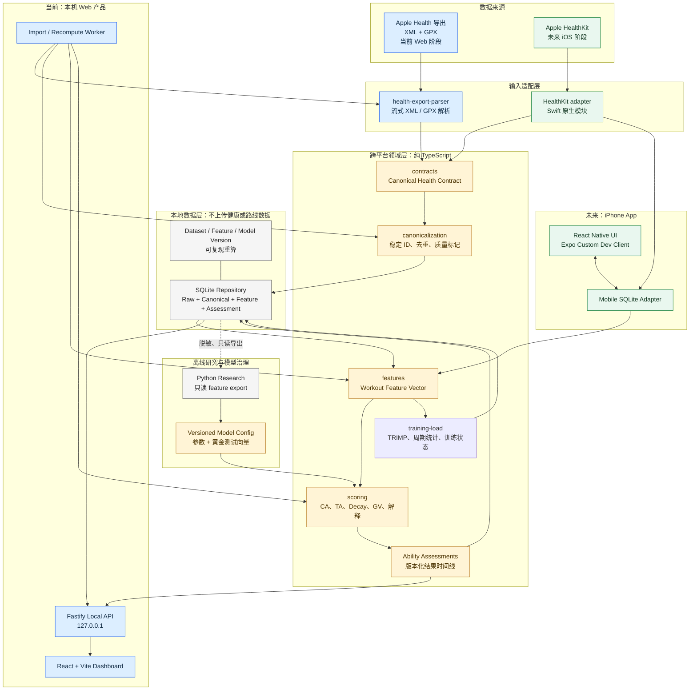

# RAI 项目架构

> 当前实施范围：本文档以浏览器 Web、localhost API 和共享 TypeScript 包为当前产品。文中移动端内容仅记录未来适配方向，不属于当前开发或验收范围；当前范围以仓库根目录 `AGENTS.md` 为准。

## 1. 架构目标

1. Web 版本先完成数据检查、模型实验和可视化。
2. 评分核心不依赖 Web、数据库或 Node，可以被移动端复用。
3. Apple 导出 XML 与 iOS HealthKit 是两个输入适配器，输出同一 canonical contract。
4. 模型升级可以重放，不修改原始数据。
5. 健康与位置数据默认只在本地。
6. 研究代码不能成为产品运行时的隐式依赖。

## 2. 关键技术决策

### 2.1 产品代码使用 TypeScript 单仓库

推荐：

- Web：React + Vite；
- 本地 API：Fastify；
- 移动端：React Native / Expo custom dev client；
- 生产评分与特征工程：纯 TypeScript packages；
- 存储：SQLite repository adapter；
- 研究：Python 只读 canonical SQLite 或脱敏 feature export。

选择 React Native 的主要原因不是 UI 复用，而是 iOS 可直接复用已经验证过的 TypeScript 特征和评分核心。HealthKit 读取通过小型原生 Swift module 完成。

如果未来坚持使用纯 SwiftUI，则不能直接复用 TypeScript 实现。仍可复用 canonical contract、模型配置和黄金测试向量，但需要实现一个 Swift scorer。不存在同时满足“纯 SwiftUI、完全离线、零重复实现”的技术方案；这一取舍应在开始移动端前明确。

### 2.2 Python 只用于研究

Python 适合 pandas、统计检验、绘图和参数搜索，但 iOS 无法自然运行 Python。正确边界：

```text
Python research
  -> 读取 canonical SQLite / feature export
  -> 产生候选参数和实验报告
  -> 参数进入 versioned JSON
  -> TypeScript scoring 通过 golden fixtures 验证
```

不得让 Web API 在生产评分时调用 notebook 或临时 Python 脚本。

### 2.3 SQLite 是 canonical store，不是模型本身

- SQL schema 只存事实、关联、特征和版本化结果。
- 评分逻辑不写在 SQL trigger 或 view 中。
- Repository interface 隔离 Node SQLite 与未来 mobile SQLite。
- 研究层可以通过 Python `sqlite3`、DuckDB 或 pandas 只读访问。

## 3. 架构总览



图中的实线表示产品运行时数据流；虚线只允许脱敏后的研究数据离开 SQLite。`contracts`、`features`、`scoring` 和 `training-load` 不依赖 Web、Node、SQLite 或 UI，因此是 Web 与移动端共用的稳定边界。

## 4. 分层

### 4.1 Ingestion adapters

职责：

- 读取平台格式；
- 规范化日期、单位和来源；
- 产生 canonical objects；
- 保存来源 provenance；
- 不计算 RAI。

实现：

- `health-export-parser`：当前 XML/GPX；
- `healthkit-adapter`：未来 iOS；
- 未来第三方 API 也必须作为独立 adapter。

### 4.2 Canonical domain

`packages/contracts` 只包含：

- canonical 类型；
- metric identifiers；
- contract version；
- 序列化 schema。

禁止依赖 React、Fastify、SQLite、HealthKit 或文件系统。

### 4.3 Canonicalization and quality

职责：

- 稳定 ID；
- 完全重复 record 去重；
- Workout group；
- canonical 选择；
- 数据覆盖率与质量标记；
- 手动 override。

质量结果是独立数据，不应直接混在评分公式里。

### 4.4 Feature engine

计划包：`packages/features`。

输入：canonical Workout、关联时间序列、跑前上下文和 feature config。  
输出：`WorkoutFeatureVector`，包含值、缺失原因、覆盖率和版本。

特征工程必须是纯函数。数据库查询由 repository 在调用前完成。

### 4.5 Scoring core

`packages/scoring`：

- 五维得分；
- CA；
- confidence；
- TA 更新；
- decay；
- GV；
- explanation codes；
- model version。

约束：

- 无 I/O；
- 不读取系统时间；
- 不访问数据库；
- 不依赖 UI；
- 输入完整显式；
- 输出确定性；
- Web 和移动端运行相同测试向量。

### 4.6 Application services

计划包：`packages/application`。

负责用例编排：

- `ImportHealthExport`；
- `RebuildCanonicalWorkouts`；
- `ExtractWorkoutFeatures`；
- `RecomputeAbilityTimeline`；
- `GetDashboard`；
- `OverrideWorkoutEligibility`。

Application service 可以依赖 repository interface 和 scoring，但不能依赖具体 UI。

### 4.7 Infrastructure

计划包：`packages/storage-sqlite`。

- migrations；
- Node SQLite repository；
- Web import job state；
- 原子重算结果切换；
- 备份和恢复。

未来移动端使用 `expo-sqlite` 实现相同 repository interface，不把 Node SQLite API带入 domain。

### 4.8 Presentation

- `apps/api`：本机 Fastify API，默认只监听 `127.0.0.1`；
- `apps/web`：React / Vite，使用 API client；
- `apps/mobile`：React Native，直接调用 application/scoring 或通过 repository；
- 页面不自己计算分数。

## 5. 目标目录

```text
apps/
  api/
    src/modules/import/
    src/modules/workouts/
    src/modules/ability/
  web/
    src/features/dashboard/
    src/features/workouts/
    src/features/trends/
  mobile/                         后续创建
    src/features/
    modules/healthkit/ios/

packages/
  contracts/                      已创建
  health-export-parser/           已创建
  scoring/                        已创建
  features/                       已创建：纯 Feature Vector 提取
  application/                    已创建：SQLite 回放、任务队列与 Run 管理
  storage-sqlite/                 从当前 parser DB 抽出 repository 时创建
  api-client/                     OpenAPI 生成
  test-fixtures/                  脱敏黄金数据

research/
  notebooks/                      不提交输出和真实数据
  experiments/
  reports/

docs/
  decisions/                      ADR
  ARCHITECTURE.md
  PARSER_DESIGN.md
  MODEL_VALIDATION_PLAN.md

var/                              本地生成，不提交
  rai.sqlite
  reports/
```

只在进入某阶段时创建对应包，避免大量空目录和占位实现。

## 6. Web 版本

### 6.1 进程

```text
Browser (React)
  -> localhost API (Fastify)
     -> import/recompute worker
     -> SQLite
     -> feature/scoring packages
```

首次 XML 导入约 91 秒，不能在普通 HTTP 请求内等待。API 应：

1. 创建 import job；
2. worker 执行解析；
3. 每个阶段写进度；
4. Web 轮询或通过 SSE 获取进度；
5. 完成后原子切换当前 dataset version。

### 6.2 API 边界

建议首批接口：

```text
POST /v1/import-jobs
GET  /v1/import-jobs/:id
GET  /v1/workouts
GET  /v1/workouts/:id
PATCH /v1/workouts/:id/override
POST /v1/model-runs
GET  /v1/model-runs/:id
GET  /v1/dashboard
GET  /v1/trends
```

API schema 通过 OpenAPI 生成 `packages/api-client`，不在前端手写第二套响应类型。

### 6.3 Web 不负责

- 不直接解析 212 MB XML；
- 不直接读 SQLite；
- 不包含评分公式；
- 不维护自己的日期/单位转换；
- 不将原始路线发往第三方地图服务。

## 7. 移动端

### 7.1 HealthKit adapter

原生 Swift module 只负责：

- 权限；
- anchored query；
- Workout 与关联 samples；
- route query；
- 删除对象；
- 转换成 canonical contract。

它不负责 CA/TA 计算。

### 7.2 同步

移动端数据库保存：

- HealthKit object ID / UUID；
- anchored query cursor；
- canonical Workout；
- feature/model version；
- assessment timeline。

HealthKit 是事实源，移动数据库是缓存和派生结果。修改或删除 HealthKit 对象后，从最早受影响点重算。

### 7.3 Web 与移动端并行开发条件

满足以下条件后再并行：

1. canonical contract v1 冻结；
2. feature vector v1 冻结；
3. scoring 输入/输出 schema 冻结；
4. 至少 20 个脱敏黄金 fixture；
5. 模型回放结果可复现；
6. Web 不再依赖临时 notebook 输出。

在此前并行做两个 UI 会放大数据语义变化成本，不建议。

## 8. 模型和数据版本

每个 `AbilityAssessment` 必须记录：

```text
dataset_version
canonical_contract_version
feature_schema_version
feature_config_hash
model_version
model_config_hash
calculated_at
```

参数变化产生新的 model run。不能覆盖旧 run 后继续沿用旧 TA 时间线。

## 9. 重算设计

### 完整重算

适用于：

- parser/canonical 规则变化；
- feature schema 变化；
- 基准策略变化；
- model major/minor 变化。

### 局部重算

适用于：

- 单条 Workout override；
- 延迟心率/路线到达；
- HealthKit 对象修改或删除。

从最早受影响 Workout 开始重放后续 TA。结果写入新 run，完成后切换 active run ID。

## 10. 安全与隐私

- API 默认只监听 localhost，不开放局域网。
- 原始数据、SQLite、feature export 和研究输出全部 gitignored。
- 日志只使用 object ID，不记录 source name、心率值或坐标。
- Web 地图优先本地渲染；不得把原始 GPX 上传到第三方。
- 诊断导出默认移除路线和原始健康序列。
- 未来若增加云同步，必须作为独立项目决策，不得由前端库隐式引入。

## 11. 测试层级

| 层级 | 内容 |
|---|---|
| Parser fixtures | XML/GPX、重复 metadata、无效日期、路径安全 |
| Canonical fixtures | 跨来源重复、canonical rank、手动 override |
| Feature fixtures | 暂停、缺失心率、间歇、坡度、睡眠边界 |
| Scoring unit | 权重重分配、confidence、TA、decay、GV |
| Golden replay | 完整输入到历史 TA 时间线 |
| API contract | OpenAPI 与 client 一致 |
| Web E2E | 导入、筛选、详情、模型切换 |
| Future mobile integration | 未来独立立项后验证真机 HealthKit 增量和删除；不属于当前 Web 验收 |

## 12. 近期实施顺序

1. 在当前 SQLite 上实现 `packages/features`。
2. 生成 36 次 Gold 的脱敏 feature table 和质量报告。
3. 建立 baseline scorer 与完整历史回放。
4. 固化 model run / assessment schema。
5. 创建 Fastify API。
6. 创建 React Web 的数据审计和跑步详情页。
7. 完善模型并冻结 beta contract。
8. 再创建 React Native iOS 工程与 HealthKit adapter。

该顺序保留 Web 快速迭代优势，同时避免移动端过早绑定仍在变化的数据语义。
