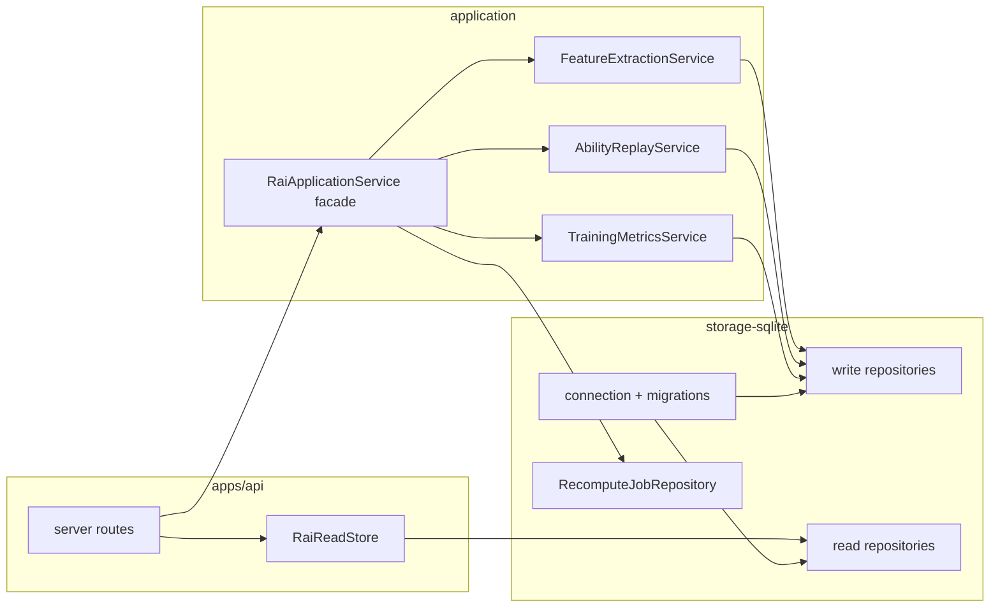

# 架构债迁移方案：storage-sqlite 全量 / 双 SQL 统一 / ApplicationService 拆分

> 状态：**读路径 largely 已落地**（trends/audit/series/zones/statistics 读 repo 下沉 + `openReadonly` PRAGMA 策略）— 2026-07-17  
> 剩余：写路径 / ImportWriter / ApplicationService 拆分进行中；parser 对 `RaiDatabase` 仍 re-export 兼容；`RaiReadStore` 仅保留缓存与 HTTP DTO 组装。  


> 范围：浏览器 Web + 本机 API + 共享包（见根目录 `AGENTS.md`）  
> 关联审计：`PROJECT_AUDIT_2026-07-17.md` #20–21、`PROJECT_AUDIT_2026-07-17_R2.md` R2-21–22  
> 原则：`ARCHITECTURE.md` §4.7–§5 — **可验证小步、先 interface 再迁移、禁止占位实现、纯领域包不依赖 `node:sqlite`**

---

## 1. 目标与非目标

### 1.1 目标

| 代号 | 目标 | 完成判据 |
|------|------|----------|
| **S** | 完整 `storage-sqlite` 迁移 | schema / migration / 连接生命周期 / 读写 repository 落在 `@rai/storage-sqlite`；`health-export-parser` 只保留解析与 canonical 逻辑 |
| **D** | 双 SQL 统一 | 同一业务查询只存在一份 SQL（或一份 SQL 片段）；API 读路径与 recompute 写路径通过共享 repository，不再各自维护平行查询 |
| **A** | `RaiApplicationService` 拆分 | 用例服务按域拆分；`service.ts` 变为薄编排门面或删除；公共 API 与测试路径可渐进兼容 |

### 1.2 非目标（本方案明确不做）

- 不引入 Postgres / 多后端方言；产品仍是 **单 SQLite**。
- 不生成 `api-client`、不统一 OpenAPI/DTO 三份手维（R2-23，另案）。
- 不重写评分 / 特征算法；领域包边界保持 pure。
- 不做原生移动 SQLite adapter（仅预留 repository 接口形状，便于未来）。
- 不做一次性大爆炸重写整个 monorepo。

### 1.3 「双 SQL」在本仓库的精确定义

**不是** SQLite vs Postgres，而是：

```text
写 / 重算路径          读 / HTTP 路径
RaiApplicationService  RaiReadStore
packages/application   apps/api/src/data.ts
  + prediction-data      + server 内联查询
  + recompute-job-repo
```

两套代码各自 `database.prepare(...)`，导致：

1. 同一语义查询重复（例如 model run summary 已有一份在 `SqliteModelRunRepository`，`compareModelRuns` 仍内联几乎相同 SQL）。
2. 口径漂移风险（active duration、eligibility、zone「当前」定义）。
3. 修 bug 要改两处（或三处：service + data + prediction-data）。

统一目标：**SQL 与行映射只活在 storage 层；application 编排领域；API 组装 HTTP DTO。**

---

## 2. 现状基线（2026-07-17）

### 2.1 包职责与体量（约）

| 位置 | 约 LOC | 现状职责 |
|------|--------|----------|
| `packages/storage-sqlite` | ~300 | publication lock、rename-aside 发布、`SqliteModelRunRepository` |
| `packages/health-export-parser/src/database.ts` | ~1830 | **全部 migrations**、`RaiDatabase` 打开/迁移、导入写入、generation seed |
| `packages/application/src/service.ts` | ~2400 | 任务队列、override、zone settings、feature 提取、zone/load 重放、CA/TA replay、激活 |
| `apps/api/src/data.ts` | ~1310 | HTTP 只读查询 + `api-contracts` DTO 映射 + 缓存 |
| `packages/application/src/recompute-job-repository.ts` | ~200 | 任务表 CRUD（已拆出，仍在 application） |
| `packages/application/src/prediction-data.ts` | ~400+ | 预测证据 SQL（含 `activeDurationSecondsSql`） |

### 2.2 依赖 DAG（当前）

```text
contracts ← pure domain packages (features, scoring, …)
contracts ← health-export-parser → storage-sqlite (仅 lock/publish re-export)
contracts ← application → health-export-parser, storage-sqlite, domain
api-contracts ← apps/api → application, health-export-parser, storage-sqlite
```

### 2.3 已完成的局部抽取（可复用模式）

- `SqliteModelRunRepository`：API `modelRuns()` 与 application 激活路径共享。
- `RecomputeJobRepository`：任务状态机已从 god service 抽出。
- `prediction-model-service` / `prediction-data`：预测用例已部分独立。
- publication lock + `publishDatabaseFile`：跨 CLI/API/worker 共用。

### 2.4 主要耦合点

| 耦合 | 说明 |
|------|------|
| `RaiDatabase` 类型 | application / API / worker / tests 构造入口均来自 parser 包 |
| `RecomputePlan` 类型 | 定义在 parser `incremental.ts`，service 签名依赖 |
| service 直接 SQL | feature 加载、session 列表、zone 证据、checkpoint、activate 等 |
| ReadStore 直接 SQL | dashboard / workouts / zones / load / audit / series |
| 重复 SQL | model run 列表/对比；active model；job list；override 读 |

---

## 3. 目标架构

### 3.1 分层

```text
┌─────────────────────────────────────────────────────────────┐
│ apps/web          HTTP client only (@rai/api-contracts)     │
├─────────────────────────────────────────────────────────────┤
│ apps/api          Fastify routes, security, import worker   │
│                   DTO assembly, RaiReadStore (薄)            │
├─────────────────────────────────────────────────────────────┤
│ @rai/application  用例编排：Job / Feature / Replay / Zones  │
│                   依赖 repository 接口 + pure domain         │
├─────────────────────────────────────────────────────────────┤
│ @rai/storage-sqlite                                         │
│   connection + migrations + repositories + SQL fragments    │
│   row mappers → contracts 领域类型（非 HTTP DTO）            │
├─────────────────────────────────────────────────────────────┤
│ @rai/health-export-parser                                   │
│   XML/GPX 流式解析、canonicalize、incremental plan、audit   │
│   通过 storage ImportWriter 落库（不再拥有 schema）          │
├─────────────────────────────────────────────────────────────┤
│ pure: contracts, features, scoring, training-load, …        │
└─────────────────────────────────────────────────────────────┘
```

### 3.2 目标包边界

#### `@rai/storage-sqlite`（基础设施唯一 SQLite 入口）

```text
packages/storage-sqlite/src/
  index.ts                      # 公共导出
  connection.ts                 # open/close、PRAGMA、busy_timeout、WAL
  migrations/
    index.ts                    # Migration[] + apply
    v001_….ts … v0N_….ts        # 可选按版本拆分；或先整文件搬迁
  sql/
    fragments.ts                # activeDurationSecondsSql 等共享片段
  mappers/                      # Record → contracts 类型
  repositories/
    import-writer.ts            # 现 RaiDatabase 导入写 API
    manifest.ts
    training-session.ts
    workout-override.ts
    feature-run.ts
    model-run.ts                # 扩展现有 SqliteModelRunRepository
    ability.ts                  # assessments / snapshots / activate
    training-metric.ts
    zone-profile.ts
    recompute-job.ts            # 从 application 迁入
    prediction-evidence.ts      # 从 prediction-data SQL 迁入
    read-dashboard.ts           # 只读聚合（供 API）
    read-workouts.ts
    read-audit.ts
    …
  publish/                      # 现有 lock + publisher（可保留顶层文件）
```

**规则：**

- 可依赖：`@rai/contracts`、`node:sqlite`、`node:fs/path/crypto`。
- **不可**依赖：`@rai/application`、`@rai/api-contracts`、`@rai/features` 等领域算法包。
- 返回 **contracts / 存储 DTO**，不返回 Fastify HTTP Response 形态。

#### `@rai/health-export-parser`（输入适配器）

保留：

- `parseAppleHealthXml`、`importGpxRoutes`
- `canonicalizeRunningWorkouts`
- `planRecompute` / fingerprint / `diffDataset`
- `buildAudit` 等审计逻辑

移除/迁出：

- `migrations` 数组与 `schema_migrations` 管理
- `RaiDatabase` 类实现（改为 re-export 过渡期，最终删除）

依赖：`@rai/contracts`、`@rai/storage-sqlite`（ImportWriter + open）。

#### `@rai/application`（用例）

拆分为多服务 + 可选门面：

| 服务 | 职责 | 主要依赖 |
|------|------|----------|
| `RecomputeJobService` | enqueue / claim / cancel / recover | `RecomputeJobRepository` |
| `FeatureExtractionService` | create feature run、load sessions、extract、reuse prefix | features + session/feature repos |
| `TrainingMetricsService` | zone profiles + TRIMP/load 重放 | training-load/zones + metric repos |
| `AbilityReplayService` | model run、checkpoint、CA/TA timeline、activate | scoring + ability/model repos |
| `WorkoutOverrideService` | append override + 触发 recompute | override repo + job service |
| `TrainingZoneSettingsService` | 手动 zone 设置 revision | zone settings repo |
| `RaiApplicationService`（门面，过渡期） | 委托上述服务，保持现有 public 方法签名 | 组合 |

**规则：** application **尽量不写 SQL**；允许极少量「跨表事务编排」调用多个 repo 的 `withTransaction`。

#### `apps/api`（展示适配）

- `RaiReadStore` 保留缓存与 `api-contracts` 映射。
- 查询委托 storage 的 read repositories。
- 路由层继续只依赖 application 做写操作。

### 3.3 统一后的读写关系



---

## 4. 迁移策略总则

1. **Strangler Fig**：先搬模块、再改 import、最后删旧实现；过渡期允许 `health-export-parser` re-export。
2. **每 PR 可独立验证**：`npm run typecheck` + 相关 `npm test`；涉及导入/重算时补 package 测试。
3. **先共享 SQL 片段与 mapper，再搬类**，降低大 diff 风险。
4. **行为锁**：优先移动代码，不在同 PR 改业务语义（审计修复另开）。
5. **兼容出口**：
   - `RaiDatabase.open` 在 parser 中 re-export ≥1 个发布周期。
   - `RaiApplicationService` public 方法签名不变，直至所有调用方切到具体服务。
6. **事务边界不变**：`BEGIN IMMEDIATE` 的粒度与现网一致（override 写 + enqueue；activate + clear prediction 等）。

---

## 5. PR 分阶段计划

### 总览

| 阶段 | 主题 | 预计 PR 数 | 风险 |
|------|------|------------|------|
| **P0** | 地基：连接 + migrations 迁入 storage | 1–2 | 中（所有 open 路径） |
| **P1** | ImportWriter 迁入；parser 瘦身 | 1–2 | 中（导入/worker） |
| **P2** | 双 SQL：共享片段 + 高频 repo 统一 | 3–4 | 中低 |
| **P3** | 读路径 repo 化（RaiReadStore 变薄） | 2–3 | 中（DTO 回归） |
| **P4** | Application 按用例拆分 | 3–4 | 中（重算路径） |
| **P5** | 收尾：删 re-export、更新 ARCHITECTURE、依赖收敛 | 1 | 低 |

合计约 **11–16 个小 PR**，可按周并行部分 P2/P3 与 P4 的早期切片。

---

### 阶段 P0 — 连接与 schema 归属 storage

**PR-P0a：迁移 `migrations` + `open` 到 storage-sqlite**

移动内容：

- `migrations: Migration[]`、`SEED_CONTENT_HASH`
- `RaiDatabaseOpenOptions`、`open` / `migrate` / `ensureMigrationTable` / backup
- PRAGMA 初始化（foreign_keys、WAL、synchronous、busy_timeout）

交付：

```ts
// @rai/storage-sqlite
export class RaiSqliteDatabase {
  readonly database: DatabaseSync;
  static open(path: string, options?: OpenOptions): Promise<RaiSqliteDatabase>;
  close(): void;
  // 过渡期可仍叫 RaiDatabase
}
export { SEED_CONTENT_HASH };
```

兼容：

```ts
// health-export-parser
export { RaiSqliteDatabase as RaiDatabase, SEED_CONTENT_HASH } from "@rai/storage-sqlite";
// 或 class 继承 / 组合 ImportWriter
```

验证：

- `packages/health-export-parser/test/migration.test.ts` 路径改为测 storage 或保留 re-export 测。
- 全仓 typecheck + 现有 migration / service / api 测试。

**PR-P0b（可选合并）：统一打开选项**

- 只读打开工厂：`openReadonly(path)` 供 `RaiReadStore` 使用（目前 `new DatabaseSync(path, { readOnly: true })` 绕过迁移）。
- 约定：**读路径不跑 migrate**；写路径 / worker / 启动时 migrate。

---

### 阶段 P1 — ImportWriter：parser 不再拥有写库实现

**PR-P1a：迁移导入写 API**

从 `RaiDatabase` 迁出方法组：

- 事务：`beginAtomicImport` / `commit` / `rollback` / `flush`
- 写入：`insertRecord` / `insertWorkout` / statistics / events / routes / points
- manifest / profile / inventory / issues
- route replacement 批处理 API
- `observeImportEntity` / `seedImportGenerations` / `finalizeImportGeneration`

形态：

```ts
export class SqliteImportWriter {
  constructor(private readonly db: RaiSqliteDatabase) {}
  // 上述方法
}
```

`health-export-parser` 的 parse/canonicalize 调用方改为：

```ts
const store = await RaiSqliteDatabase.open(path);
const writer = new SqliteImportWriter(store);
// parse → writer.insert*
```

或过渡期 `RaiDatabase` = `RaiSqliteDatabase` + mixin ImportWriter，保持 `parse` CLI 零改动。

**PR-P1b：文档与依赖**

- 更新 `ARCHITECTURE.md` 目录树与 §4.7。
- 确认 `application` 构造注入 `RaiSqliteDatabase`（类型从 storage 导入，parser re-export 仍可用）。

验收：

- import-replay、worker、cli-atomic、parser 测试全绿。
- `health-export-parser` 不再包含 `CREATE TABLE`（或仅 re-export）。

---

### 阶段 P2 — 双 SQL 统一（写/读共享 repository）

按 **共享频率 × 漂移风险** 排序。

#### PR-P2a：SQL fragments 模块

迁入并单一化：

| 片段 | 当前位置 | 用途 |
|------|----------|------|
| `activeDurationSecondsSql()` | `prediction-data.ts` | 活跃时长 / VDOT 标签 |
| model-run summary SELECT | `model-run-repository` + `data.ts` compare | 列表与对比 |
| active model join | service / data / analyze-cli | 多处 |

```ts
// sql/fragments.ts
export function activeDurationSecondsSql(alias = "w"): string { … }
export const MODEL_RUN_SUMMARY_SELECT = `mr.*, amr.model_run_id IS NOT NULL AS active, …`;
```

`prediction-data` 与未来 read repos 只引用 fragments。

#### PR-P2b：扩展 `SqliteModelRunRepository`

- `getByIds(ids)` 供 compare
- `mapModelRunSummary` 导出或内部统一（删除 data.ts 重复 SELECT 字段列表）
- activate 已有；补 `clearActivePredictionModel()` 若希望 activate 事务内只走 repo

#### PR-P2c：迁移 `RecomputeJobRepository` → storage-sqlite

- 从 `packages/application` 物理移动。
- application re-export 过渡。
- API `jobs()` / `job()` 改为使用同一 mapper（与 `RecomputeJob` contracts 对齐；HTTP DTO 仍在 API 层转换）。

#### PR-P2d：Session + Override repositories

```ts
class SqliteTrainingSessionRepository {
  get(id): … | null
  listActiveForFeatures(): SessionRow[]  // 现 loadSessions SQL
}
class SqliteWorkoutOverrideRepository {
  latest(trainingSessionId): WorkoutOverride | null
  append(…): void  // 含 revision 分配
}
```

`appendWorkoutOverride` 与 `RaiReadStore.override` / workout detail 共用读映射。

#### PR-P2e：Feature / Metric / Zone / Ability 写 repository

从 service private 方法抽出 **纯持久化**：

| Repo | 方法示例（来自 service） |
|------|--------------------------|
| FeatureRun | create / finish / loadVectors / insertFeature / reusePrefix copy |
| TrainingMetric | createRun / finish / persist loads / daily metrics / zone summaries |
| ZoneProfile | loadSettings / appendSettings / persist daily profiles |
| Ability | createModelRun / finish / assessments / snapshots / checkpoints / activate 事务 |

service 只保留算法循环与领域调用。

**P2 完成判据：**

- `rg "database.prepare" packages/application/src/service.ts` 显著下降（目标：仅事务壳或 0）。
- model run / job / override 相关 SQL 在 storage 中只有一份。

---

### 阶段 P3 — 读路径 repo 化（消解 RaiReadStore 平行 SQL）

原则：**SQL 在 storage；HTTP 字段命名与缓存留在 API。**

#### PR-P3a：高流量读

| API 方法 | 新 storage 读端口 |
|----------|-------------------|
| `dashboard` | `ReadDashboardRepository.load()` → 领域摘要 |
| `workouts` / `workout` | `ReadWorkoutRepository` |
| `trends` | `ReadTrendsRepository` |
| `trainingZones*` / `trainingLoadTimeline` | `ReadTrainingRepository` |

`RaiReadStore` 变为：

```ts
dashboard() {
  return this.cached("dashboard", () =>
    mapDashboardDto(this.dashboardRepo.load())
  );
}
```

#### PR-P3b：审计 / 诊断 / 系列

- `dataSummary` / `dataAudit` / `diagnostics`
- `workoutSeries`（含窗口函数采样 SQL）

系列查询可保留较长 SQL，但必须只在 storage 一处。

#### PR-P3c：jobs 读与 model compare

- `jobs` / `job` 完全走 `RecomputeJobRepository` + DTO map
- `compareModelRuns` 走扩展后的 model-run repo

**P3 完成判据：**

- `apps/api/src/data.ts` 中无大段业务 `SELECT`（或仅剩 DTO glue）。
- API data 测试与 E2E web 关键路径绿。

---

### 阶段 P4 — `RaiApplicationService` 拆分

**禁止**在未完成对应 repo 前硬拆文件（否则只是把 SQL 复制到多个 service）。

推荐顺序（依赖写 repo 已就绪）：

#### PR-P4a：抽出无 DB 纯函数

从 `service.ts` 顶部迁出到 `packages/application/src/recompute/` 或 `feature-support/`：

- HR 区间合并、峰值、coverage
- unit 转换、`theilSenVelocity` 等

可单测，不碰存储。

#### PR-P4b：`FeatureExtractionService`

迁入：

- `createFeatureRun` / `finishFeatureRun`
- `loadSessions` / `buildFeatureSource` / `extractFeatures`
- `reuseFeaturePrefix` / `loadFeatureRunVectors`
- 相关 private loaders（statistic、record series、route quality…）→ 已 repo 化则注入

#### PR-P4c：`TrainingMetricsService` + zone 构建

迁入：

- `buildAndPersistZoneProfiles`
- `replayTrainingMetrics` / `persistDailyTrainingMetrics`
- zone settings append（或独立 `TrainingZoneSettingsService`）

#### PR-P4d：`AbilityReplayService`

迁入：

- `createModelRun` / `replayModel` / checkpoint / snapshot refresh
- `activateModelRunAndCompleteJob`
- shadow validation compare（可调用 read repo）

#### PR-P4e：门面收敛

```ts
export class RaiApplicationService {
  constructor(
    private readonly jobs: RecomputeJobService,
    private readonly features: FeatureExtractionService,
    private readonly metrics: TrainingMetricsService,
    private readonly ability: AbilityReplayService,
    private readonly overrides: WorkoutOverrideService,
    // …
  ) {}

  runNextJob() { /* claim → dispatch */ }
  // 其余 public 方法一对一委托
}
```

工厂：

```ts
export function createApplicationServices(db: RaiSqliteDatabase): RaiApplicationService
```

调用方（worker、server、CLI、tests）逐步改用工厂；旧 `new RaiApplicationService(store)` 可保留适配构造。

**P4 完成判据：**

- `service.ts` ≤ ~200 行（门面）或删除并由 index 导出组合。
- 每个子服务有聚焦单测（可从 `service.test.ts` 拆分，不必一次拆完）。

---

### 阶段 P5 — 收尾

1. 删除 `health-export-parser` 对 database 实现的 re-export（更新所有 import 到 `@rai/storage-sqlite`）。
2. `application` 不再依赖 `@rai/health-export-parser` 的 database 类型；仅在 CLI/import 用例需要时依赖 `RecomputePlan` / canonicalize（或把 `RecomputePlan` 类型上移到 `contracts` / `storage`）。
3. 更新：
   - `docs/ARCHITECTURE.md` 目录树与 §4.6–4.7
   - `docs/DATABASE_DESIGN.md` 注明 schema 源文件路径
   - `PROJECT_AUDIT_*` 关闭 R2-21/R2-22
4. 依赖检查：`health-export-parser` 不依赖 application；storage 不依赖 application/api-contracts。

---

## 6. 关键类型与接口草图

### 6.1 连接

```ts
export interface OpenOptions {
  createMigrationBackup?: boolean;
  readOnly?: boolean; // true 时不 migrate、PRAGMA 只读安全集
}

export class RaiSqliteDatabase {
  readonly database: DatabaseSync;
  readonly path: string;
  static open(path: string, options?: OpenOptions): Promise<RaiSqliteDatabase>;
  withTransaction<T>(mode: "IMMEDIATE" | "DEFERRED", fn: () => T): T;
  close(): void;
}
```

### 6.2 Repository 约定

```ts
// 写路径返回 contracts 领域类型
// 读路径可返回 storage 内部 ReadModel，由 API map 到 api-contracts

export interface ModelRunRepository {
  listSummaries(limit?: number): StoredModelRunSummary[];
  activeSummary(): StoredModelRunSummary | null;
  getSummariesByIds(ids: string[]): StoredModelRunSummary[];
  featureRunId(modelRunId: string): string | null;
  activateSucceeded(modelRunId: string, activatedAt: string): void;
}
```

### 6.3 Application 构造（目标）

```ts
export function createRaiApplication(db: RaiSqliteDatabase): RaiApplicationService {
  const jobs = new RecomputeJobRepository(db.database);
  const modelRuns = new SqliteModelRunRepository(db.database);
  // …
  return new RaiApplicationService({ db, jobs, modelRuns, … });
}
```

---

## 7. 测试与验证矩阵

| 阶段 | 必跑 | 建议加跑 |
|------|------|----------|
| P0 migrations | `health-export-parser` migration tests；typecheck | application service smoke |
| P1 import | parser / cli-atomic / import-replay | `apps/api` worker tests |
| P2 repos | storage-sqlite 新测 + 原 application 测 | data.test modelRuns/jobs |
| P3 read | `apps/api/test/data.test.ts` | `npm run test:e2e:web` |
| P4 split | `application/test/service.test.ts` 全绿 | import-replay + worker |
| P5 收尾 | 全仓 `typecheck` + `npm test` | e2e:web |

**行为锁策略：** 每个搬家 PR 尽量「移动 + 改 import」，禁止夹带算法改动。若必须改 SQL，附 before/after 行级说明与对应断言。

---

## 8. 风险与缓解

| 风险 | 影响 | 缓解 |
|------|------|------|
| 迁移顺序错误导致双重 migrate | 启动失败 | 单一 `migrations` 数组所有权；re-export 不复制数组 |
| 只读连接误跑 migrate | 权限/锁 | `readOnly` 工厂明确分支 |
| 事务边界被拆碎 | 并发/半激活 | 跨 repo 事务只通过 `db.withTransaction`；activate+clear prediction 保持同一事务 |
| DTO 映射漂移 | Web 字段错误 | P3 保留 data.test 快照式断言；e2e:web |
| 循环依赖 storage ↔ application | 构建失败 | storage 禁止 import application；Job 类型用 contracts |
| 大 PR review 疲劳 | 回归 | 严格按上表切片；单 PR < ~800 行净迁入优先 |
| `RecomputePlan` 仍挂在 parser | 依赖别扭 | P5 将类型移到 `contracts` 或 `storage` 的 `recompute-plan.ts` |

---

## 9. 推荐实施顺序（执行检查清单）

```text
[ ] P0a  migrations + open → storage-sqlite；parser re-export
[x] P0b  openReadonly；ReadStore 使用统一入口（可选）
[ ] P1a  ImportWriter 迁移；导入路径改依赖
[ ] P1b  ARCHITECTURE 更新；确认无 CREATE TABLE 残留在 parser
[ ] P2a  sql/fragments（activeDuration 等）
[ ] P2b  扩展 ModelRunRepository；删除 data 重复 SQL
[ ] P2c  RecomputeJobRepository → storage
[ ] P2d  Session + Override repos
[ ] P2e  Feature / Metric / Zone / Ability 写 repos
[ ] P3a  dashboard/workouts/trends/zones/load 读 repos
[ ] P3b  audit/diagnostics/series 读 repos
[ ] P3c  jobs/compare 完全共享
[ ] P4a  纯函数抽出
[ ] P4b  FeatureExtractionService
[ ] P4c  TrainingMetricsService
[ ] P4d  AbilityReplayService
[ ] P4e  门面 + createRaiApplication 工厂
[ ] P5   删兼容层；依赖收敛；关闭审计债项
```

**不要并行：** P0 与 P1 必须串行。  
**可并行：** P2a–c 与文档；P3 与 P4a（纯函数）在 P2e 未完成前不要拆 replay 写路径。

---

## 10. 工作量粗估

| 阶段 | 工程量（1 人熟悉代码） |
|------|------------------------|
| P0 | 1–2 天 |
| P1 | 2–3 天 |
| P2 | 4–6 天 |
| P3 | 3–5 天 |
| P4 | 4–6 天 |
| P5 | 1 天 |
| **合计** | **约 3–4 周**（含测试与 review，不含算法改动） |

---

## 11. 成功定义（Definition of Done）

1. **S**：`@rai/storage-sqlite` 拥有 schema 唯一源与全部 repository；`health-export-parser` 无 product schema。
2. **D**：业务 SQL 无「读路径 / 写路径」双份维护；共享片段有单测或集中模块。
3. **A**：`RaiApplicationService` 仅为编排门面或已删除；子服务边界与 `ARCHITECTURE.md` §4.6 用例列表对齐。
4. 全仓 `npm run typecheck`、`npm test` 通过；导入/重算相关测试与 `test:e2e:web` 在 P3/P4 后通过。
5. 纯领域包仍不依赖 `node:sqlite`（`tsconfig.pure.json` 继续守门）。

---

## 12. 与审计项映射

| 审计 ID | 本方案阶段 |
|---------|------------|
| R2-21 / 审计 #20 storage-sqlite | P0 + P1 + P2e |
| R2-22 / 审计 #21 双 SQL + 大 service | P2 + P3 + P4 |
| ARCHITECTURE §4.7 渐进迁移 | 全文；禁止大爆炸 |

---

## 13. 建议的下一动作

1. **评审本方案**：确认 PR 切片粒度与命名（`RaiDatabase` 是否永久改名 `RaiSqliteDatabase`）。
2. **从 P0a 开干**：风险可控、立刻把 schema 所有权迁正。
3. 不在本迁移中夹带 R2 已修语义的二次改动；发现 bug 另开 PR。

若需要执行，建议指令明确为：`按 docs/ARCHITECTURE_DEBT_MIGRATION.md 从 P0a 开始实施`。
