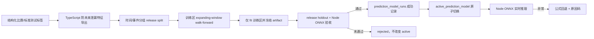

# RAI CatBoost 直接激活实施说明

## 目标与边界

CatBoost 只学习“公式预测与真实标准测试/比赛成绩之间的残差”，不替代现有生理与成绩公式，也不修改冻结的 `rai-model-config-v2` CA/TA 算法。

- 监督标签仅来自结构化的 5K、10K、半马比赛或标准测试。
- 普通训练、自动识别训练类型、CA、TA 不得作为监督标签。
- Python 只负责离线训练、walk-forward 验证和 ONNX 导出。
- Node/TypeScript 负责生产推理；运行时不依赖 Python 或 CatBoost。
- 不保存影子预测，不运行候选模型。离线门槛通过后，在同一事务中直接切换 active 指针。
- 没有 active 模型、距离不支持、契约不匹配或推理失败时，逐距离回退公式预测。

## 数据链路



训练数据契约为 `race-residual-feature-v2`，模型版本为 `race-residual-catboost-v1`。目标值固定为：

`acuteChronicLoadRatio` 使用 active composite training load 构建的正式 7/28 天半衰期 EWMA 比值，并只读取 `asOf` 之前已结束训练的负荷。该语义进入 feature schema hash；旧语义模型不能通过激活校验。

```text
targetLogResidual = log(actualSeconds / baselinePredictedSeconds)
```

模型输出转成时间修正比例，并限制在 `±12%`。预测结果使用 `catboost_residual_v6`，证据码为 `catboost_residual_model`。

## 激活门槛

训练前：

- 总真实标签不少于 50。
- 5K、10K、半马每个距离不少于 8。

训练区 walk-forward 验证：

- expanding-window 持出预测不少于 12。
- 每个距离持出预测不少于 3。
- 总体 MAE 至少改善 5%。
- 任一距离 MAE 退化不得超过 5%。
- 预测区间覆盖率下降不得超过 5 个百分点。
- CatBoost 原生输出与 ONNX 输出最大绝对误差必须小于 `1e-6`。

发布验收使用按时间排序、按 `(observedAt, completedAt)` 事件原子分组的尾部 release holdout：

- holdout 不少于 24，且每个距离不少于 6；训练区不少于 24，且每个距离不少于 4。
- 训练标签完成时间必须早于 holdout 起点 24 小时，embargo 内标签不进入训练。
- 冻结模型只拟合训练区一次；holdout 验收后不再 refit，评估 SHA 即激活 SHA。
- paired bootstrap 按事件成组重采样 2000 次，MAE 改善 95% 区间下界必须大于 0。
- Python native、Python ONNX 与 Node ONNX 对全部 holdout 逐项一致；Node 重新计算的 MAE 和区间覆盖必须与评估文件一致。

全部通过后，`prediction_model_runs.status` 更新为 `succeeded`，并在同一 SQLite 事务内更新 `active_prediction_model`。任一门槛失败则记录为 `rejected`，旧 active 模型保持不变。

## Artifact

每次运行生成不可变目录：

```text
var/model-artifacts/prediction/<prediction-model-run-id>/
  attempt-1/
    model.onnx
    manifest.json
    feature-schema.json
    evaluation.json
    onnx-golden.json
```

任务因进程异常而恢复时使用新的 `attempt-N` 子目录，避免旧训练进程与重试进程同时写入同一 artifact。数据库只保存最终通过验证的尝试目录。

CatBoost 导出的随机 `model_guid` 和训练完成时间会在发布前移除，ONNX 使用确定性 protobuf 序列化。相同数据、配置和评估时间应生成相同模型哈希。

Node 加载时验证：模型版本、特征版本、特征顺序、schema hash、T/H 数据 hash、embargo、ONNX 文件 SHA-256、输入输出名称、holdout 全量 golden parity 与聚合指标。

## API 与状态

- `POST /v1/prediction-models/train`：预检并创建训练任务；标签不足返回 422，且不创建空 Run。
- `GET /v1/prediction-models`：模型历史。
- `GET /v1/prediction-models/:id`：运行与事件详情。
- `POST /v1/prediction-models/:id/cancel`：取消排队或运行中的任务。
- `POST /v1/prediction-models/:id/activate`：回滚到历史中已验证成功的模型。
- `GET /v1/predictions`：读取 active 模型推理；没有 active 时继续公式预测。

worker 使用 SQLite 租约、1 秒心跳、30 秒超时和最多 3 次尝试。过期租约会重新排队，旧 worker 即使稍后返回也无法越过 token fencing 完成或激活模型。同一时间数据库只允许一个预测模型任务处于 queued/running/validating。

逐距离回退原因：

- `no_active_model`
- `unsupported_distance`
- `feature_schema_mismatch`
- `inference_failed`

## 本地运行

```powershell
npm install
npm run ml:install
npm run typecheck
npm test
npm run ml:test
npm run build
```

训练由 API 的持久化 worker 启动。也可直接调试 runner：

```powershell
node --import tsx packages/application/src/prediction-training-runner.ts `
  --database var/rai.sqlite `
  --run-id <run-id> `
  --as-of <ISO-8601> `
  --artifact-directory var/model-artifacts/prediction/<run-id> `
  --result var/prediction-training-results/<run-id>.json
```

当前真实数据库没有结构化比赛/标准测试标签，因此训练接口应返回 422，预测页应显示 `no_active_model` 并继续使用公式基线。积累真实标签后无需改代码，即可通过数据与模型页面发起训练并在门槛通过后直接激活。
