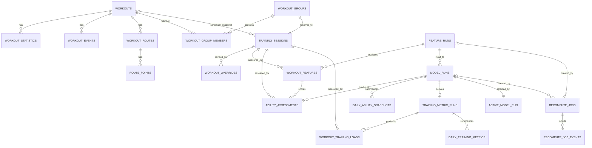

# RAI 数据库设计

> Schema 版本：v9  
> Canonical contract：`canonical-health-v2`  
> Feature schema：`workout-feature-v1`  
> 运行时数据库：本地 SQLite  
> Schema 源码：`packages/storage-sqlite/src/database.ts`（migrations + `RaiDatabase`）

## 1. 分层原则

数据库分为三层：

1. **事实层**：Apple Health 原始 Record、Workout、路线与统计，不随模型变化而改写。
2. **派生层**：Training Session、Feature Run、Workout Feature、Model Run、Assessment 和每日 Snapshot；每次重算新增记录。
3. **控制层**：用户覆盖、任务队列、active Model Run 与迁移历史。

原始 Workout Group 的成员会因新增来源副本变化，因此它不是稳定的产品实体。`training_sessions` 才代表“同一次真实训练”，所有用户覆盖、特征和评分都引用它。

## 2. ER 图

## 3. 事实层

| 表 | 主键 | 关系与说明 |
|---|---|---|
| `health_records` | `id` | HealthKit Record 的稳定本地 ID；保留来源、数值、时间、metadata 与原始 attributes。 |
| `workouts` | `id` | 原始 Workout；`canonical_group_id` 和 `is_canonical` 仅表示当前来源选择。 |
| `workout_statistics` | `workout_id + ordinal` | 距离、能量、平均心率、跑步功率、步态等统计。 |
| `workout_events` | `workout_id + ordinal` | Segment、Pause 等训练事件。 |
| `workout_routes` | `id` | Workout 与 GPX 路线文件映射。 |
| `route_points` | `route_id + sequence` | 坐标、海拔、速度和精度；只存本机。 |
| `activity_summaries` | `date_components` | Move、Exercise、Stand 上下文。 |
| `workout_groups` | `id` | 同一次真实训练的来源候选组。 |
| `workout_group_members` | `group_id + workout_id` | 候选成员及 canonical rank。 |

## 4. 稳定训练实体

### `training_sessions`

| 字段 | 类型/约束 | 含义 |
|---|---|---|
| `id` | TEXT PK | 稳定的真实训练 ID。 |
| `activity_type` | TEXT | 当前 V1 为 Running。 |
| `anchor_start_at`, `anchor_end_at` | UTC ISO TEXT | 用于跨导入匹配 Session。 |
| `anchor_distance_km` | REAL nullable | 匹配辅助信息。 |
| `canonical_workout_id` | FK nullable | 当前用于计算的原始 Workout 快照。 |
| `status` | `active/inactive/ambiguous` | 不明确匹配不会自动进入模型。 |

新的 Workout Group 与既有 Session 在开始时间、重叠比例和距离上唯一匹配时复用 Session ID。匹配多个既有 Session 时创建 `ambiguous` Session，并写入 `import_issues`，由用户后续人工确认。

## 5. Feature 与模型历史

### `feature_runs` 与 `workout_features`

`feature_runs` 锁定 dataset、contract、feature schema、Feature Config JSON 和 hash。`workout_features` 的唯一约束是 `feature_run_id + training_session_id`，核心查询列包括：

- 训练时间、时长、距离、平均速度、平均心率；
- 心率样本数与覆盖率；
- 路线点数和路线质量；
- 来源置信度、训练类型、资格状态、质量分；
- `missing_reasons_json`、`features_json`、`provenance_json`。

五维原始信号放在 `features_json`，而非 CA/TA。缺失指标为 `null`，并在 `missing_reasons_json` 中说明，绝不以 `0` 或 `50` 补齐。

### `model_runs` 与 `ability_assessments`

`model_runs` 锁定 Feature Run、模型版本、模型配置快照、配置 hash 和 `evaluated_at`。成功 Run 永不覆盖旧结果。

`ability_assessments` 的唯一约束是 `model_run_id + training_session_id`，保存：

- CA、Efficiency/Pace/Cardio/Stability/Recovery 分数；
- 重分配后的有效权重与四项置信度因子；
- 训练贡献、证据强度、方向系数、成长阻力；
- TA 更新前后值与更新量；
- 资格状态、解释代码与解释 JSON。

### `daily_ability_snapshots`

每个 Model Run 每个本地日期只有一行，保存 TA、Decay 点数、GV、最后 Assessment、状态和时区。新的 `snapshot_refresh` 只为 active Run 追加尚未存在的日期，不改写既有 Assessment 或模型配置。

## 6. 用户控制与任务

### `workout_overrides`

覆盖作用于 `training_session_id`。编辑不会覆盖旧行，而是创建更大的 `revision`；`effective_workout_overrides` 视图只返回最新 revision。

可覆盖字段：

- `eligibility_override`: `include` 或 `exclude`；
- `session_type`；
- `rpe`: 1～10；
- `condition_tags_json`；
- `note`。

任何覆盖都会排入一次完整重算。`include` 不能凭空补出缺失的心率或距离，只能改变可由用户控制的资格判断。

### `recompute_jobs` 与 `recompute_job_events`

V1 使用单 worker 串行队列。任务类型：`import`、`full_recompute`、`snapshot_refresh`。任务保存输入版本、Feature/Model Run ID、进度、取消标记和错误 JSON；事件表保存阶段进度，供后续 Web UI 轮询或 SSE 使用。

## 7. Active 视图

| 视图 | 用途 |
|---|---|
| `effective_workout_overrides` | 最新用户覆盖。 |
| `active_ability_assessments` | 当前展示模型的评分结果。 |
| `active_daily_ability_snapshots` | 当前展示模型的趋势数据。 |

`active_model_run` 是单例表。只有状态为 `succeeded` 的 Model Run 才能在单一事务中写入该指针。失败、取消或运行中的 Run 永远不会影响当前展示。

## 8. 迁移与恢复

`RaiDatabase.open()` 统一执行迁移：

1. 检查并升级 `schema_migrations` 的 `name` 和 `checksum` 元数据。
2. 对已有导入库创建 SQLite backup。
3. 在事务中执行未应用迁移并记录 checksum。
4. 执行 `foreign_key_check`；失败则阻止数据库继续使用。

当前 v2 迁移会保留所有原始 Record、Workout、路线和 Group，并为每个既有 Group 回填一个 Training Session。原始导出始终可以作为重建来源，但迁移不是依赖重新导入才可完成。

## 9. 索引与查询约束

- `workout_features(feature_run_id, workout_start_at)`：完整模型回放。
- `ability_assessments(model_run_id, sequence_number)`：TA 时间线。
- `daily_ability_snapshots(model_run_id, local_date)`：趋势图。
- `workout_overrides(training_session_id, revision DESC)`：最新覆盖。
- `recompute_jobs(status, created_at)`：单 worker 领取任务。

所有时间为 UTC ISO 8601；每日 Snapshot 按 `timezone_identifier` 生成展示日。JSON 在 TypeScript contract 边界校验，SQLite 只存序列化快照，以保证移动端适配器可复用相同语义。
