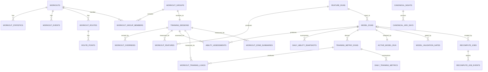

# RAI 数据库设计

> Schema 版本：v18（`packages/storage-sqlite/src/database.ts` migrations v1–v18；v11 为历史保留占位，无 SQL）
> Canonical contract：`canonical-health-v2`（`packages/contracts`）
> Feature schema：`workout-feature-v3`；Feature 配置：`feature-config-v8`（`packages/features`）
> 评分模型配置：`rai-model-config-v4`（`packages/scoring`）
> 训练负荷配置：`training-load-config-v4`；训练分区配置：`training-zone-config-v3`
> 运行时数据库：本地 SQLite（`var/rai.sqlite`，可由 `RAI_DATABASE` 覆盖）
> 说明：以下列出主要表与视图；完整 SQL 与迁移内容以 `database.ts` 为唯一事实源。

## 1. 分层原则

数据库分为四层：

1. **事实层**：Apple Health 原始 Record、Workout、路线与统计，不随模型变化而改写；睡眠/HRV 经 canonicalization 后的规范化夜与日也属于稳定派生事实。
2. **派生层**：Training Session、Feature Run、Workout Feature、Model Run、Assessment、每日 Snapshot、训练指标 Run、分区摘要、恢复事实与每日 Zone Profile；每次重算新增记录。
3. **控制层**：用户覆盖、任务队列、active Model Run / active Prediction Model、模型验证门禁、迁移历史，以及移动端周目标、周计划和锁课。
4. **导入状态层**：import batch / entity generation / 文件指纹 / checkpoint / validation（增量同步与发布控制）。移动端控制数据持久化在独立控制库 `var/rai-control.sqlite` 的 `mobile_goals` / `mobile_goals_history` 表中；旧 `var/mobile-goals.json` 仅作为一次性迁移来源。

原始 Workout Group 的成员会因新增来源副本变化，因此它不是稳定的产品实体。`training_sessions` 才代表"同一次真实训练"，所有用户覆盖、特征和评分都引用它。

## 2. ER 图（核心产品实体）

> 上图为稳定产品实体关系；导入状态表（import_*、route_file_fingerprints、model_checkpoints、recompute_validations）与预测模型表（prediction_model_runs/events/active_prediction_model）未展开，见 §3/§6。

## 3. 事实层

| 表 | 主键 | 关系与说明 |
|---|---|---|
| `health_records` | `id` | HealthKit Record 的稳定本地 ID；保留来源、数值、时间、metadata 与原始 attributes。 |
| `workouts` | `id` | 原始 Workout；`canonical_group_id` 和 `is_canonical` 仅表示当前来源选择。 |
| `workout_statistics` | `workout_id + ordinal` | 距离、能量、平均心率、跑步功率、步态等统计。 |
| `workout_events` | `workout_id + ordinal` | Segment、Pause 等训练事件。 |
| `workout_routes` | `id` | Workout 与 GPX 路线文件映射。 |
| `route_points` | `route_id + sequence` | 坐标、海拔、速度和精度；只存本机。 |
| `activity_summaries` | `date_components` | Move、Exercise、Stand 上下文。 |
| `workout_groups` | `id` | 同一次真实训练的来源候选组。 |
| `workout_group_members` | `group_id + workout_id` | 候选成员及 canonical rank。 |
| `canonical_nights` | `id` | 规范化睡眠夜（v17）。主夜 `main` 按 `(wake_date, timezone_identifier)` 唯一；午睡 `nap` 按来源与入睡时刻唯一。保存 `asleep/in_bed/awake` 并集分钟、分期时长、来源与 provenance。 |
| `canonical_hrv_days` | `id` | 每夜关联的 HRV 日窗口（v17）：`night_id` 外键、SDNN 中位数/样本数/置信度（confident/sparse/missing），`(local_date, timezone_identifier)` 唯一。 |

睡眠与 HRV 是恢复/教练事实的唯一事实源：`InBed` 不计入睡眠、午睡不替代主夜；workout 恢复只使用训练开始前已完成的数据。

## 4. 稳定训练实体

### `training_sessions`

| 字段 | 类型/约束 | 含义 |
|---|---|---|
| `id` | TEXT PK | 稳定的真实训练 ID。 |
| `activity_type` | TEXT | 当前为 Running。 |
| `anchor_start_at`, `anchor_end_at` | UTC ISO TEXT | 用于跨导入匹配 Session。 |
| `anchor_distance_km` | REAL nullable | 匹配辅助信息。 |
| `canonical_workout_id` | FK nullable | 当前用于计算的原始 Workout 快照。 |
| `status` | `active/inactive/ambiguous` | 不明确匹配不会自动进入模型。 |

新的 Workout Group 与既有 Session 在开始时间、重叠比例和距离上唯一匹配时复用 Session ID。匹配多个既有 Session 时创建 `ambiguous` Session，并写入 `import_issues`，由用户后续人工确认。

## 5. Feature、模型与训练指标历史

### `feature_runs` 与 `workout_features`

`feature_runs` 锁定 dataset、contract、feature schema、Feature Config JSON 和 hash，并记录 `parent_feature_run_id`、`reused_feature_count`、`recomputed_feature_count`（增量回放血缘）。`workout_features` 的唯一约束是 `feature_run_id + training_session_id`，核心查询列包括：

- 训练时间、时长、距离、平均速度、平均心率；
- 心率样本数与覆盖率、路线点数和路线质量；
- 来源置信度、训练类型、资格状态、质量分；
- `missing_reasons_json`、`features_json`（含恢复子信号：睡眠时长、过夜 HRV、静息心率、近负荷）、`provenance_json`。

五维原始信号放在 `features_json`，而非 CA/TA。缺失指标为 `null`，并在 `missing_reasons_json` 中说明，绝不以 `0` 或 `50` 补齐。

### `model_runs` 与 `ability_assessments`

`model_runs` 锁定 Feature Run、模型版本、模型配置快照、配置 hash 与 `evaluated_at`，并记录父 Run 血缘（`parent_model_run_id`、`reused_assessment_count`、`recomputed_assessment_count`）。成功 Run 永不覆盖旧结果。

`ability_assessments` 的唯一约束是 `model_run_id + training_session_id`，保存：

- CA、Efficiency/Pace/Cardio/Stability/Recovery 分数；
- 重分配后的有效权重与四项置信度因子；
- 训练贡献、证据强度、方向系数、成长阻力；
- TA 更新前后值与更新量；
- 资格状态、解释代码与解释 JSON。

### `daily_ability_snapshots`

每个 Model Run 每个本地日期只有一行，保存 TA、Decay 点数、GV、最后 Assessment、状态和时区。新的 `snapshot_refresh` 只为 active Run 追加尚未存在的日期，不改写既有 Assessment 或模型配置。

### `model_validation_gates`

候选 Model Run 激活前的 shadow gate（v18，门禁 `rai-shadow-gate-v1`）：

- `candidate_model_run_id`（FK model_runs）+ `gate_version` 唯一；
- `base_model_run_id` 为 incumbent（无 incumbent 时 `skipped`）；
- `status`：`passed/failed/skipped`；`metrics_json`、`thresholds_json`、`failure_reasons_json` 记录空值率、可评估 session 数、CA 均值/P95、最终 TA、状态变化率、恢复饱和率等验收指标。
- 失败时候选标记失败且 incumbent 不变；只有通过（或无 incumbent）才允许激活。

### 训练指标与分区

- `training_metric_runs`：锁定训练指标配置与 Model Run 血缘，`workout_training_loads`（HRR-TRIMP、急/慢性 EWMA、单调性、应激等；字段随版本演进）与 `daily_training_metrics`（含 `phys_state` 生理状态）由此派生。
- `training_zone_profile_settings`（多 revision）、`daily_zone_profiles`、`workout_zone_summaries`：训练分区（心率/配速区间）设置与每日/训练级分区摘要。

## 6. 预测模型历史（独立于跑力 Model Run）

| 表 | 说明 |
|---|---|
| `prediction_model_runs` | CatBoost 残差模型的训练 Run；含 worker token/heartbeat/attempt_count，v16 起记录 `ability_baseline_hash`（公式/能力基线指纹）。 |
| `prediction_model_events` | 训练阶段进度事件。 |
| `active_prediction_model` | 单例 active 指针；跑力模型激活会清理该指针，要求按当前指纹重新训练预测模型。 |

## 7. 用户控制与任务

### `workout_overrides`

覆盖作用于 `training_session_id`。编辑不会覆盖旧行，而是创建更大的 `revision`；`effective_workout_overrides` 视图只返回最新 revision。

可覆盖字段：

- `eligibility_override`: `include` 或 `exclude`；
- `session_type`；
- `rpe`: 1～10；
- `condition_tags_json`；
- `note`。

任何覆盖都会排入一次完整重算。`include` 不能凭空补出缺失的心率或距离，只能改变可由用户控制的资格判断。

### `recompute_jobs` 与 `recompute_job_events`

使用单 worker 串行队列。任务类型：`import`、`full_recompute`、`snapshot_refresh`（以及配套的预测模型训练任务，走 `prediction_model_runs`）。任务保存输入版本、Feature/Model Run ID、进度、取消标记和错误 JSON；事件表保存阶段进度，供 Web/移动端轮询。

### 导入状态与发布控制

- `import_batches` / `import_batch_files` / `import_entity_changes`：批导入与实体级变更记录；
- `import_entity_generations`：按实体类型的 generation（增量同步 XML）；
- `route_file_fingerprints`：GPX 文件指纹（增量更新路线）；
- `model_checkpoints`：兼容 checkpoint（增量回放起点）；
- `recompute_validations`：局部结果与独立完整回放的 hash 对照，不一致时拒绝切换 active 数据库。

## 8. Active 视图

| 视图 | 用途 |
|---|---|
| `effective_workout_overrides` | 最新用户覆盖。 |
| `active_ability_assessments` | 当前展示模型的评分结果。 |
| `active_daily_ability_snapshots` | 当前展示模型的趋势数据。 |
| `active_workout_training_loads` | 当前展示模型的训练负荷。 |
| `active_daily_training_metrics` | 当前展示模型的每日训练指标。 |
| `active_daily_zone_profiles` | 当前展示模型的每日分区。 |
| `active_workout_zone_summaries` | 当前展示模型的训练级分区摘要。 |

`active_model_run` 与 `active_prediction_model` 是单例表。只有状态为 `succeeded` 的 Run 才能在单一事务中写入指针。失败、取消或运行中的 Run 永远不会影响当前展示。

## 9. 迁移与恢复

`RaiDatabase.open()` 统一执行迁移：

1. 检查并升级 `schema_migrations` 的 `name` 和 `checksum` 元数据（对已有导入库先创建 SQLite backup）。
2. 在事务中执行未应用迁移并记录 checksum。
3. 执行 `foreign_key_check`；失败则阻止数据库继续使用。

当前最新迁移为 v18（`model_validation_gates`）。历史关键迁移：v2 引入 `training_sessions` 与 Feature/Model/Assessment/active 指针并回填既有 Group 的 Session；v4–v5 引入预测模型 Run 与 worker 租约；v6–v8 建立训练负荷与每日训练指标（含来源参与规则）；v9 加固 active Run 视图；v10/v12 引入导入批次、raw entity generation 与 GPX 文件指纹；v13 引入 `model_checkpoints` 与 `recompute_validations`（兼容 checkpoint + shadow 校验）并给 Model/Feature Run 增加父 Run 血缘；v14–v15 演进训练分区与复合训练负荷（v3）；v16 增加预测模型 `ability_baseline_hash` 并清空 active 预测模型；v17 建立睡眠/HRV canonical 表；v18 建立模型验证门禁。原始导出始终可以作为重建来源，迁移不依赖重新导入。

## 10. 索引与查询约束

- `workout_features(feature_run_id, workout_start_at)`：完整模型回放。
- `ability_assessments(model_run_id, sequence_number)`：TA 时间线。
- `daily_ability_snapshots(model_run_id, local_date)`：趋势图。
- `workout_overrides(training_session_id, revision DESC)`：最新覆盖。
- `recompute_jobs(status, created_at)`：单 worker 领取任务。
- `canonical_nights(kind, wake_date)` / `(wake_at)`；主夜按 `(wake_date, timezone)` 唯一。
- `model_validation_gates(candidate_model_run_id, created_at)` 等。

所有时间戳为 UTC ISO 8601；每日 Snapshot/Zone/恢复按 `timezone_identifier` 生成展示日。当前恢复趋势 API 固定使用 `Asia/Shanghai` 作为展示时区，并同时返回 `asOf`、`latestDataDate` 和 `timezone`，不能将服务时钟与数据最新日混为一谈。JSON 在 TypeScript contract 边界校验，SQLite 只存序列化快照，以保证移动端适配器可复用相同语义。移动端周目标通过 `/v1/mobile/goals` 读写独立控制库；旧 JSON 迁移成功后不再作为生产写入路径。
