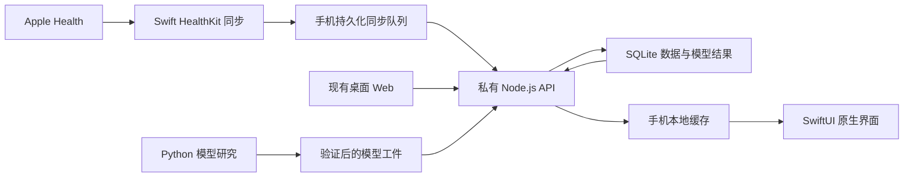

# RAI SwiftUI 原生 iOS App 实施方案与验收标准

- 编写日期：2026-09-08
- 技术路线：路线 A——SwiftUI 原生 App + 现有 Node.js API + TypeScript 计算核心 + Python 研究模块
- 文档状态：待实施方案，不代表任务已经执行或通过验收
- 使用方式：供 Luna 按阶段实施、验证和交接
- 事实基线：此前对当前仓库的静态审阅；实施前必须重新核验实际代码、契约、环境和工作区改动

## 1. 最终交付目标与范围

在现有 `apps/ios` 工程内开发真正的 SwiftUI 原生 App。最终日常使用不依赖 WKWebView，桌面 Web 继续承担数据管理与模型分析。

目标闭环：

> 连接私有服务 → 授权读取 Apple 健康 → 同步数据 → 查看训练与分析 → 修改目标和计划 → 断网查看缓存 → 联网后恢复同步。

| 分类 | 本次范围 |
|---|---|
| 原生界面 | SwiftUI 页面、导航、表单、图表和路线 |
| 健康数据 | HealthKit 只读同步，复用并完善已有实现 |
| 后端 | 保留 Fastify，按客户端实际需要补齐契约和可靠性 |
| 算法 | 保留 TypeScript 特征、评分、生理预测及模型治理 |
| Python | 保留现有研究与训练模块 |
| 数据库 | 服务端 SQLite 保持权威；手机新增缓存和同步状态数据库 |
| 桌面 Web | 保留现有功能，用作高级管理工作台 |
| 离线 | 查看缓存；已持久化同步任务可在联网后继续 |
| 部署 | 局域网或个人 VPN，不新增公网开放要求 |

### 1.1 明确不包含

- Python 后端重构、Swift 评分核心迁移。
- HealthKit 写入、Apple Watch App、主动录制跑步。
- 保证固定周期执行的后台健康同步。
- 多用户、商业账号、支付、社交。
- 手机与服务端双向数据库复制。
- 新增或改造 macOS 原生产品。
- 改造桌面 Web 的冻结窄屏布局。
- 为迁移顺便修改评分公式、重新训练或激活模型。

### 1.2 总体验收

主要业务页面不使用 WKWebView；同一份服务端数据在原生 App 与 Web 中的数值和业务状态一致。

## 2. 执行原则与权威数据边界

必须固定以下职责，避免客户端与后端形成两套业务规则。

| 数据或行为 | 权威位置 | 手机职责 |
|---|---|---|
| Apple 健康原始样本 | HealthKit 来源；服务端保存导入事实 | 读取、封装、可靠传输 |
| 去重、标准化、来源选择 | 服务端 | 展示结果 |
| 特征、跑力、恢复、负荷、预测 | 服务端 | 展示、格式化、解释 |
| 目标、周计划、锁课 | 服务端控制数据库 | 联网读取和提交 |
| 已确认同步游标 | 手机持久化，受服务身份和数据代际约束 | 服务端确认后提交 |
| 页面缓存 | 手机，可删除重建 | 快速启动、离线读取 |
| 模型训练与激活 | 现有服务端流程 | 首版不提供新的手机训练入口 |

手机可以计算单位换算、显示格式和图表坐标；不得自行推导另一套恢复评分、训练建议或预测结果。

必须区分三个时间：

- **数据截至时间**：实际健康数据覆盖到哪里。
- **结果生成时间**：服务端何时计算。
- **缓存更新时间**：手机何时取回结果。

不能把“刚刚刷新缓存”显示成“健康数据已更新”。

## 3. 目标技术方案

| 领域 | 选型 |
|---|---|
| UI | SwiftUI |
| 状态管理 | Observation，页面级状态与业务服务分离 |
| 异步任务 | Swift Concurrency、async/await |
| 网络 | URLSession |
| 图表 | Swift Charts |
| 路线 | MapKit |
| 本地数据库 | SQLite + GRDB，通过 Swift Package Manager 管理 |
| 凭证 | Keychain |
| 健康数据 | HealthKit |
| API 类型 | 基于核验后的 OpenAPI 契约生成；特殊部分使用显式 Codable 适配 |
| 测试 | XCTest、XCUITest；网络测试使用受控模拟响应 |

保持现有 iOS 17 最低版本，除非实际依赖验证证明必须提高；不得为了实现方便直接提高部署版本。

Swift 语言模式和 Xcode 版本在 P0 冻结，不同时开展无关的全工程语言版本升级。

### 3.1 建议代码组织

名称可小范围调整，职责不能混杂。先按模块拆分文件，不要求立即拆成大量 Swift Package。

```text
apps/ios/RAI/
  App/
    RAIApp.swift
    AppContainer.swift
    AppRouter.swift
  Core/
    Networking/
    Persistence/
    Security/
    Formatting/
    DesignSystem/
  Features/
    Onboarding/
    Today/
    Workouts/
    Plan/
    Analysis/
    Settings/
  Health/
    HealthKitReader.swift
    HealthSyncCoordinator.swift
    SyncTaskStore.swift
    HealthArchiveBuilder.swift
  Models/
    API/
    Cache/
  Resources/

apps/ios/RAITests/
apps/ios/RAIUITests/
```

### 3.2 数据流



## 4. 页面清单与逐页验收

| 页面 | 必须实现 | 验收标准 |
|---|---|---|
| 首次连接 | 私有服务地址、凭证、连接测试 | 首次安装可完成连接；错误地址、超时、401 有不同提示 |
| 健康连接 | 读取用途说明、授权入口、同步入口 | 权限有限或无记录时不崩溃，不把空结果断言为拒权 |
| 今日 | 同步状态、今日建议、恢复、本周进度、最近训练 | 展示数据截至时间；过期证据不显示成有效训练许可 |
| 训练列表 | 分页、日期与训练条件筛选、下拉刷新 | 切换筛选无串项；分页无重复；同步完成后正确刷新 |
| 训练详情 | 总览、分段、路线、时序、质量说明 | 与 Web 同源结果一致；缺失指标正确显示为空 |
| 周计划 | 周目标、已有计划与锁课行为 | 保存后重新读取一致；冲突不会静默覆盖 |
| 分析 | 跑力、恢复、负荷、分区、生理和成绩预测 | 指标名称、单位、置信度与服务端含义一致 |
| 设置 | 服务、凭证、健康同步、缓存、版本、数据管理入口 | 清缓存不删除服务端数据；切服务不泄露旧数据 |

建议五个主入口：今日、训练、计划、分析、设置。

训练详情应覆盖现有数据可提供的心率、速度/配速、步频、海拔、功率、步幅、垂直振幅、触地时间。没有对应样本时隐藏该图或明确显示数据不足。

图表采用统一的时间或距离轴。不得把不同轴的数据直接拼接联动。

### 4.1 视觉与原生交互

- 延续现有配色与品牌；数量上克制地使用装饰元素。（2026-09-18 更新：原生端不再使用像素风元素，视觉以 `RAI/Skins/Technology/TechTheme.swift` 的冰蓝科技令牌为准。）
- 导航、表单、弹窗、键盘行为使用原生模式。
- 普通文字支持动态字体；颜色不是表达风险和状态的唯一方式。
- 验证目标 iPhone、另一种较小 iPhone 尺寸、深色模式和 VoiceOver 核心流程。

这些是原生 iOS 验收，不要求修改现有 Web 响应式代码。

## 5. 接口与契约改造规则

优先复用现有接口：

- `/v1/handshake`
- `/v1/mobile/today`
- `/v1/workouts` 及详情、时序接口
- `/v1/mobile/goals`
- `/v1/mobile/lock`
- `/v1/mobile/statistics`
- `/v1/mobile/trends`
- `/v1/recovery-trends`
- 训练负荷、分区、生理预测接口
- 上传、导入任务、任务状态接口

以上只表示现有入口，实际字段及能力必须以实施时的代码和契约核验为准。

### 5.1 需要补齐或确认

1. 服务身份：`serverId`。
2. 个人数据身份：`athleteId` 或等价稳定标识。
3. 数据恢复代际：`datasetEpoch`。
4. API 和同步协议版本。
5. 数据截至、结果生成、结果版本等字段。
6. 统一错误结构，至少包含机器可识别错误码及用户可读信息。
7. 目标、计划写入的 revision 或等价并发控制。
8. 同步批次幂等标识和结果查询能力。

普通新增数据不应改变 `datasetEpoch`；恢复旧库、替换数据集等会使游标失效的操作才改变代际。普通结果更新另用结果版本或 generation 表达。

新增字段优先采用兼容扩展。只有语义确实不兼容时才增加协议版本，不为了原生化复制一整套 API。

### 5.2 验收标准

- Swift 类型解析合法空值、未知可扩展枚举和标准错误。
- 日期使用明确偏移或 UTC；日历统计遵循服务端指定时区。
- 数值单位在契约中明确。
- 修改 API 后现有桌面 Web 仍通过相应检查。
- 生成客户端的命令和版本可复现，禁止手改生成文件。

## 6. 本地缓存和离线行为

| 数据 | 保存策略 |
|---|---|
| 首页、分析摘要 | 最近成功快照，带生成时间和数据版本 |
| 训练列表 | 已加载的分页及查询范围 |
| 训练详情 | 已访问详情，按容量淘汰 |
| 高密度时序 | 按需缓存，设置容量上限 |
| 精确路线 | 首版只作短期或内存缓存，不承诺离线地图 |
| 同步批次、待提交游标 | 持久保存，任务完成前不得作为普通缓存淘汰 |
| 凭证 | 仅 Keychain |

所有记录按服务、个人数据身份和数据代际隔离。

### 6.1 离线规则

- 可查看已缓存内容，并显示上次更新时间。
- 不能将缓存建议重新认定为今天的新建议。
- 目标修改、锁课、重算明确提示需要联网。
- 可以保留已完成本地采集的待上传批次。
- 如果当前 HealthKit 采集尚未完成，诚实显示未完成，不能伪报同步成功。

### 6.2 验收标准

- 杀掉 App 后断网重启，缓存仍可读。
- 清页面缓存后，同步任务和凭证仍完整。
- 切换服务立即切换可见缓存命名空间。
- 数据代际变化后旧缓存不能继续作为当前结果展示。
- 缓存满额后正常淘汰，不无限增长。

## 7. HealthKit 同步专项方案

先复用现有 `HealthKitSync.swift`、`HealthKitExport.swift` 和 ZIP/XML 管道，本次不同时切换为全新的 JSON 导入系统。

### 7.1 同步状态机

```text
待执行 → 采集 → 本地批次已保存 → 上传
      → 服务端检查 → 导入/重算 → 服务端成功
      → 本地确认游标 → 清理临时文件
```

每个任务至少持久化：

- 本地任务 ID、幂等批次 ID。
- 目标服务身份和数据代际。
- 各类型旧游标、待确认新游标。
- 批次文件路径、校验值、范围与协议版本。
- 服务端 source/job 标识。
- 当前阶段、重试次数、最近错误和时间。

### 7.2 关键规则

1. 读取游标与上传确认游标分开。
2. 服务端确认导入发布成功后，才提交已确认游标。
3. 服务端成功但手机尚未确认时被终止，恢复后查询旧批次结果，不重复创建业务数据。
4. 无新跑步但有新睡眠、HRV、静息心率时仍同步。
5. 按样本类型独立追踪变化；对迟到路线与关联样本设置明确补查机制。
6. 删除采用来源 UUID 和删除事件，不把查询窗口外记录或权限变化解释成删除。
7. 游标损坏、权限变化、服务恢复后支持安全重新对账。
8. 所有幂等范围都绑定目标身份，不能跨服务误复用。
9. 空批次作为合法结果处理，不能改变已有数据。
10. ZIP 临时文件使用文件保护并排除普通系统备份；成功及时清理，失败按恢复策略保留。

### 7.3 重试与取消

- 短暂网络失败采用有上限的退避。
- 401 停止自动重试并提示更新凭证。
- 不兼容协议和坏数据明确失败，保留可诊断信息。
- 取消只在定义的安全点生效；服务端已经提交的任务不能假装撤销。

### 7.4 同步必测矩阵

| 场景 | 期望结果 |
|---|---|
| 首次完整同步 | 记录完整，游标在成功后推进 |
| 同一批次重复提交 | 不重复产生训练或恢复事实 |
| 只有睡眠/HRV 更新 | 恢复数据和相关结果更新 |
| 删除一条训练 | 对应来源失效，必要时重选 canonical 并回算 |
| 路线晚于训练到达 | 能补齐，不重复训练 |
| 上传途中断网 | 恢复后继续或安全重传 |
| 上传后 App 终止 | 从已记录阶段恢复 |
| 服务端成功后 App 终止 | 查询成功结果并完成本地确认 |
| 服务恢复旧数据库 | 识别代际变化并重新对账 |
| 部分读取权限、没有跑步 | 无崩溃、无错误远程删除 |
| 切换服务后同步 | 不复用不匹配的游标和批次 |
| 首次历史量很大 | 分批处理，内存有界，界面仍可操作 |

## 8. 计划与目标写入

首版只允许联网写入，不建立离线业务写队列。

### 8.1 写入流程

1. 读取当前目标及 revision。
2. 用户编辑。
3. 带 revision 和请求幂等标识提交。
4. 服务端检查并写入控制库。
5. 手机重新读取确认。
6. 更新相关缓存。

### 8.2 验收标准

- 重复点击不会重复锁课。
- 保存中断后能够判断是否已成功，不单凭超时显示确定失败。
- Web 与手机同时修改时，返回冲突并提示重新读取。
- 未编辑字段不会被默认空值覆盖。
- 重算、导入、服务重启不覆盖用户目标与计划。

## 9. 私有访问、数据保护和恢复

默认沿用现有服务主机，不因为原生化更换部署平台。

### 9.1 生产访问

- 局域网或个人 VPN。
- 使用符合当前 App 连接策略的 HTTPS，正确配置可信证书。
- 不通过关闭证书校验解决连接问题。
- 凭证只发送给配置的可信目标，跨源重定向不得携带认证信息。
- 日志不包含 Token、完整健康样本或精确路线。

### 9.2 完整备份

备份 bundle 应包括：

- 业务 SQLite。
- 计划与目标控制库。
- 恢复所需的任务状态。
- 模型工件与配置。
- 文件清单、版本、校验值。

备份时协调所有相关写入，并使用 SQLite 支持的备份机制；不能仅复制正在写入的数据库主文件。

### 9.3 恢复流程

1. 校验清单、数据库完整性和必需工件。
2. 先备份当前状态。
3. 暂停写入并恢复相互匹配的资产。
4. 更新数据代际。
5. 重建读取连接和必要运行状态。
6. 手机重新校验缓存与同步游标。

### 9.4 验收标准

在隔离环境完成一次真实恢复演练，训练、目标、计划、模型版本均匹配；恢复失败不会破坏原可用状态。

手机首版提供备份状态和必要入口。完整多库恢复操作可保留在桌面管理流程，避免把高风险管理表单搬进手机。

## 10. 可直接执行的阶段任务包

每个阶段单独提交、单独验收。阶段完成不等于允许自动进入真实数据切换。

| 阶段 | 实施内容 | 交付物 | 通过条件 |
|---|---|---|---|
| P0 基线 | 检查工作区、实际功能、接口、Xcode 与设备；冻结样本 | 实施基线、差异表、任务清单 | 已知问题与新增问题可区分 |
| P1 契约 | 核验 OpenAPI，补齐身份、版本、错误及并发字段 | 契约和 Swift API 类型 | 契约测试及旧客户端兼容检查通过 |
| P2 基础 | App 容器、导航、网络、Keychain、缓存、连接页 | 可运行原生骨架 | 真机连接、401、断网重启、切服务通过 |
| P3 只读业务 | 首页、列表、详情、路线、图表 | 首个可用原生版本 | 核心阅读流程无需 WKWebView |
| P4 同步 | 拆分并完善已有 HealthKit 实现与持久任务 | 可恢复同步闭环 | 同步矩阵自动化及真机关键项通过 |
| P5 计划分析 | 目标、计划、锁课、统计、趋势与预测 | 日常功能完整版本 | 写入冲突和数据语义验收通过 |
| P6 可靠性 | 缓存容量、弱网、辅助功能、完整备份恢复 | 验证报告与运行说明 | 无阻断缺陷，恢复演练通过 |
| P7 收尾交付 | 移除原生产品中的旧 Web 主路径、签名安装、文档 | 可安装 App 和交接清单 | 发布配置下完整真机闭环通过 |

### 10.1 依赖关系

- P1 先于依赖新增字段的客户端开发。
- P2 是全部原生页面基础。
- P3 先完成最短可用阅读链路。
- P4 的服务身份和任务协议必须稳定后再接真实同步。
- P5 不得绕过已有控制库和并发机制。
- P7 只能在完整验收后进行。

旧 Web 壳可以在开发过渡期保留，但不能作为最终原生页面验收的替代品。删除旧文件前检查 Xcode 引用、快捷指令和其他共享依赖。

## 11. 测试与验收执行要求

### 11.1 测试分层

| 层次 | 重点 |
|---|---|
| Swift 单元测试 | DTO 解码、单位和日期、缓存隔离、状态机、游标提交 |
| 网络集成测试 | 401、超时、断连、重试、协议不兼容、幂等确认 |
| 本地数据库测试 | 迁移、事务中断、容量淘汰、任务恢复 |
| 服务端测试 | 协议兼容、删除传播、批次幂等、revision 冲突、恢复代际 |
| UI 测试 | 连接、首页到详情、筛选、离线、目标保存和冲突 |
| 真实设备测试 | HealthKit、权限、生命周期、地图与图表、签名版本 |

服务端或共享包变更时，按仓库要求运行：

```text
npm run typecheck
npm test
npm run build
```

影响浏览器业务流程时，再运行：

```text
npm run test:e2e:web
```

不得执行冻结响应式覆盖，除非后续用户单独扩大范围。

iOS 使用实际可用的 Xcode scheme 和设备执行构建、单元测试及 UI 测试；P0 确认环境后再形成准确命令，不能把不存在的模拟器名称写成已验证流程。

### 11.2 性能验收建议

以下是待测目标，不代表当前性能。

| 项目 | 初始目标 |
|---|---|
| 已有缓存的冷启动 | 目标真机上 2 秒内显示主要内容 |
| 私有网络首页读取 | 约定数据集和网络条件下 p95 ≤ 1 秒 |
| 训练长列表 | 500 条样本集分页滚动，无持续明显卡顿 |
| 大历史同步 | 分批处理，内存不随总历史量无限增长 |
| 页面图表 | 大序列在后台准备；不阻塞主线程 |
| 小增量同步 | P0 固定样本规模后设定阈值，分别测采集、上传和计算 |

性能不达标时先定位瓶颈，不通过删掉必要样本或改变算法结果来“优化”。

### 11.3 缺陷分级

- **阻断**：数据丢失、重复、错删、凭证泄露、跨服务串数据、启动崩溃。
- **高优先**：同步不能恢复、业务结果不一致、计划被覆盖、离线显示伪最新结果。
- **普通**：非关键布局、文案、轻微视觉差异。

最终交付要求阻断和高优先缺陷为零；普通缺陷必须明确登记，不得隐瞒。

### 11.4 验收记录要求

每项验收记录应包含：阶段、场景、测试环境与数据版本、操作或测试命令、期望结果、实际结果、通过/失败/未运行、证据位置和遗留问题。

静态审查、模拟响应测试、模拟器测试、HealthKit 真机测试必须分别标识。未运行项目不得标为通过。

## 12. 真实数据迁移与回退

本路线没有更换后端语言，也不需要把完整服务端数据库搬进手机。主要迁移对象是原生客户端、同步协议及可能的兼容性 schema 扩展。

### 12.1 迁移顺序

1. 先用脱敏夹具和隔离数据库验收。
2. 再用真实数据副本只读核对。
3. 如需服务端迁移，先备份全部关联资产。
4. 保留原 Web 工作台和旧 App 可安装版本。
5. 新协议优先兼容旧壳，保证回退窗口。
6. 新 App 小范围个人试用后再移除开发期旧路径。

### 12.2 回退要求

- 客户端回退不破坏服务端数据。
- 后端回退前明确新增写入如何保留。
- 不能为了回退直接恢复旧快照并丢弃新训练或目标修改。
- 不自动激活模型、不自动重算正式数据作为安装附带步骤。
- 数据恢复造成游标失效时，必须通过代际机制重新对账。

## 13. 交付文件与工期

### 13.1 文档交付

实施时维护或创建以下文件：

- `docs/IOS_NATIVE_IMPLEMENTATION_PLAN.md`：本方案，实施后记录冻结范围和必要变更。
- `docs/IOS_NATIVE_API_CONTRACT.md`：客户端契约和兼容规则。
- `docs/IOS_NATIVE_SYNC_PROTOCOL.md`：同步状态机、幂等、游标与恢复。
- `docs/IOS_NATIVE_ACCEPTANCE.md`：验收项目、结果和证据。
- `docs/IOS_NATIVE_RUNBOOK.md`：构建、签名、安装、私有连接和排障。
- 更新 `apps/ios/README.md` 和根 `AGENTS.md` 的产品范围。

### 13.2 粗估工作量

按一名熟悉项目的开发者全职投入估算，包含基本测试与联调，不是承诺工期。

| 阶段 | 人日 |
|---|---:|
| P0 基线与环境 | 3–5 |
| P1 契约 | 3–5 |
| P2 原生基础 | 4–6 |
| P3 只读业务 | 7–11 |
| P4 健康同步 | 6–10 |
| P5 计划与分析 | 7–11 |
| P6 可靠性验收 | 5–8 |
| P7 交付收尾 | 2–4 |
| **合计** | **37–60** |

估算包含同步异常矩阵、契约兼容和恢复演练。建议另留约 20% 缓冲；签名环境、设备准备和外部依赖等待不包含在纯开发人日中。

## 14. 交给 Luna 的执行约束

以下执行指令仅在用户后续明确启动实施时生效；创建和阅读本方案不等于执行授权。

> 按本方案执行路线 A，在现有 iOS 工程内开发 SwiftUI 原生 App，保留 Node.js 后端、TypeScript 计算核心和 Python 研究模块。先完成 P0，核验当前代码与方案的差异，然后按 P1–P7 顺序推进。普通实现选择自主处理，不因可逆代码修改重复请求许可。
>
> 不重构后端语言、不迁移评分到 Swift、不改变模型公式、不改冻结 Web 响应式代码、不新增 macOS 或 Watch 产品、不扩展 HealthKit 写入。可靠后台 delivery 已在 2026-09-22 按单独立项授权（三机制，见 `docs/IOS_NATIVE_SYNC_PROTOCOL.md`），本方案其余边界不变。
>
> 每阶段输出：修改内容、验证结果、未完成项、风险和下一阶段依赖。未运行的检查明确标记未运行，不能把静态审查写成真机通过。已有用户改动和未跟踪文件不得覆盖。
>
> 优先使用隔离数据和脱敏测试。真实数据库迁移、正式服务切换、模型激活和破坏性数据操作只有在用户实际授权覆盖该动作时才能执行；所需迁移脚本、备份方案和回退验证应提前准备完成。
>
> 若没有可用 Mac/Xcode 或真机，继续完成可独立完成的接口、代码及测试准备，明确列出尚未完成的 iOS 验收，不宣称原生 App 已交付。
>
> 最终验收以本方案的页面清单、同步矩阵、离线规则、数据一致性、恢复演练和签名真机闭环为准；编译成功或展示几个原生页面不算完成。

## 15. 当前实施状态

- [x] P0 基线静态核验：确认现有 API、HealthKit ZIP/XML 管道、旧 WebView 路径和 Xcode 工程配置。
- [x] P1 契约适配：复用现有身份、代际、协议版本、聚合接口和 revision 接口；加入 Swift Codable 适配与统一错误处理。
- [x] P2 原生基础代码：SwiftUI 五入口、URLSession、Keychain 连接、SQLite 页面缓存和离线展示已加入 `apps/ios/RAI`。
- [x] P3 只读业务代码：今日、训练筛选/分页、训练详情、路线、时序、分段、统计和趋势页面已加入。
- [x] P4 同步持久化准备：已有 HealthKit 增量/失败 ZIP/任务恢复逻辑接入本机 SQLite 任务存储，并保留旧任务迁移。
- [x] P5 计划分析代码：目标、逐日计划、锁课、趋势和统计页面接入现有服务端控制接口。
- [ ] P4/P5 自动化异常矩阵和真实数据联调。
- [ ] P6 缓存容量淘汰、辅助功能、弱网和完整备份恢复演练。
- [ ] P7 Xcode 编译、签名安装和真实 iPhone 闭环。

本轮代码实施受当前 Windows 环境限制，未将未运行的 Xcode、模拟器、HealthKit 真机检查标为通过。旧 `AppWebView.swift` 暂保留到 P7 完成，iOS 主入口已经切换到原生 `NativeRootView`。
