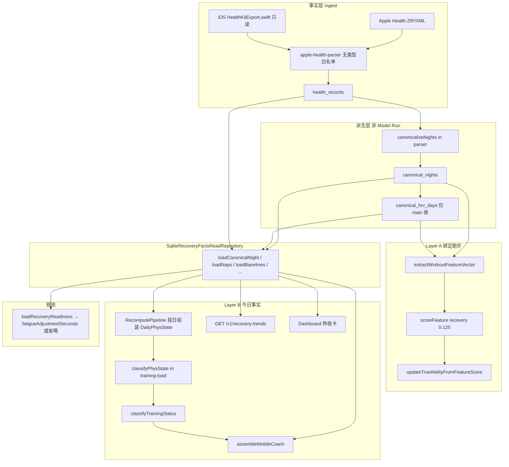
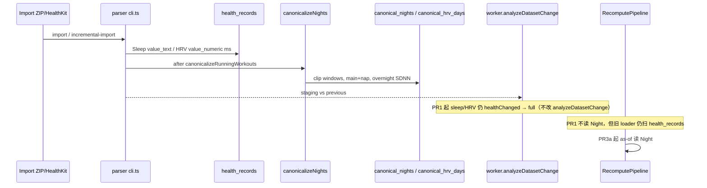

# 加入睡眠数据与 HRV 数据（canonical nights + personal baselines）

| 字段   | 值                                                                                       |
| ---- | --------------------------------------------------------------------------------------- |
| 作者   | TBD                                                                                     |
| 日期   | 2026-09-04                                                                              |
| 状态   | Implemented in `881578b`; canonical facts and recovery integrations active               |
| 产品范围 | 浏览器 Web（`apps/web`）+ 本地 API + 共享包；iOS 仅为 WKWebView 只读 HealthKit 导出壳                     |
| 主视口  | 1440 × 900；不改 frozen responsive 区域                                                      |
| 验收依据 | `AGENTS.md`、`README.md`、`docs/WEB_IMPLEMENTATION.md`（归档 PRD `RAI_PRD_V1.0.md` 不是当前验收依据） |

---

## Overview

RAI 已经把 Apple Health 的睡眠分段（`HKCategoryTypeIdentifierSleepAnalysis`）和 HRV SDNN（`HKQuantityTypeIdentifierHeartRateVariabilitySDNN`）写入 `health_records`，但没有夜/日派生层。Feature、Coach、训练负荷和成绩预测各自用不同的错误窗口从原始分段现算：睡眠把重叠 `Asleep*` 相加、HRV 用 28 天全样本均值或今晨 04:00–12:00 中位数、恢复分数绑在人口绝对阈值（8 小时 / 100 ms）上，缺失时还会用 `?? 50`，预测则把负荷无条件混进所谓恢复值。

本设计把恢复拆成**两层、不是一个 0–100 分数**：

- **Layer A — Ability Recovery（CA 的 ~12.5%）**：绑定到每次跑步的 as-of start，无未来泄漏；子信号相对个人 28 天基线；sleep + HRV + RHR 全缺则 recovery unavailable，**即使有训练负荷也不填**。
- **Layer B — Today / Coach 事实卡**：昨夜睡眠分钟 vs 28d、过夜 SDNN vs 28d（带样本数）、RHR vs 28d；先算生理离散态 `{unknown, depleted, reduced, recovered_phys}`，再跑 `classifyTrainingStatus`，卡片标签可 overlay 负荷态。保留现有 conjunction gates。不做 WHOOP 式 Recovery。

当前实现说明：PR1 的 v17 schema、canonical 夜/HRV 派生和导入挂钩已启用；PR2 的 Coach/恢复趋势核心读取、PR3 的版本隔离与预测 nullable 已启用。完整个人基线 scoring 和按日生理状态重放仍应通过 shadow Model Run 门禁后再扩大使用范围。

落地顺序必须可独立合并：先把夜/日事实写入 SQLite 并测试（不改 scoring），再在桌面 Web 展示，最后才把个人基线喂进 CA / TA / 预测。

---

## Background & Motivation

### 当前产品边界

- 单用户、本地优先；API 只听 `127.0.0.1:8787`（`docs/WEB_IMPLEMENTATION.md`）。
- 睡眠和 HRV 已经随 ZIP/XML 进入事实层：parser 对 Record 类型**没有白名单**（`packages/health-export-parser/src/apple-health-parser.ts` `buildRecord`）；iOS `HealthKitExport.swift` 的 `readTypes` 已包含 `HKCategoryType(.sleepAnalysis)` 与 `HKQuantityType(.heartRateVariabilitySDNN)`，`writeGlobalRecords` 以毫秒单位导出 SDNN，并以 `HKCategoryValueSleepAnalysis*` 字符串写出睡眠。
- `canonicalizeRunningWorkouts`（`packages/health-export-parser/src/canonicalize.ts`）只处理跑步 Workout 去重，不处理 sleep/HRV。
- 派生层目前只有 `training_sessions`、`workout_features`、`ability_assessments`、`daily_ability_snapshots`、`daily_training_metrics`、`daily_zone_profiles`。没有 nightly/daily recovery 表（已核对 `schema_migrations` 最新为 v16 `prediction_model_ability_baseline_fingerprint`）。


### 已核对的数据覆盖

`docs/DATA_AUDIT.md`（生成于 2026-09-04T00:42:33Z）记录：

| 类型                                                 |   条数 | 跨度                | 单位        |
| -------------------------------------------------- | ---: | ----------------- | --------- |
| `HKCategoryTypeIdentifierSleepAnalysis`            | 5664 | 2023-10 → 2026-09 | —         |
| `HKQuantityTypeIdentifierHeartRateVariabilitySDNN` |  762 | 2024-06 → 2026-09 | ms        |
| `HKQuantityTypeIdentifierRestingHeartRate`         |  408 | 2024-06 → 2026-09 | count/min |

对当前 `var/rai.sqlite` 的只读核对（2026-09-04，导入后继续增长）给出更细的来源结构，**以它作为实现容量估计**；审计快照作为回归对照：

| 事实                                     | 活库观察                                                                                                                            |
| -------------------------------------- | ------------------------------------------------------------------------------------------------------------------------------- |
| Sleep 5693 行                           | `apple_watch` 5479（2024-06-12 → 2026-09-03）；`apple_phone` 214（2023-10-31 → 2024-08-12）                                          |
| Sleep `value_text` 分布                  | Core 2527 / Awake 1389 / REM 837 / Deep 548 / InBed 267 / Unspecified 125                                                       |
| iPhone 睡眠                              | **214/214 全是 `InBed`，0 条 `Asleep*`**                                                                                            |
| Watch 睡眠                               | staged（Core/Deep/REM）3912；Unspecified 125；InBed 53；Asleep* 合计 4037                                                              |
| 粗夜数（Watch `Asleep*`，上海时区 start+6h 的日期） | **185 夜 / ~813–814 日历日 ≈ 23% 覆盖**（`julianday(max)−julianday(min)` = 813，含端点 +1 = 814）；naive 求和均值 406 min，最大 739 min（重叠未合并的典型症状） |
| HRV SDNN 1532 行                        | 全部 `apple_watch`；253 个 UTC 日，日样本 min 2 / max 14 / 均 6.06；**没有 1-sample 日**                                                      |
| HRV 上海小时分布                             | 04:00–12:00 仅 471/1532（30.7%）；其余 1061 条在夜间与傍晚。18 时一档 174 条、23 时 160 条、00 时 134 条                                                |
| RHR                                    | Watch 206 + Connect 207                                                                                                         |

结论：原始数据够做个人基线，但**不是每天都有夜**；iPhone 行绝不能当睡眠时长；今晨 04–12 窗口会丢掉约七成 SDNN。


### 现有实现的具体缺陷

**1. Feature 睡眠窗口（无 overlap merge、无来源选择）**

```670:687:packages/application/src/services/recompute-pipeline.ts
  private loadSleepDurationMinutes(workoutStartAt: string): number | null {
    const cutoff = new Date(Date.parse(workoutStartAt) - 36 * 3_600_000).toISOString();
    const rows = this.database
      .prepare(`
        SELECT start_at AS startAt, end_at AS endAt, value_text AS valueText
        FROM health_records
        WHERE type = ? AND start_at >= ? AND end_at <= ?
      `)
      .all(sleepType, cutoff, workoutStartAt) ...
    const minutes = rows
      .filter((row) => row.valueText?.includes("Asleep") ?? false)
      .reduce((total, row) => total + Math.max(0, Date.parse(row.endAt) - Date.parse(row.startAt)) / 60_000, 0);
    return minutes > 0 ? minutes : null;
  }
```

36 小时内所有来源的 `Asleep*` 时长直接相加。HealthKit 文档明确 in-bed 与 stages **重叠**；同一源的 Unspecified 与 staged 也可能并存。活库最大 naive 夜长达 739 min，就是这个 bug 的数量级。

**2. Feature HRV / RHR 不是昨夜/今晨**

`loadRecoveryAverage` 对 `workoutStartAt` 前 28 天 **全部样本 `AVG(value_numeric)`**。HRV 被当成连续均值，而 Apple Watch SDNN 是稀疏 tachogram（本库约每夜数个点，外加日间点）。

**3. `recoveryRaw` 用人口绝对阈值，负荷单独就能让 recovery 非空**

```440:450:packages/features/src/index.ts
  const recoveryParts = [
    source.sleepDurationMinutes === null ? null : clamp(source.sleepDurationMinutes / 480, 0, 1),
    source.restingHeartRate === null
      ? null : 1 - clamp((source.restingHeartRate - 40) / 80, 0, 1),
    source.hrvSdnn === null ? null : clamp(source.hrvSdnn / 100, 0, 1),
    source.recentLoadMinutes === null
      ? null : 1 - clamp(source.recentLoadMinutes / (7 * 60), 0, 1)
  ].filter((value): value is number => value !== null);
  const recoveryRaw = average(recoveryParts);
```

8 小时睡眠、RHR 40–120、HRV 100 ms、7×60 分钟负荷都是人口尺度。`eligibility()` 把 `sleep + RHR + HRV` 全缺记为 `recovery_data_missing`，但这**不是硬排除**（硬排除列表在 `features/src/index.ts` 375–383 行，不含该项），随后 equal-mean 仍可只用 load 产出 `recoveryRaw`。

**4. Scoring 缺维会 renormalize，但 TA 方向系数把 null 当成 50**

CA 权重：efficiency 0.375 / pace 0.3125 / cardio 0 / stability 0.1875 / **recovery 0.125**（`defaultRaiModelConfig`）。`scoreFeature` 对 `null` 维度重分配权重，符合“缺失不填 50”。但：

```353:354:packages/scoring/src/model.ts
  const negative = score.currentAbility < currentTrueAbility;
  const directionFactor = negative && (score.dimensions.recovery ?? 50) < 40 ? 0.25 : negative ? 0.4 : 1;
```

`updateTrueAbilityFromFeatureScore` 把缺失 recovery 当成中性 50，**关闭**本应只在 recovery 明确偏低时启用的疲劳保护。

**5. 训练负荷 `recoveryEvidence` 不是夜间事实**

`RecomputePipeline` 把每次 workout 的 `recoveryRaw` 按本地日期送给 `buildDailyTrainingMetrics`；后者对最近 7 天最多 3 次 workout 做加权平均（`packages/training-load/src/index.ts` 235–236 行）。Dashboard / Statistics / iOS Physiology 展示的“恢复证据”因此是**跑步绑定的派生分**，不是昨夜睡眠或过夜 SDNN。

**6. 预测 `loadRecoveryReadiness` 不用睡眠；负荷项无条件入列，所以永远是 number**

```494:536:packages/application/src/prediction-data.ts
export function loadRecoveryReadiness(...): number {
  // 近 7 天 vs 前 28 天的 RHR/HRV 中位数
  // 随后无条件 scores.push(负荷比项) 与 days-since-last-run
  ...
  return clamp(average(scores) ?? 0.65, 0, 1);
}
```

`scores.push` 负荷项是无条件的，因此 `?? 0.65` **是死代码**。无 RHR/HRV 时函数仍返回一个掺了负荷与休息天数的数（近期 0 分钟时常接近 1.0），不是“缺省 0.65”。`packages/physiology/src/index.ts` 已把 `recoveryReadiness === null` 映射为 **0 疲劳惩罚且不 push `fatigue_adjustment`**，但 loader 与 `FormulaPredictionBase.recoveryReadiness: number`、`assertRange(..., 0, 1)`（`prediction-report.ts` 186）拒绝 null，所以公式路径永远有疲劳修正。`PredictionsPage.tsx` 178 的 `Math.round(data.inputs.recoveryReadiness * 100)` 与 `IosBodyStatusCard`（`Physiology.tsx` 46–59）同样假定 number。

**7. Coach 最接近正确，但仍有三处硬伤**

`apps/api/src/mobile-read.ts`：

- `loadSleepWindow`：时区硬编码 `Asia/Shanghai`；夜 key = `startAt + 6h` 的上海日期；`Asleep*` 求和、无 overlap merge、无来源选择。
- `loadMetricWindow(..., hrv, today, 4, 12)`：今晨 04:00–12:00 中位数。活库 69% SDNN 落在该窗外。
- `buildRecovery.score` 赋值为 `input.recoveryEvidence`（训练负荷 EWMA），不是夜间事实。

iOS `Home.tsx` 拉取了 `/v1/mobile/today`，**完全不渲染 `data.recovery`**。桌面 Trends（`TrendResponse` / `TrendsPage` / `TrendAnalysisCharts`）只有 TA/CA/Decay、五维 CA、跑量与负荷，没有睡眠小时或 HRV ms 图。

---

## Goals & Non-Goals

### Goals

1. 从 `health_records` 派生 **canonical night** 与 **canonical HRV day**，带 overlap union、单源选择、naps 分离、时区参数。
2. 桌面 Web 1440×900 展示睡眠分钟、HRV (SDNN, ms) vs 28d band、RHR；Coach / `/v1/mobile/today.recovery` 读同一事实。
3. Layer A：workout 绑定、as-of start、个人基线、子权重 renormalize；sleep+HRV+RHR 全缺 → recovery unavailable。
4. Layer B：离散状态 + 触发条件；保留 `decideVerdict` 现有 conjunction gates。
5. 预测：夜间事实进入疲劳秒修正（上限 4%）；三生理全缺则 `recoveryReadiness = null`、省略疲劳行；不再把负荷混进该值。
6. TA `directionFactor`：`recovery == null` 不得视为 50。
7. 命名永远写 **HRV (SDNN, ms)**，相对个人 28 天。诚实表达缺失。不做医疗推断。

### Non-Goals

- 独立移动产品、HealthKit 写入、background delivery、RMSSD / beat-to-beat（`HKHeartbeatSeries`）作为 V1。
- WHOOP / Garmin Body Battery / Bevel 式不透明 0–100 Recovery；Apple Sleep 习惯分（50/30/20）当 readiness。
- 把 `InBed` 当睡眠时长；跨源 Watch+iPhone 相加。
- 绝对 8 小时 / 100 ms 作为分数。
- Intraday Body Battery。
- 用户可配置时区 UI（V1 只参数化，默认仍 `Asia/Shanghai`；本项目不做 Settings IANA 选择器）。
- 改 frozen responsive：`mobileNavigation`、`.mobile-nav-links`、`<1024px` media queries、390px E2E。
- 把睡眠/HRV 叠到 TA/CA 曲线上。
- 重写 TypeScript scoring 到 iOS 设备上。

---

## Competitive Landscape

多智能体 2026-09-04 对照结论。RAI 抄**可解释的个人基线与负荷/生理分离**，不抄**黑盒 Recovery 剧场**。

### 抄

| 来源                                    | 抄什么                                                                                                     | 落到 RAI 的哪一层                               |
| ------------------------------------- | ------------------------------------------------------------------------------------------------------- | ----------------------------------------- |
| Polar Nightly Recharge / Sleep Plus   | 28 天 “usual for you”，相对个人而不是人口 8h                                                                       | Layer A 子信号与 Layer B 对比带                  |
| Oura                                  | 贡献因子拆开显示（睡眠、HRV、RHR、负荷各算各的）                                                                             | Layer B 事实卡；Layer A 加权但 UI 不合成 0–100      |
| Athlytic                              | 缺数据不填 50；早晨快照冻结，避免白天活动污染                                                                                | null ≠ 50；as-of 绑定；HRV 用过夜窗口而非 04–12      |
| TrainingPeaks / Intervals.icu / COROS | 负荷模型（CTL/ATL/TSB 或等效）与生理 overlay **分离**                                                                 | `daily_training_metrics` 继续描述负荷；夜/日事实另表另图 |
| Apple HealthKit                       | 睡眠是 **segment 不是 night 对象**；`inBed` 与 stages 重叠；时长只计 `asleep*` 的 **union**；HRV **只有 SDNN**，稀疏 tachogram | Night 算法；永远标注 HRV (SDNN, ms)              |

### 不抄

| 来源                          | 不抄什么                             | 原因                                                        |
| --------------------------- | -------------------------------- | --------------------------------------------------------- |
| WHOOP Recovery              | 不透明 0–100                        | 无法审计、无法解释缺失                                               |
| Garmin Body Battery         | 日内能量积分                           | 需要连续生理流，HealthKit 导出没有                                    |
| Bevel                       | 黑盒 Recovery                      | 同上                                                        |
| Apple Watch Sleep 习惯分       | 50% 时长 / 30% bedtime / 20% 唤醒一致性 | 那是习惯，不是跑步 readiness                                       |
| 任何要求 RMSSD 的产品              | V1 要 beat-to-beat                | HealthKit 对第三方只保证 SDNN 样本；`HKHeartbeatSeries` 不在当前 ZIP 管线 |
| 把 InBed 当睡着、Watch+iPhone 相加 | 常见 DIY 错误                        | 本库 iPhone 行 100% InBed；跨源相加会把 in-bed 与 stages 再加一遍        |

官方依据见 [References](#references)。

---


## Key Decisions

1. **两层产品，不是一个分数。** Layer A 只服务 CA/TA；Layer B 只服务今日事实与 Coach 闸门。禁止再发明第三个 0–100 readiness。
2. **先存夜/日事实，再展示，最后改 scoring。** PR1 不改 `recoveryRaw`。PR2 **会改变** Today/Coach 建议（输入从 naive sum / 04–12 换成 union / 过夜 SDNN），评分仍走旧 Feature，直到 PR3a。这是可接受的双源窗口。
3. **两表，视图可选。** 物理表只有 `canonical_nights` 与 `canonical_hrv_days`。`daily_recovery_facts` 若加也只是 `nights LEFT JOIN hrv` 的糖，Coach 走 repository 方法，不靠视图。
4. **夜窗口是全函数：** 按本地日迭代；分段 **clip** 进 18:00(D−1)→14:00(D)，禁止复制；14:00–18:00 另开午睡 pass。`wake_date` = 窗口的 14:00 侧日期 D。
5. **Winning source，然后该源最长 session = main。** `sourceRank = min(该源在窗口 D 内各 session 的 rank)`；取 sourceRank 最好的源，再在该源里取 asleep-union 最长的 session 为 `main`，同源其余为 `nap`。session 级只作同源并列时的 tie-break。duration = winning session 内全部 `asleep*` 的 union。InBed-only 永不赢。
6. **HRV 行只为 `kind = 'main'` 夜插入**（过夜 n=0 也插 `confidence = 'missing'`）。不插无夜日期，不用 04:00–12:00。
7. **28d median of daily values 为主基线；<14 天则 60d；最少 7 个 daily values 才有 baseline。** 所有 as-of 边界用 `start_at < T`，禁止读 T 当天 T 之后的样本。
8. **Layer A 子权重锁定 35/25/25/15。** 缺则 renormalize；三生理全缺 → `recoveryRaw = null`。usual load 为 **中性 1.0**（只惩罚超负荷）。对照 Run 若 CA 抖动过大，允许热修为个人相对值 equal-mean，**load-only 禁令不撤**。
9. **时区：参数化 `timezoneIdentifier`，行上持久化；V1 调用点硬编码 `"Asia/Shanghai"`。** IANA 墙钟用 parser 包内 `localDateTimeAt`。本项目不做 Settings IANA 选择器；改时区是用户可见的评分不连续，不得绑进 scoring PR。
10. **Trends V1 只画时长与 SDNN/RHR 带，不叠 TA/CA，不画 stages 堆叠。** stages 仍写入 JSON。
11. **派生重建挂在 parser CLI，不挂 Model Run。** PR3a **必须**同时 bump `FEATURE_CONFIG_VERSION` 与 `MODEL_CONFIG_VERSION`。`FEATURE_SCHEMA_VERSION` 仅在 `assertWorkoutFeatureVector` / 列布局变化时 bump。
12. **PR1 不改 `analyzeDatasetChange`。** `loadSleepDurationMinutes` 仍扫 `health_records`，睡眠同步必须继续触发 full Model Run，否则 CA 会冻在旧 `recoveryRaw` 上。接受浪费的 full recompute。`canonicalizeNights` 只挂 CLI。
13. **生理态先于训练状态。** `classifyPhysState` 与 `countNightsBelowSleepBaseline` 放在 `@rai/training-load`（类型在 `@rai/contracts`），**PR2 落地纯函数**（不改 `buildDailyTrainingMetrics`）。3 夜计数永远是日历窗 `{D, D−1, D−2}`，缺日 +0，禁止 `LIMIT 3`。PR2 卡片 `state` 只做生理映射；PR3b 才 overlay 训练状态并按日喂负荷机。
14. **不做医疗推断。** 文案用“低于个人 28 天中位数”，不用“恢复不足导致伤病/过度训练”。
15. **`morningHrvMs` 字段名保留。** 语义是过夜 SDNN 中位数；note / UI 文案写「过夜 HRV (SDNN, ms)」。不改合约字段名。

---

## Proposed Design


### 架构




### 夜模型

HealthKit 不提供 night 对象。`HKCategoryValueSleepAnalysis` 的 in-bed 样本与 stage 样本时间重叠，stage 之间不重叠（[Apple 文档](https://developer.apple.com/documentation/healthkit/hkcategoryvaluesleepanalysis)）。时长只能对 `asleep*` 做 **union**。算法版本：`canonical-night-v1`（写入每行 `provenance_json.algorithmVersion`；bump 该字符串则全量重建，不做 dirty 窗）。

**Asleep class**（计入 duration）：`AsleepUnspecified`、`AsleepCore`、`AsleepDeep`、`AsleepREM`、以及历史 XML 里已弃用的 `Asleep`。  
**InBed class**：只存 `in_bed_minutes`，永不作为 duration 胜出依据。  
**Awake class**：计入 `awake_minutes`，不计入 asleep union。

#### IANA 墙钟（parser 包内，禁止依赖 `@rai/application`）

`@rai/health-export-parser` 只依赖 `@rai/contracts` 与 `@rai/storage-sqlite`。`@rai/application` 已依赖 parser，因此不得从 `packages/application/src/utils.ts` 引入 `localDateStartAt` / `deterministicId`。夜 ID 用 parser 已有的 `stableId`。

在 `packages/health-export-parser/src/utils.ts` 新增：

```ts
export function localDateAt(instantIso: string, timezone: string): string // YYYY-MM-DD

/** Wall-clock instant for YYYY-MM-DD + hour:minute in IANA timezone. */
export function localDateTimeAt(
  localDate: string,
  hour: number,
  minute: number,
  timezone: string
): string // UTC ISO
```

`localDateTimeAt` 对 UTC 猜测二分，使 `Intl.DateTimeFormat(..., { timeZone })` 的本地 Y-M-D + H:m 等于目标。

- 春天拨快、墙钟不存在（`America/New_York` 2026-03-08 02:30）：snap **向前** 到下一有效瞬间。
- 秋天拨慢、墙钟重复：取 **较早** 的 offset（夏令时侧）。
- **禁止** `localDateStartAt(date) + 18 * 3600_000`：纽约春拨后从午夜到 18:00 只有 17 个流逝小时，会落到 19:00。
- **禁止** `shanghaiInstant` 的 `+08:00` 拼接（`mobile-read.ts` 68–69 行）。

PR1 DST fixture 断言瞬间，不只断言日期：

| 调用                                                         | 期望 UTC                                |
| ---------------------------------------------------------- | ------------------------------------- |
| `localDateTimeAt("2026-03-07", 18, 0, "America/New_York")` | `2026-03-07T23:00:00.000Z`（EST，UTC−5） |
| `localDateTimeAt("2026-03-08", 18, 0, "America/New_York")` | `2026-03-08T22:00:00.000Z`（EDT，UTC−4） |
| `localDateTimeAt("2026-03-08", 14, 0, "America/New_York")` | `2026-03-08T18:00:00.000Z`            |

#### 区间工具

```ts
type Interval = { startMs: number; endMs: number };

function clip(seg: Interval, window: Interval): Interval | null {
  const start = Math.max(seg.startMs, window.startMs);
  const end = Math.min(seg.endMs, window.endMs);
  return end > start ? { startMs: start, endMs: end } : null;
}

function unionMinutes(intervals: Interval[]): number {
  const sorted = intervals
    .filter((i) => i.endMs > i.startMs)
    .sort((a, b) => a.startMs - b.startMs);
  if (sorted.length === 0) return 0;
  let total = 0;
  let cur = { ...sorted[0]! };
  for (const next of sorted.slice(1)) {
    if (next.startMs <= cur.endMs) cur.endMs = Math.max(cur.endMs, next.endMs);
    else {
      total += cur.endMs - cur.startMs;
      cur = { ...next };
    }
  }
  return (total + (cur.endMs - cur.startMs)) / 60_000;
}

function gapSplit(pieces: Interval[], gapMs = 90 * 60_000): Interval[][] {
  const sorted = [...pieces].sort((a, b) => a.startMs - b.startMs);
  const sessions: Interval[][] = [];
  let current: Interval[] = [];
  let lastEnd = -Infinity;
  for (const p of sorted) {
    if (current.length > 0 && p.startMs - lastEnd >= gapMs) {
      sessions.push(current);
      current = [];
    }
    current.push(p);
    lastEnd = Math.max(lastEnd, p.endMs);
  }
  if (current.length > 0) sessions.push(current);
  return sessions;
}
```

一条原始分段 **禁止整段复制进两个窗口**。跨界段被 clip 成互不重叠碎片，分钟数之和 ≤ 原段。

#### Pass 1 — 夜窗口

```
records ← sleepAnalysis rows (full rebuild, or overlapping the dirty window)

dateMin ← localDateAt(min(start_at) − 1d, tz)
dateMax ← localDateAt(max(end_at)   + 1d, tz)

for D in inclusive [dateMin, dateMax]:          // D = wake_date = 窗口 14:00 侧日期
  windowStart ← localDateTimeAt(D − 1d, 18, 0, tz)
  windowEnd   ← localDateTimeAt(D,      14, 0, tz)
  for each record:
    clipped ← clip(record, [windowStart, windowEnd))
    if clipped is null: continue
    bucket[source_name][D].push(clipped + value_text + source_category)
```

**跨 14:00 fixture（Monday 13:00–19:00 本地，必须写测试）：**

| 窗口                               | clip            |
| -------------------------------- | --------------- |
| D=Monday（Sun 18:00 → Mon 14:00）  | Mon 13:00–14:00 |
| Pass 2 D=Monday 14:00–18:00      | Mon 14:00–18:00 |
| D=Tuesday（Mon 18:00 → Tue 14:00） | Mon 18:00–19:00 |

三段互不重叠，原 6 h 各出现一次。

#### Pass 2 — 14:00–18:00 午睡（显式第二趟）

夜窗口不含 14:00–18:00。对每个 D：

```
napWindow ← [localDateTimeAt(D, 14, 0, tz), localDateTimeAt(D, 18, 0, tz))
clip 每条分段到 napWindow（仍不复制）
gapSplit ≥ 90 min
asleep_union_minutes == 0 → 丢弃
其余全部 kind = 'nap'，wake_date = D，永不与 Pass 1 竞争 main
```

#### Session 度量

对 Pass 1 每个 `(source_name, D)` 的 gap-split session：

- `asleep_union_minutes` = 该 session 内 **全部 asleep*** 的 `unionMinutes`（Unspecified ∩ Core 重叠不双计）。**不是**“只 union 胜出 stage class”。
- `in_bed_union_minutes` = InBed union。
- `stage_minutes_json` = `{core, deep, rem, unspecified, awake}` **各自** union，与 duration 独立。
- `has_stages` = `unionMinutes(core∪deep∪rem) > 0`。
- `sleep_onset_at` / `wake_at` = 第一个 / 最后一个 asleep clip 的端点（无 asleep → session 丢弃）。
- `wake_date` = D（窗口键，不是 `localDateAt(wake_at)`）。

纯 InBed / 纯 Awake session 丢弃，不写表。本库 iPhone 214 行全部走这条。

#### 胜出：source 级 rank，然后该源最长 session

候选 = Pass 1 窗口 D 内所有源、`asleep_union_minutes > 0` 的 session。每个 session 先算 `sessionRank`：

| sessionRank | 条件                                                      |
| ----------: | ------------------------------------------------------- |
|           1 | `apple_watch` 且 `has_stages`                            |
|           2 | `apple_watch` 且无 stages                                 |
|           3 | `coros` / `huawei` / `connect` / `other` 且 `has_stages` |
|           4 | 第三方无 stages                                             |
|           5 | `apple_phone` 且 asleep > 0                              |

然后 **升到 source 粒度**（Watch 当天只要有一条 staged session，整源就是 rank 1）：

```
sourceRank(source_name) ← min(sessionRank) among that source's sessions in window D
winningSource ← min sourceRank, then min source_name
main ← among winningSource sessions: max asleep_union_minutes,
        then max wake_at, then min sleep_onset_at
main.kind = 'main'
other winningSource sessions → kind = 'nap'
other sources → 丢弃（禁止跨源相加）
```

duration = **winning session 内全部 asleep*** 的 union（同 session 的 Unspecified ∩ Core 不双计）。`stage_minutes_json` 仍按 stage 各自 union。PR1 用数字分钟断言。

同源短 staged（20 min，sessionRank 1）vs 长 unspecified（400 min，sessionRank 2）：`sourceRank(Watch) = 1`，main = **400**，nap = **20**。短 staged 只提升源的资格，不抢走过夜时长。

Pass 2 午睡全部 `kind = 'nap'`，计入 Layer B「另有 N 分钟午睡」，**不进入** Layer A，也不进入 28d 睡眠基线。基线只用 `kind = 'main'`。


### HRV 日模型

Apple 只提供 SDNN（[文档](https://developer.apple.com/documentation/healthkit/hkquantitytypeidentifierheartratevariabilitysdnn)）。稀疏离散样本，不是 RMSSD。活库日均 ~6 点，峰值在夜间与 18 时。

**只为 `kind = 'main'` 夜插一行**（包括过夜 n=0 的 `confidence = 'missing'`）。不插无主夜的日历日，不插“有 SDNN 但无夜”的 UTC 日。活库 ~253−185 个 HRV-only 日故意不出现。

对每个 main night：

```
envelopeStart ← min(sleep_onset_at, in-bed union start)   // asleep ∪ in-bed 包络
envelopeEnd   ← max(wake_at, in-bed union end)
samples ← HRV SDNN WHERE start_at >= envelopeStart AND start_at < envelopeEnd
prefer night.source_name; if 0 rows, allow source_category = 'apple_watch'
n ← samples.length
row = {
  local_date: night.wake_date,
  night_id: night.id,                 // NOT NULL
  hrv_sdnn_ms: n == 0 ? null : median(samples),
  sample_count: n,
  confidence: n >= 2 ? 'confident' : n == 1 ? 'sparse' : 'missing',
  window_start_at, window_end_at, source_name,
  provenance: { algorithmVersion: "canonical-night-v1", fallbackWatch: boolean }
}
```

**禁止**回退 04:00–12:00。UI 必须显示 `sample_count`。


### 个人基线

as-of 时刻 `T`（UTC ISO）。所有样本过滤 `start_at < T`。本地日上界是 `localDateAt(T, tz)` **不含当天尚未发生的样本**。

```
function dailyValues(X, lookbackDays):
  dates ← local dates in [localDateAt(T, tz) − lookbackDays, localDateAt(T, tz))
  for each date d:
    if X is sleep: value = main night asleep_union_minutes on wake_date = d
    if X is hrv:   value = canonical_hrv_days.hrv_sdnn_ms on local_date = d
                   (skip confidence = 'missing')
    if X is rhr:   value = median of RHR samples with localDateAt(start_at)=d
                   AND start_at < T
                   prefer apple_watch; if that day's Watch n=0, use connect
  return non-null values

values = dailyValues(X, 28)
if count(values) < 14: values = dailyValues(X, 60)
baseline = count(values) < 7 ? null : median(values)
```

RHR **recovery 基线用 median、不做 MAD 裁剪**，以免和 `robustDailyRestingHeartRate`（分区）抢平滑。分区逻辑不改。

相对值（baseline 缺失或 ≤ 0 则该 ratio 为 null）：

- `sleep_ratio = night_minutes / sleep_baseline`
- `hrv_ratio = sdnn / hrv_baseline`
- `rhr_ratio = rhr_baseline / current_rhr`（越低越好）

### Layer A load 基线（usual = 中性）

`recentLoadMinutes` 保持现有 `loadRecentLoadMinutes`：`workout.start_at ∈ [T − 7×86400s, T)` 的 active running 时长之和（分钟）。

`load_baseline_7d` = **过去 28 个本地日里 22 个重叠 7 日窗的分钟和的中位数**：

```
today ← localDateAt(T, tz)
for offset in 0..21:                          // 22 windows
  endDate = today − 1d − offset               // 不含 T 的本地日
  windowMinutes[offset] = Σ duration_minutes of active running sessions
    whose localDateAt(start_at, tz) ∈ [endDate − 6d, endDate]
    AND start_at < T
  // 无跑日计 0，休息是 usual 的一部分
load_baseline_7d = median(windowMinutes)
```

负荷子信号只惩罚超负荷，usual 为 1.0，减量不为假恢复：

```
denom = max(load_baseline_7d, 1)
load_part = 1 - clamp(recentLoadMinutes / denom - 1, 0, 1)
// ratio 0.5 → 1.0；ratio 1.0 → 1.0；ratio 2.0 → 0.0
```


### Layer A — Ability Recovery

**As-of 绑定（无未来泄漏）**

`T = workoutStartAt`。所有生理样本 `start_at < T`。

1. `night` = `canonical_nights` 中 `kind = 'main'` 且 `wake_at < T`，按 `wake_at` DESC 取 1。若 `T - wake_at > 36h`，`sleepDurationMinutes = null`。
2. `hrv` = `canonical_hrv_days` 中 `night_id = night.id`（night 缺失则 HRV 缺失）。
3. **RHR current**（禁止按 wake_date 取全日中位数）：
   ```
   windowStart = max(night?.sleep_onset_at, T − 36h)   // night 空则 T−36h
   rhrSamples = RHR WHERE start_at >= windowStart AND start_at < T
   prefer apple_watch; else connect
   current_rhr = median(rhrSamples) or null
   ```
4. `recentLoadMinutes` = 现有 `loadRecentLoadMinutes`（`start_at ∈ [T−7d, T)`）。

替换 `RecomputePipeline.loadSleepDurationMinutes` / `loadRecoveryAverage`。睡眠/HRV 读夜表；RHR 仍扫 `health_records` 但必须 `start_at < T`。

**`recoveryRaw`**

生理相对值用 `clamp(ratio, 0, 1)`（高于 usual 记 1，**没有** 1.2 软顶——那是恒等 no-op）。`sparse` HRV 仍用，provenance 标记。

| 子信号   |   权重 | 公式                                                                  | 缺失               |
| ----- | ---: | ------------------------------------------------------------------- | ---------------- |
| sleep | 0.35 | `clamp(sleep_ratio, 0, 1)`                                          | 不参与              |
| rhr   | 0.25 | `clamp(rhr_ratio, 0, 1)`                                            | 不参与              |
| hrv   | 0.25 | `clamp(hrv_ratio, 0, 1)`                                            | 不参与              |
| load  | 0.15 | `1 - clamp(recentLoadMinutes / max(load_baseline_7d, 1) - 1, 0, 1)` | 仅当 ≥1 个生理信号存在时加入 |

```
if sleep == null && rhr == null && hrv == null:
  recoveryRaw = null   // load-only 非法
else:
  recoveryRaw = weightedMean(available parts)  // 权重 renormalize 到 1
```

废弃 `/480`、`(RHR-40)/80`、`/100`、`/420`。权重锁定 35/25/25/15。若对照 Run 显示 CA 抖动过大，允许热修为个人相对值 equal-mean，load-only 禁令不撤。

`scoreFeature` 仍对 `recoveryRaw` 做既有 robust z-score → 0–100（校准期个人分布）。这是**一层**个性化（28d usual）之后的**第二层**（校准期 z），不是人口 50。风险见下文；不把 recovery 改成跳过 z-score，以免 CA 量纲与其它维不一致。

`eligibility` 的 `recovery_data_missing` 继续只做解释，不做硬排除。CA 在 recovery null 时按现有 `effectiveWeights` renormalize（efficiency/pace/stability 承担 0.125）。`minimumAvailableWeight = 0.65`：缺 recovery 后剩余 0.875，仍过线。

**TA `directionFactor`**

```ts
const recoveryScore = score.dimensions.recovery; // number | null
const directionFactor =
  negative && recoveryScore !== null && recoveryScore < 40 ? 0.25
  : negative ? 0.4
  : 1;
```

缺失 ≠ 50，也不额外惩罚。只有**明确偏低的 recovery 分数**才把负向更新从 0.4 压到 0.25。

**训练负荷：按日 `DailyPhysState[]` 替换 `RecoveryEvidence[]`，删除 7 日 EWMA**

`classifyPhysState` **不**放在 SQLite repository。分层：

| 符号                                                  | 包                                                    | 职责                                      |
| --------------------------------------------------- | ---------------------------------------------------- | --------------------------------------- |
| `PhysState`、`DailyPhysState`                        | `@rai/contracts`                                     | `{ localDate, physState }`              |
| `classifyPhysState`、`countNightsBelowSleepBaseline` | `@rai/training-load`（与 `classifyTrainingStatus` 同文件） | 纯函数，无 IO；**PR2 落地**                     |
| `SqliteRecoveryFactsReadRepository`                 | `@rai/storage-sqlite`                                | 只返回 night / nap / HRV / RHR / baselines |
| `RecomputePipeline`                                 | `@rai/application`                                   | 按日组装 `DailyPhysState[]`                 |

```ts
export type PhysState = "unknown" | "depleted" | "reduced" | "recovered_phys";
export interface DailyPhysState { localDate: string; physState: PhysState }

export function classifyPhysState(input: {
  sleepMinutes: number | null;
  sleepBaselineMinutes: number | null;
  hrvSdnnMs: number | null;
  hrvBaselineMs: number | null;
  rhrBpm: number | null;
  rhrBaselineBpm: number | null;
  nightsBelowSleepBaseline: number; // 0–3；由 countNightsBelowSleepBaseline 给出
}): PhysState {
  const sleepRatio = input.sleepMinutes != null && input.sleepBaselineMinutes
    ? input.sleepMinutes / input.sleepBaselineMinutes : null;
  const hrvRatio = input.hrvSdnnMs != null && input.hrvBaselineMs
    ? input.hrvSdnnMs / input.hrvBaselineMs : null;
  const rhrUp = input.rhrBpm != null && input.rhrBaselineBpm != null
    && input.rhrBpm > input.rhrBaselineBpm * 1.03;
  if (sleepRatio == null && hrvRatio == null && input.rhrBpm == null) return "unknown";
  if (input.sleepBaselineMinutes == null && input.hrvBaselineMs == null) return "unknown";
  if (input.nightsBelowSleepBaseline >= 3) return "depleted";
  if (sleepRatio != null && sleepRatio < 0.75 && hrvRatio != null && hrvRatio < 0.85 && rhrUp)
    return "depleted";
  if ((sleepRatio != null && sleepRatio < 0.75) || (hrvRatio != null && hrvRatio < 0.85 && rhrUp))
    return "reduced";
  const recovered =
    (sleepRatio != null && sleepRatio >= 0.9) ||
    (hrvRatio != null && hrvRatio >= 0.9) ||
    (input.rhrBpm != null && input.rhrBaselineBpm != null && input.rhrBpm <= input.rhrBaselineBpm);
  return recovered ? "recovered_phys" : "reduced";
}

/** Same function for Coach and pipeline. `slots` is [D, D−1, D−2]; missing days are null and add 0. */
export function countNightsBelowSleepBaseline(
  slots: Array<{ asleepUnionMinutes: number } | null>,
  sleepBaselineMinutes: number | null
): number {
  if (sleepBaselineMinutes == null || sleepBaselineMinutes <= 0) return 0;
  let n = 0;
  for (const night of slots) {
    if (night == null) continue;
    if (night.asleepUnionMinutes < 0.8 * sleepBaselineMinutes) n += 1;
  }
  return n;
}
```

**3 夜窗（唯一合法定义，与现 `loadSleepWindow` 449–452 行同构）：** 在 `wake_date ∈ {D, D−1, D−2}` 上各取 **一次** `loadCanonicalNight`；有 main 且 `asleepUnionMinutes < 0.8 × sleepBaseline` 则 +1；缺日 +0。禁止用 `wake_date DESC LIMIT 3`（覆盖 ~23% 时那 3 行会跨数周，Coach 会比当前代码更常 rest）。

Pipeline 对 `throughDate` 之前每个本地日 `D`（PR3b）：

```
asOf ← localDateStartAt(D + 1d, tz)          // 当日本地日结束，无未来泄漏
night ← loadCanonicalNight(D, tz)            // wake_date === D 的 main；缺则 null
hrv   ← loadHrvDay(D, tz)
rhr   ← loadRhrMedian(asOf − 36h, asOf)
baselines ← loadBaselines(asOf, tz)          // 全部 start_at < asOf
slots ← [0, 1, 2].map(off => loadCanonicalNight(D − off, tz))
nightsBelow ← countNightsBelowSleepBaseline(slots, baselines.sleepMinutes)
physByDate.push({ localDate: D, physState: classifyPhysState({...}) })

buildDailyTrainingMetrics(loads, throughDate, physByDate)
// 不再传入 RecoveryEvidence[]，删除
//   recovery.filter(...).slice(0, 3) 的 7 日 recoveryRaw EWMA（training-load 235–236 行）
```

`classifyTrainingStatus` 改动（PR3b，循环内读 **该日** `physByDate` 行，缺日当 `unknown`）：

- 删除 `recoveryEvidence < 0.35 && loadRatio >= 1.1`。改为 `physState === 'depleted' && loadRatio >= 1.1` → `attention`。
- **替换** `effective_stimulus` 的 `(recoveryEvidence === null || recoveryEvidence >= 0.45)`。新谓词：`physState !== 'depleted'`。`unknown` 不挡。
- `recovery_evidence` 列保留、写入 NULL。Dashboard / Statistics 去掉“恢复证据 %”。

卡片 `state`：

- **PR2**：生理映射，无 overlay。`recovered_phys → recovered`，其余原样（`depleted` / `reduced` / `unknown`）。
- **PR3b**：training status 算完之后 overlay（不得写回状态机）：

```
if phys_state === 'recovered_phys' && trainingStatus ∈ {attention, high_load}:
  card = 'reduced'
else:
  card = phys_state mapped { recovered_phys → recovered, depleted, reduced, unknown }
```


### Layer B — Today / Coach 事实卡

`assembleMobileCoach` 不再调用 `loadSleepWindow` / `loadMetricWindow(..., 4, 12)`。`mobile-read.ts` 用 repository 取事实，再用 **同一** `countNightsBelowSleepBaseline` + `classifyPhysState`（PR2 已在 `@rai/training-load`；`apps/api` 增加对该包的依赖）。

**昨夜选择（早晨快照）**：`today = localDateAt(now, tz)`。

```
if loadCanonicalNight(today, tz) exists: lastNight = that row   // 冻结在 wake_date === today
else: lastNight = loadCanonicalNight(today − 1d, tz)
naps = loadNaps(lastNight.wakeDate, tz)
D = lastNight?.wakeDate ?? today
slots = [0, 1, 2].map(off => loadCanonicalNight(D − off, tz))   // 日历窗，不是 LIMIT 3
nightsBelowSleepBaseline = countNightsBelowSleepBaseline(slots, sleepBaseline)
phys = classifyPhysState({ ..., nightsBelowSleepBaseline })
card.state = phys === "recovered_phys" ? "recovered" : phys     // PR2：无 overlay
```

冻结键是 **`wake_date === today`**，不是 `localDateAt(wake_at)`（周日 23:00 醒来仍属于 Monday 窗口的 `wake_date`）。`decideVerdict` 继续读 `CoachInput.nightsBelowSleepBaseline`（该值必须与 pipeline / `classifyPhysState` 用同一函数）。

`decideVerdict` 闸门阈值不变（0.75 / 0.85 / 3 夜），**输入换源**。PR2 起 Today 建议会翻（union vs naive sum；过夜 SDNN vs 04–12，活库仅 30.7% 样本在旧窗）。CA 在 PR3a 前仍用 36h Asleep* 与 load-only `recoveryRaw`。这是接受的双源窗口。`buildRecovery.score` 恒为 null。

iOS Home 目前忽略 `data.recovery`。PR2 在 `apps/web/src/ios/Home.tsx` 的 `MorningBlocks` 增加事实卡（睡眠分钟、HRV (SDNN, ms)、RHR、state）。这不是 `App.tsx` 的 `mobileNavigation`，也不改 `<1024px` CSS。

桌面 Dashboard（1440×900）增加同构“昨夜恢复事实”面板，与 CA 的 recovery 维度卡片分开，避免用户以为 0–100 CA 维就是昨夜分数。

### Trends

扩展 `TrendResponse`（或新 `RecoveryTrendResponse`，推荐新端点以免污染能力趋势缓存）在 28/90/180/365 天范围返回：

- 每日 main sleep minutes、28d band（median ± 0.2×median 作为参考带，不是临床区间）
- stages JSON 下发但不画堆叠（已关闭的 OQ3）
- 每日 overnight HRV (SDNN, ms)、sample_count、28d band
- 每日 RHR vs 28d band
- 明确 `null` 日（不插值、不填 50）

`TrendsPage` 在能力图**下方**新增独立 panel，图层开关与 TA/CA/volume/load 分开。`DimensionTrendChart` 的 Recovery 折线仍是 **CA 维度分**，标题改为“能力维：恢复”，以免和过夜 SDNN 混淆。

不做 390px 新基线。

### Prediction

`loadRecoveryReadiness` 改为 `number | null`：

- 输入：昨夜 `sleep_ratio`、过夜 `hrv_ratio`、`rhr_ratio` 的可用平均，映射到 0–1（与 Layer A 生理部分相同，**不含 load**）。
- `null`：三生理全缺或无 baseline。不再无条件 `scores.push` 负荷项。
- `FormulaPredictionBase.recoveryReadiness` 与 `PhysiologyPredictionReport.inputs.recoveryReadiness`：`number` → `number | null`。`assertRange` **遇到 null 则跳过**。
- physiology 已有 `recoveryReadiness === null ? 0 : (1 - r) * 0.04` 且不 push `fatigue_adjustment`。保持。V1 封顶 4%。
- UI 全部 null-guard，显示“疲劳修正：数据不足，已省略”：
  - `apps/web/src/pages/PredictionsPage.tsx`（`Math.round(data.inputs.recoveryReadiness * 100)`）
  - `apps/web/src/ios/Physiology.tsx` 的 `IosPhysiologyPage`
  - **`IosBodyStatusCard`（同文件 46–59 行）**
- ML：`predictionResidualFeatureSchema.missingValue` 已是 `"NaN"`（`packages/contracts/src/index.ts` 904）。PR3b 写 NaN，**不**默认 bump `PREDICTION_RESIDUAL_FEATURE_SCHEMA_VERSION`；若要让旧 ONNX 失败关闭，走既有 stale/fallback，不把 0.65 写进特征。


### 包与调用点

| 职责                        | 位置                                                                                                                                                                      |
| ------------------------- | ----------------------------------------------------------------------------------------------------------------------------------------------------------------------- |
| 夜/日算法 + `localDateTimeAt` | `packages/health-export-parser/src/canonicalize-nights.ts`、`utils.ts`                                                                                                   |
| Schema v17                | `packages/storage-sqlite/src/database.ts`                                                                                                                               |
| 读取                        | `packages/storage-sqlite/src/read/recovery-facts-read-repository.ts`                                                                                                    |
| 合约                        | `packages/contracts` + `packages/api-contracts`                                                                                                                         |
| Feature 装载                | `RecomputePipeline.buildFeatureSource`（PR3a）                                                                                                                            |
| Coach                     | `mobile-read.ts` / `mobile-coach.ts`（PR2 用日历窗 + `classifyPhysState`；PR3b overlay）                                                                                       |
| Import 挂钩                 | **仅** `packages/health-export-parser/src/cli.ts`：`import` 与 `incremental-import` 在 `canonicalizeRunningWorkouts` 之后调用 `canonicalizeNights`                              |
| 空表回填                      | `recoverDatabaseJobs`（`apps/api/src/server.ts` 255–267）在 `RaiDatabase.open` 之后：夜表为空且存在睡眠行则 `canonicalizeNights`。失败走既有 `databaseRecoveryRequired` 路径，**不**阻断 HTTP listen |
| Model Run 分类              | `apps/api/src/worker.ts` `analyzeDatasetChange`（**不是** `planRecompute`）。**PR1 不改此函数**                                                                                   |

`planRecompute`（`packages/health-export-parser/src/incremental.ts` 65–79）**生产路径不调用**。Worker 在 CLI 跑完之后用 `analyzeDatasetChange`（`worker.ts` 748–749、961+）。`relevantTypes` 已含 `sleepAnalysis` 与 `hrvSdnn`（990–1021）：它们今天把 `healthChanged` 设真并返回 `mode: "full"`，因为 `loadSleepDurationMinutes` / `loadRecoveryAverage` **仍然扫 `health_records`**。`data-only` 是体重/inventory/audit-manifest，不是睡眠路径。CLI 已在分类之前跑完 canonicalize，worker 不必再调。

**PR1 决策：不改 `analyzeDatasetChange`。** 纯睡眠同步仍 full Model Run（浪费，但 CA 用上新分段）。把 sleep/HRV 标成 `data-only` 会让 `recoveryRaw` 冻在上一次导入的 36h 求和上，比浪费重算更糟。PR3a 也不必“撤销例外”——例外根本不加。

#### 增量重建（夜表自身）

dirty 时间戳来自 `health_records.start_at` / `end_at`（sleep 与 HRV 行），**不是** `planRecompute` 的 `entityKind: "sleep"|"hrv"`（`import_entity_generations.entity_kind` CHECK 只有 `'record'|'workout'|'activity_summary'`，`database.ts` 951）。

```
dirtyFrom ← min(changed.start_at, changed.end_at) 的 UTC
dirtyTo   ← max(...)
rebuildStart ← dirtyFrom − 1 calendar day          // 夜窗口向后跨日
rebuildEnd   ← dirtyTo   + 1 calendar day

-- 按窗口重叠删除，禁止只按 wake_date
DELETE FROM canonical_hrv_days
 WHERE night_id IN (
   SELECT id FROM canonical_nights
    WHERE timezone_identifier = ?
      AND (
        (sleep_onset_at IS NOT NULL AND sleep_onset_at < rebuildEndIso
         AND COALESCE(wake_at, sleep_onset_at) > rebuildStartIso)
        OR (wake_date >= rebuildStartLocal AND wake_date <= rebuildEndLocal)
      )
 );
DELETE FROM canonical_nights
 WHERE timezone_identifier = ?
   AND (同一重叠谓词);

然后按顺序：canonicalize nights in window → insert HRV rows for those mains.
```

`algorithmVersion` bump（`canonical-night-v1` → v2）：忽略 dirty，DELETE 该时区全部夜+HRV 后全量重建。



### 容量估计

| 对象          | 估计                                                             | 存储                                                 |
| ----------- | -------------------------------------------------------------- | -------------------------------------------------- |
| Sleep 原始行   | 审计 5664 / 活库 5693                                              | 已在 `health_records`                                |
| Main nights | ~185（Watch Asleep* 粗分组）；加 iPhone InBed-only **0** 个 duration 夜 | 行宽 ~0.8–2 KB（含 `stage_minutes_json`）→ **< 0.5 MB** |
| Nap 行       | 远少于 main；按 0.3× 计 ~50 行                                        | 可忽略                                                |
| HRV 原始行     | 审计 762 / 活库 1532                                               | 已在事实层                                              |
| HRV 日点      | 过夜窗口后 ≈ main night 数（~185–250），不是 253 个全天日                     | **< 0.1 MB**                                       |
| 28d 基线      | 不物化，查询时算；若以后慢再加 generated column                               | 0                                                  |

相对 16 万+ `health_records` 与 20 万 GPX 点，派生表可忽略。重建 5k 睡眠行 + 1.5k SDNN：单进程、内存排序 union，目标 **< 2 s**（冷）/ **< 200 ms**（dirty 窗 4 天）。

---

## API / Interface Changes


### 内部 DTO（`packages/contracts`）

```ts
export const SLEEP_ANALYSIS_VALUES = {
  inBed: "HKCategoryValueSleepAnalysisInBed",
  awake: "HKCategoryValueSleepAnalysisAwake",
  asleepUnspecified: "HKCategoryValueSleepAnalysisAsleepUnspecified",
  asleepCore: "HKCategoryValueSleepAnalysisAsleepCore",
  asleepDeep: "HKCategoryValueSleepAnalysisAsleepDeep",
  asleepRem: "HKCategoryValueSleepAnalysisAsleepREM",
  asleepDeprecated: "HKCategoryValueSleepAnalysisAsleep"
} as const;

export type CanonicalNightKind = "main" | "nap";
export type HrvDayConfidence = "confident" | "sparse" | "missing";
export type RecoveryFactState = "recovered" | "reduced" | "depleted" | "unknown";

export interface CanonicalNight {
  id: string;
  wakeDate: string;                 // YYYY-MM-DD in timezoneIdentifier
  timezoneIdentifier: string;
  kind: CanonicalNightKind;
  sourceName: string;
  sourceCategory: string;
  sourceRank: number;
  hasStages: boolean;
  sleepOnsetAt: string | null;      // UTC ISO
  wakeAt: string | null;
  asleepUnionMinutes: number | null;
  inBedUnionMinutes: number | null;
  awakeMinutes: number | null;
  stageMinutes: {
    core: number;
    deep: number;
    rem: number;
    unspecified: number;
    awake: number;
  };
  segmentCount: number;
  provenance: {
    algorithmVersion: "canonical-night-v1";
    competingSourceCount: number;
    rejectedInBedOnly: boolean;
  };
}

export interface CanonicalHrvDay {
  id: string;
  localDate: string;
  timezoneIdentifier: string;
  nightId: string;                  // NOT NULL: only persisted for main nights
  hrvSdnnMs: number | null;         // median, Apple Watch SDNN
  sampleCount: number;
  confidence: HrvDayConfidence;
  windowStartAt: string | null;
  windowEndAt: string | null;
  sourceName: string | null;
  provenance: {
    algorithmVersion: "canonical-night-v1";
    fallbackWatch: boolean;
  };
}
```


### HTTP（`packages/api-contracts`）

`MobileRecoveryBreakdown` 现状（`packages/api-contracts/src/index.ts` 508–517 行）把 `score` 绑在训练负荷 EWMA 上。PR2 替换为：

```ts
export interface MobileRecoveryBreakdown {
  /** @deprecated Layer B 不提供 0–100。PR2 起恒为 null。 */
  score: number | null;
  state: "recovered" | "reduced" | "depleted" | "unknown";
  lastNightSleepMinutes: number | null;
  sleepBaselineMinutes: number | null;
  sleepHasStages: boolean;
  napMinutes: number | null;
  /** Overnight SDNN median. Field name kept; UI copy is 「过夜 HRV (SDNN, ms)」. */
  morningHrvMs: number | null;
  hrvBaselineMs: number | null;
  hrvSampleCount: number;
  hrvConfidence: "confident" | "sparse" | "missing";
  restingHeartRateBpm: number | null;
  restingHeartRateBaselineBpm: number | null;
  triggers: MobileTrigger[];
  note: string;
}
```

新只读端点（桌面 Trends / Dashboard 共用，避免把生理序列塞进 `TrendResponse.context`）：

```ts
export interface RecoveryTrendPoint {
  date: string;
  sleepMinutes: number | null;
  sleepBaselineMinutes: number | null;
  hasStages: boolean;
  stageMinutes: { core: number; deep: number; rem: number; unspecified: number; awake: number } | null;
  hrvSdnnMs: number | null;
  hrvBaselineMs: number | null;
  hrvSampleCount: number;
  hrvConfidence: "confident" | "sparse" | "missing";
  restingHeartRateBpm: number | null;
  restingHeartRateBaselineBpm: number | null;
}

export interface RecoveryTrendResponse {
  generatedAt: string;
  timezone: string;
  startDate: string | null;
  endDate: string | null;
  coverage: {
    nightCount: number;
    hrvDayCount: number;
    calendarDays: number;
  };
  daily: RecoveryTrendPoint[];
}
```

```
GET /v1/recovery-trends?days=28|90|180|365
```

JSON Schema 加在 `apps/api/src/schemas.ts`。`days` **枚举这四个 UI chip**，不要复用 `/v1/trends` 的 `trendQuerySchema`（`pattern: "^[0-9]{1,4}$"`，会放行 `days=7`）。

`PhysiologyPredictionReport.inputs.recoveryReadiness`：`number` → `number | null`（PR3b）。

### Feature 信号（PR3a **必须** bump 版本）

PR3a 始终：

- `FEATURE_CONFIG_VERSION`：`feature-config-v7` → `feature-config-v8`（`recoveryRaw` 公式变了；`configHash` 挡住 prefix reuse）。
- `MODEL_CONFIG_VERSION`：`rai-model-config-v2` → `rai-model-config-v3`（`directionFactor` 是 TA 规则，hashed in `recompute-pipeline.ts` 433 / 1452）。**不是“必要时”。**

`FEATURE_SCHEMA_VERSION`（`workout-feature-v3`）**仅当** `assertWorkoutFeatureVector` 或列布局变化时 bump。

`assertWorkoutFeatureVector`（`packages/contracts/src/index.ts` 639–641）要求 `signals.*` 每个值都是 `number | null`。因此 `recoveryParts` **必须**写在 `WorkoutFeatureVector.provenance`（`Record<string, unknown>`），禁止放进 `signals`。

```ts
feature.provenance = {
  ...feature.provenance,
  recoveryParts: {
    sleepRatio: number | null,
    rhrRatio: number | null,
    hrvRatio: number | null,
    loadPart: number | null,
    weights: {} as Partial<Record<"sleep" | "rhr" | "hrv" | "load", number>>,
    nightId: string | null,
    hrvConfidence: null as HrvDayConfidence | null
  }
};
```

---


## Data Model Changes

Migration **v17** `canonical_nights_and_hrv_days`。照抄近期 migration 模板：`${nowSql}` 插值、`CREATE INDEX IF NOT EXISTS`、事后 `foreign_key_check`。`docs/DATABASE_DESIGN.md` 仍写 “Schema 版本：v9”，PR1 落地时改到 v17。

SQLite UNIQUE 把 NULL 当互异：两行 `sleep_onset_at IS NULL` 的 nap 会绕过 `UNIQUE (wake_date, timezone, kind, source_name, sleep_onset_at)`。因此不用那条表级 UNIQUE。

```sql
-- version: 17  name: canonical_nights_and_hrv_days
-- inside database.exec(`... ${nowSql} ...`)

CREATE TABLE IF NOT EXISTS canonical_nights (
  id TEXT PRIMARY KEY,
  wake_date TEXT NOT NULL,
  timezone_identifier TEXT NOT NULL,
  kind TEXT NOT NULL CHECK (kind IN ('main', 'nap')),
  source_name TEXT NOT NULL,
  source_category TEXT NOT NULL,
  source_rank INTEGER NOT NULL CHECK (source_rank BETWEEN 1 AND 5),
  has_stages INTEGER NOT NULL CHECK (has_stages IN (0, 1)),
  sleep_onset_at TEXT,
  wake_at TEXT,
  asleep_union_minutes REAL CHECK (asleep_union_minutes IS NULL OR asleep_union_minutes >= 0),
  in_bed_union_minutes REAL CHECK (in_bed_union_minutes IS NULL OR in_bed_union_minutes >= 0),
  awake_minutes REAL CHECK (awake_minutes IS NULL OR awake_minutes >= 0),
  stage_minutes_json TEXT NOT NULL,
  segment_count INTEGER NOT NULL CHECK (segment_count >= 0),
  provenance_json TEXT NOT NULL,
  computed_at TEXT NOT NULL DEFAULT (${nowSql}),
  CHECK (
    kind <> 'main' OR (
      sleep_onset_at IS NOT NULL
      AND wake_at IS NOT NULL
      AND asleep_union_minutes IS NOT NULL
    )
  ),
  CHECK (kind <> 'nap' OR sleep_onset_at IS NOT NULL)
);

CREATE UNIQUE INDEX IF NOT EXISTS idx_canonical_nights_main
  ON canonical_nights(wake_date, timezone_identifier)
  WHERE kind = 'main';

CREATE UNIQUE INDEX IF NOT EXISTS idx_canonical_nights_nap
  ON canonical_nights(wake_date, timezone_identifier, source_name, sleep_onset_at)
  WHERE kind = 'nap' AND sleep_onset_at IS NOT NULL;

CREATE INDEX IF NOT EXISTS idx_canonical_nights_kind_wake
  ON canonical_nights(kind, wake_date);

CREATE INDEX IF NOT EXISTS idx_canonical_nights_wake_at
  ON canonical_nights(wake_at);

CREATE TABLE IF NOT EXISTS canonical_hrv_days (
  id TEXT PRIMARY KEY,
  local_date TEXT NOT NULL,
  timezone_identifier TEXT NOT NULL,
  night_id TEXT NOT NULL REFERENCES canonical_nights(id) ON DELETE CASCADE,
  hrv_sdnn_ms REAL CHECK (hrv_sdnn_ms IS NULL OR hrv_sdnn_ms >= 0),
  sample_count INTEGER NOT NULL DEFAULT 0 CHECK (sample_count >= 0),
  confidence TEXT NOT NULL CHECK (confidence IN ('confident', 'sparse', 'missing')),
  window_start_at TEXT,
  window_end_at TEXT,
  source_name TEXT,
  provenance_json TEXT NOT NULL,
  computed_at TEXT NOT NULL DEFAULT (${nowSql}),
  UNIQUE (local_date, timezone_identifier)
);

CREATE INDEX IF NOT EXISTS idx_canonical_hrv_days_night
  ON canonical_hrv_days(night_id);
```

**不加**带 `UNION ALL … WHERE night_id IS NULL` 的视图。可选糖：

```sql
CREATE VIEW IF NOT EXISTS daily_recovery_facts AS
SELECT
  n.wake_date AS local_date,
  n.timezone_identifier,
  n.id AS night_id,
  n.sleep_onset_at,
  n.wake_at,
  n.asleep_union_minutes AS sleep_minutes,
  n.has_stages AS sleep_has_stages,
  n.stage_minutes_json,
  n.source_category AS sleep_source_category,
  h.id AS hrv_day_id,
  h.hrv_sdnn_ms,
  h.sample_count AS hrv_sample_count,
  h.confidence AS hrv_confidence
FROM canonical_nights n
LEFT JOIN canonical_hrv_days h ON h.night_id = n.id
WHERE n.kind = 'main';
```

Coach **不读该视图**（缺 nap、RHR、baseline、`wake_at` 冻结）。`id` = parser `stableId("canonical_night", [wakeDate, timezone, kind, sourceName, sleepOnsetAt])`。

RHR 不建第三张表。`recovery_evidence BETWEEN 0 AND 1` 已允许 NULL。

**迁移策略**：v17 只加空表。回填：下一次 CLI import，或 `recoverDatabaseJobs` 在 `RaiDatabase.open` 之后发现夜表为空且存在睡眠行时调用 `canonicalizeNights`。canonicalize 失败：catch、打 error 日志、设 `databaseRecoveryRequired`（与 `server.ts` 269–276 现有路径相同），HTTP 仍 listen，maintenance restore 可用。


### `SqliteRecoveryFactsReadRepository`

只做存储映射。不算 `physState`、不依赖 `@rai/api-contracts`。

```ts
export interface StoredRecoveryTrendPoint {
  date: string;
  sleepMinutes: number | null;
  sleepBaselineMinutes: number | null;
  hasStages: boolean;
  stageMinutes: { core: number; deep: number; rem: number; unspecified: number; awake: number } | null;
  hrvSdnnMs: number | null;
  hrvBaselineMs: number | null;
  hrvSampleCount: number;
  hrvConfidence: "confident" | "sparse" | "missing";
  restingHeartRateBpm: number | null;
  restingHeartRateBaselineBpm: number | null;
}

class SqliteRecoveryFactsReadRepository {
  constructor(private readonly database: DatabaseSync) {}

  loadCanonicalNight(wakeDate: string, timezone: string): CanonicalNight | null;
  loadNaps(wakeDate: string, timezone: string): CanonicalNight[];
  /**
   * Optional display helper (last N mains, wake_date DESC).
   * MUST NOT be used for nightsBelowSleepBaseline — that window is
   * calendar {D, D−1, D−2} via three loadCanonicalNight calls.
   */
  loadRecentMainNights(endWakeDate: string, count: number, timezone: string): CanonicalNight[];
  loadHrvDay(localDate: string, timezone: string): CanonicalHrvDay | null;
  loadBaselines(asOfIso: string, timezone: string): {
    sleepMinutes: number | null;
    hrvSdnnMs: number | null;
    rhrBpm: number | null;
    loadBaseline7d: number | null;
  };
  /** Watch-then-Connect median; start_at ∈ [fromIso, toIso). */
  loadRhrMedian(fromIso: string, toIso: string): number | null;
  loadRecoveryTrend(days: number, timezone: string, nowIso: string): StoredRecoveryTrendPoint[];
}
```

`apps/api` 把 `StoredRecoveryTrendPoint[]` 映射为 `RecoveryTrendPoint[]`。`nightsBelowSleepBaseline` 由 `mobile-read.ts` 对 `{D, D−1, D−2}` 各调一次 `loadCanonicalNight`，再交给 `countNightsBelowSleepBaseline`（与 pipeline 同一函数）。`loadRecentMainNights` 若保留，只用于展示，不算闸门。

---

## Alternatives Considered

### A. 一张 `daily_recovery_facts` 宽表，不要两表

- 优点：Coach/Trends 一次读完；schema 表面更简单。
- 缺点：夜（可有 nap 多行）与 HRV 日、RHR 日粒度不同；活库 185 夜 vs 253 HRV 日，宽表会用 null 填充制造“这一天有恢复行”的假象；nap 无处放。
- **不选为物理表。** 视图可选且不含 nap/RHR；Coach 走 repository。

### B. 继续现算、不物化夜表

- 优点：零迁移。
- 缺点：Feature、Coach、Trends、预测四套窗口已经分叉；overlap union 在 SQL 里难看且难测；每次 `/v1/mobile/today` 扫 28×N 分段。
- **不选。** 夜选择是 canonical 问题，与 Workout 去重同类。

### C. 把 overnight 生理写进 `daily_training_metrics`

- 优点：少表。
- 缺点：该表挂 `training_metric_run_id`，随 Model Run 重生；无跑日没有行；违反“负荷与生理 overlay 分离”。
- **不选。**

### D. Layer A 继续 equal-mean，只换“昨夜 + 个人基线”

- 优点：更小的 scoring diff。
- 缺点：load 与 HRV 同权，覆盖稀疏时 load 仍会主导；与三方共识的 35/25/25/15 不符。
- **不选为 V1 默认。** 权重锁定 35/25/25/15。对照 Run 抖动过大才允许热修 equal-mean；load-only 禁令不撤。

### E. HRV 主窗口用 04:00–12:00（现状）

- 活库 69% 样本在窗外；Apple Watch SDNN 多在睡眠中记录。
- **明确拒绝。**

---

## Security & Privacy Considerations

| 威胁             | 缓解                                                                                                                            |
| -------------- | ----------------------------------------------------------------------------------------------------------------------------- |
| 睡眠/HRV 是高敏健康数据 | 不离开本机；API 仍 bind `127.0.0.1`；`/v1/diagnostics` 已剥离时间序列（`docs/WEB_IMPLEMENTATION.md` §6），新表同样不得进入脱敏诊断默认集                       |
| 医疗推断           | 文案禁止诊断/伤病概率；Settings 既有免责声明保持；新 UI 标注“相对你的 28 天中位数，不是临床 HRV”                                                                  |
| iOS HealthKit  | 只读；不申请 write、不 background delivery；不在设备上重写 scoring                                                                            |
| 来源指纹           | `canonical_nights.source_name` 存设备名（与 `health_records` 同级）。Web 审计页继续不展示原名（现有 Data Audit 约定）；Trends 只展示类别（Watch / iPhone / 其他） |
| 跨用户            | 单用户库，无 authz 变化                                                                                                               |

威胁模型不因本功能扩大网络面。

---

## Observability

- Import / canonicalize 日志：`nights_main`、`nights_nap`、`nights_rejected_in_bed_only`、`hrv_days_confident|sparse|missing`、耗时 ms。写在 **parser CLI stdout** 与 import job 的 `message`（`apps/api` 的 import 任务状态），**不**写 `recompute_job_events`（那张表只服务 Feature/Model 重算）。
- 数据审计页（`/v1/data-audit`）增加聚合：睡眠夜数、InBed-only 拒绝数、HRV 日 coverage%。**不**输出具体分钟或 ms。
- 缺失诚实：Dashboard / Trends / Coach 在 coverage < 50% 日历日时显示“睡眠覆盖有限（N/M 夜），恢复维常缺席并已重分配权重”。
- 告警：单用户本地应用，无 pager。canonicalize 抛错 → import job `failed`，保留 staging（现有原子切换）。

---

## Rollout Plan

1. **PR1 merge 后**：migrate v17；CLI import 或 `recoverDatabaseJobs` 空表回填生成夜/日。`analyzeDatasetChange` **不改**：睡眠同步仍 full（CA 继续吃新 `health_records`）。夜表是新的；旧 Feature 公式不变。
2. **PR2**：Today/Coach **建议会变**（双源：Coach 新事实，CA 仍旧 Feature）。落地纯 `classifyPhysState`；`state` 无 overlay。3 夜窗 = `{D, D−1, D−2}`。Trends 只读夜表。
3. **PR3a**：必须 bump `FEATURE_CONFIG_VERSION` 与 `MODEL_CONFIG_VERSION`。sleep/HRV 本就 `healthChanged` → full。新 Model Run；`active_model_run` 仅 succeeded 后切换。
4. **PR3b**：训练状态机 + 预测 null + UI。“恢复证据 %”删除。`recoveryReadiness` 可 null；NaN 走既有 residual missingValue，不默认 bump residual schema。
5. **回滚**：3a/3b 回滚 = 激活旧 Model Run + 还原 Feature 装载。夜表可留。PR2 回滚还原 UI/合约。

不需要百分比灰度。验证命令（普通 Web 工作）：

```text
npm run typecheck
npm test
npm run build
npm run test:e2e:web   # PR2/PR3 UI
```

不跑 `npm run test:e2e:responsive`。

---

## Risks

| 风险                                                           | 严重度     | 缓解                                                                       |
| ------------------------------------------------------------ | ------- | ------------------------------------------------------------------------ |
| 睡眠日历覆盖仅 ~23%，多数跑步 recovery 将变为 null，CA 权重重分配，历史曲线在 PR3 后可见跳动 | 高       | 独立 Model Run；compare API；UI 说明“此前恢复维含负荷与绝对阈值，已作废”                        |
| `recoveryRaw` 已相对 28d，再经校准期 z-score，信号可能被压扁                  | 中       | 校准期同样是相对 usual 的残差，z 的是“你是否异常地偏离自己”；若落地后 recovery 维方差过小，再考虑跳过 z（不在 V1 做） |
| 过夜 HRV 窗口使日点数从 253 降到 ~185，Coach 更常 `unknown`                | 中       | 诚实缺失；不回退 04–12                                                           |
| Unspecified 与 stages 同 session                               | 中       | fixture：重叠 Core+Unspecified duration = union 分钟数（非求和）                    |
| PR2 Coach 与 CA 双源                                            | 中       | 文档化；PR3a 关闭；测试分别钉 Coach 与 scoring                                        |
| PR1 睡眠同步仍 full Model Run                                     | 低       | 接受浪费；避免 CA 冻在旧 36h 求和上                                                   |
| 18:00 的 SDNN 高峰若被包进夜窗口（晚睡）可能含运动后样本                           | 中       | 窗口用 asleep∪in-bed 包络，不包含 18:00 日间点，除非用户 18 点已 in-bed                     |
| PR3 改变 `directionFactor` 后负向 TA 更新变多或变少                      | 中       | 对照 Run；单测 null recovery 走 0.4 而非 0.25                                    |
| 预测 ML 特征 `recoveryReadiness` 分布变化                            | 中       | null 不填 0.65；schema bump 或 fallback 公式                                   |
| iPhone InBed 被误当睡着                                           | 高（若实现错） | 单测：214 行量级的 InBed-only fixture → 0 main duration                         |
| 跨源相加回归                                                       | 高（若实现错） | 单测：同夜 Watch stages + iPhone InBed → duration = Watch union               |

---

## Open Questions

已全部关闭（写入 Key Decisions，实现按此做）：

1. **表形状** → 两表 `canonical_nights` + `canonical_hrv_days`；视图可选糖；Coach 走 repository。
2. **时区** → 参数化 `timezoneIdentifier`，行上持久化；V1 调用点硬编码 `"Asia/Shanghai"`。本项目不做 Settings IANA 选择器。
3. **Trends stages 堆叠** → V1 不画；JSON 仍持久化。
4. **子权重** → 35/25/25/15。对照 Run 抖动过大 → equal-mean 热修；load-only 禁令不撤。
5. **`morningHrvMs`** → 保留字段名；note / UI 写「过夜 HRV (SDNN, ms)」。不改合约名。
6. **`recovery_evidence` 列** → 保留、写入 NULL；`classifyTrainingStatus` 读 `phys_state`；Dashboard/Statistics 去掉“恢复证据 %”。

---


## References

- Apple HealthKit Sleep Analysis：<https://developer.apple.com/documentation/healthkit/hkcategoryvaluesleepanalysis>
- Apple HealthKit HRV SDNN：<https://developer.apple.com/documentation/healthkit/hkquantitytypeidentifierheartratevariabilitysdnn>
- Polar Nightly Recharge（28-day usual）：<https://www.polar.com/en/smart-coaching/nightly-recharge>
- Oura Readiness contributors：<https://ouraring.com/blog/readiness-score/>
- TrainingPeaks TSS / CTL / ATL / TSB：<https://www.trainingpeaks.com/blog/the-science-of-the-performance-manager/>
- Intervals.icu wellness vs fitness：<https://intervals.icu/>
- COROS training load / recovery guidance：<https://support.coros.com/>
- WHOOP Recovery（不抄）：<https://www.whoop.com/us/en/the-data/#recovery>
- Garmin Body Battery（不抄）：<https://www.garmin.com/en-US/garmin-technology/health-science/body-battery/>
- Athlytic HealthKit HRV/sleep 实践（缺数据不填）：<https://athlytic.app/>
- 仓库：`docs/DATA_AUDIT.md`、`docs/DATABASE_DESIGN.md`、`docs/TRAINING_LOAD_V1.md`、`docs/WEB_IMPLEMENTATION.md`、`AGENTS.md`
- 关键代码：`packages/features/src/index.ts`（`recoveryRaw`）、`packages/application/src/services/recompute-pipeline.ts`（`loadSleepDurationMinutes` / `loadRecoveryAverage`）、`packages/scoring/src/model.ts`（`directionFactor`）、`apps/api/src/mobile-read.ts`（`loadSleepWindow` / `loadMetricWindow`）、`apps/api/src/mobile-coach.ts`（`buildRecovery` / `decideVerdict`）、`packages/application/src/prediction-data.ts`（`loadRecoveryReadiness`）、`packages/physiology/src/index.ts`（fatigue 4%）、`apps/ios/RAI/HealthKitExport.swift`

---

## PR Plan

按序合并。每一刀独立可审、可回滚；PR1 禁止改 scoring 黄金测试期望值。


### PR 1 — Store nightly facts

- **标题**：`Add canonical_nights and canonical_hrv_days derived tables`
- **依赖**：无
- **影响文件**
  - `packages/storage-sqlite/src/database.ts`（migration v17，`${nowSql}`、`IF NOT EXISTS`、nap 部分唯一索引）
  - `packages/storage-sqlite/src/read/recovery-facts-read-repository.ts`（新；方法见上）
  - `packages/storage-sqlite/src/index.ts`
  - `packages/storage-sqlite/test/canonical-nights-migration.test.ts`（打开 v16 fixture DB，断言 v17 表存在；模式同 `prediction-model-baseline-migration.test.ts`）
  - `packages/health-export-parser/src/utils.ts`（`localDateAt` / `localDateTimeAt`）
  - `packages/health-export-parser/src/canonicalize-nights.ts`（新）
  - `packages/health-export-parser/src/index.ts`（export `canonicalizeNights`）
  - `packages/health-export-parser/src/cli.ts`（`import` 与 `incremental-import` 在 `canonicalizeRunningWorkouts` 之后调用）
  - `packages/health-export-parser/test/canonicalize-nights.test.ts`
  - `packages/contracts/src/index.ts`（夜/日 DTO）
  - `apps/api/src/server.ts`（`recoverDatabaseJobs` 内空表回填；失败走 `databaseRecoveryRequired`）
  - `docs/DATABASE_DESIGN.md`（schema 版本 v17）
- **行为**
  - clip 窗口、Pass 2 午睡、InBed-only 永不赢、**source 级 rank**、asleep* union、HRV 仅 main 夜。
  - 不修改 `extractWorkoutFeatureVector`、`loadSleepDurationMinutes`、`directionFactor`、Coach 现算、**`analyzeDatasetChange`**。
- **必须 fixtures**
  - in-bed ∩ stages：duration = union 分钟，不是求和。
  - Watch stages + iPhone InBed：duration = Watch union。
  - 同 Watch 同 session Core+Unspecified 重叠：numeric minutes = union。
  - 第三方 stages vs Watch unspecified：Watch unspecified（sourceRank 2）赢。
  - 短 Watch staged（20 min）vs 长 Watch unspecified（400 min，另一 session）：**main = 400，nap = 20**。
  - 纯 InBed 日 → 0 main。
  - gap 89 vs 91 min。
  - Monday 13:00–19:00 跨 14:00：三片 clip，无重复。
  - `America/New_York` 2026-03-07 18:00 vs 2026-03-08 18:00 的 UTC 瞬间。
  - dirty 窗内加一段晚 stage 使 `wake_at` 跨日：旧 main 行删除、无重复 `idx_canonical_nights_main`。
  - HRV 落在夜窗外 → `missing` 行仍插入；n=1 → `sparse`；无 main 夜 → 不插 HRV 行。
- **验证**：`npm run typecheck && npm test`


### PR 2 — Show trends + coach facts（**Coach 行为会变**）

- **标题**：`Surface nightly sleep and HRV (SDNN) facts on desktop trends and coach`
- **依赖**：PR 1
- **影响文件**
  - `packages/contracts/src/index.ts`（`PhysState`）
  - `packages/training-load/src/index.ts` 与测试（**只**加纯函数 `classifyPhysState` + `countNightsBelowSleepBaseline`；不改 `buildDailyTrainingMetrics`）
  - `packages/api-contracts/src/index.ts`
  - `apps/api/package.json`（增加 `@rai/training-load`）
  - `apps/api/src/schemas.ts` / `server.ts`（`GET /v1/recovery-trends`，`days` 枚举 28|90|180|365）
  - `apps/api/src/data.ts`、`mobile-read.ts`、`mobile-coach.ts`（日历窗三夜计数；冻结 `wake_date === today`；`state` = 生理映射）
  - `apps/api/test/mobile-coach.test.ts`、`mobile.test.ts`、`data.test.ts`
  - `apps/web/src/pages/TrendsPage.tsx`、`pages/DashboardPage.tsx`
  - `apps/web/src/components/TrendAnalysisCharts.tsx`（`RecoveryFactsChart`，不叠加 AbilityChart）
  - `apps/web/src/ios/Home.tsx`（渲染 `data.recovery`；不改 `mobileNavigation` / `<1024px` CSS）
  - `apps/web/test/ios-mobile-app.test.tsx`、`pages.test.tsx`
  - `docs/WEB_IMPLEMENTATION.md`
- **行为**
  - **明确：PR2 改变 Today/Coach 建议**（union vs naive sum；过夜 SDNN vs 04–12）。闸门阈值 0.75/0.85/3 夜不变；3 夜窗与现 `loadSleepWindow` 同为 `{D, D−1, D−2}`。CA/TA 仍走旧 Feature，直到 PR3a。接受双源窗口。
  - `buildRecovery.score = null`。`state` = `classifyPhysState` 生理映射（`recovered_phys → recovered`），**无** attention/high_load overlay。
  - 合约字段仍名 `morningHrvMs`；note 与 UI 文案为「过夜 HRV (SDNN, ms)」。
  - 桌面 1440×900：睡眠分钟、HRV (SDNN, ms) vs 28d band（sample count）、RHR。不画 stages 堆叠。
- **验证**：`npm run typecheck && npm test && npm run build && npm run test:e2e:web`

### PR 3a — Feature + TA + 版本号

- **标题**：`Score recovery from personal nightly baselines; null recovery is not 50`
- **依赖**：PR 1（必）、PR 2（强烈建议）
- **影响文件**
  - `packages/features/src/index.ts`（`recoveryRaw`、`FEATURE_CONFIG_VERSION` → `feature-config-v8`）
  - `packages/features/test/features.test.ts`
  - `packages/application/src/services/recompute-pipeline.ts`（夜表 as-of；RHR `start_at < T`）
  - `packages/scoring/src/model.ts`（`directionFactor`；`MODEL_CONFIG_VERSION` → `rai-model-config-v3`）
  - `packages/scoring/test/scoring.test.ts`
- **行为**
  - 35/25/25/15；usual load 中性；三生理全缺 → `recoveryRaw = null`。
  - TA：`recovery == null` → 负向 0.4，不是 0.25。
  - **必须**同时 bump 两个 version。不 bump `FEATURE_SCHEMA_VERSION`，除非 `assertWorkoutFeatureVector` 变。
  - 完整重算新 Model Run。
- **验证**：`npm run typecheck && npm test` + `npm run data:recompute` 对照：load-only session 的 recovery 维为 null。


### PR 3b — 训练状态 + 预测 null

- **标题**：`Drive training status from phys_state; omit prediction fatigue when nights missing`
- **依赖**：PR 3a
- **影响文件**
  - `packages/contracts/src/index.ts`（`DailyPhysState`；`recoveryReadiness: number | null`）
  - `packages/training-load/src/index.ts` 与测试（`buildDailyTrainingMetrics(..., physByDate)` 替换 `RecoveryEvidence[]`；删 7 日 EWMA 与 `>= 0.45`；`classifyPhysState` 已在 PR2）
  - `apps/api/src/mobile-read.ts` / `mobile-coach.ts`（卡片 overlay：`recovered_phys` + attention/high_load → `reduced`）
  - `packages/application/src/services/recompute-pipeline.ts`（按日组装 `DailyPhysState[]`）
  - `packages/application/src/prediction-data.ts`、`prediction-report.ts`、`prediction-training-data.ts`
  - `packages/physiology/src/index.ts`（null-guard 保持）
  - `apps/web/src/pages/PredictionsPage.tsx`
  - `apps/web/src/ios/Physiology.tsx`（含 `IosBodyStatusCard`）
  - `apps/web/src/pages/DashboardPage.tsx` / `StatisticsPage.tsx`（去掉“恢复证据 %”）
  - `docs/TRAINING_LOAD_V1.md`
- **行为**
  - 按日 `DailyPhysState[]` 喂 `classifyTrainingStatus`。卡片加上 overlay。无夜事实 → 省略疲劳行，不把负荷混进 `recoveryReadiness`。
- **验证**：同上 + e2e web。训练负荷测试失败不得挡住 3a 回滚。
