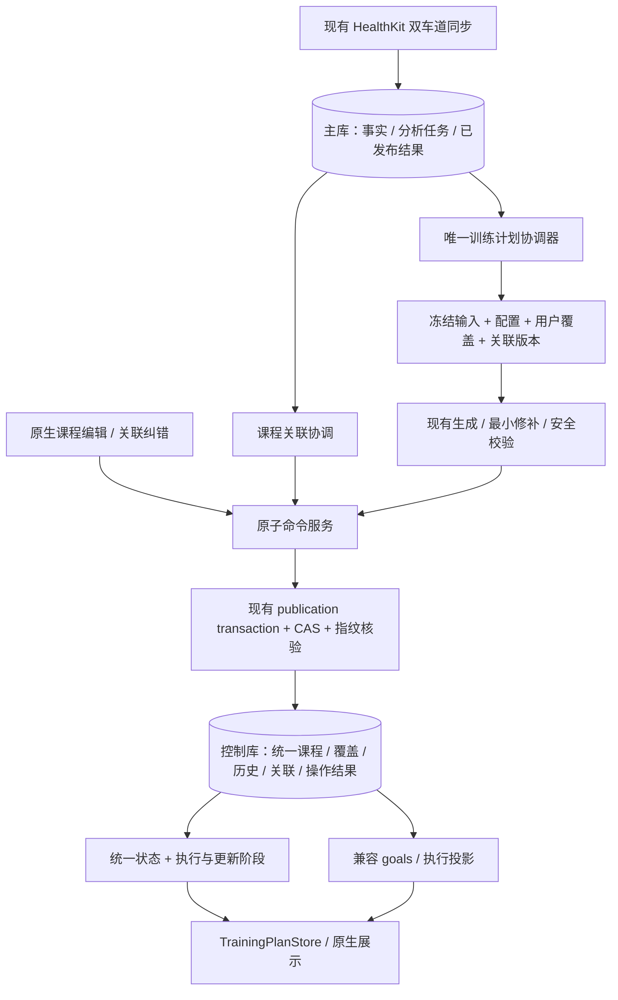

# 智能教练训练计划 V2 完整闭环实施方案

编制日期：2026-10-25（Asia/Shanghai）  
源码基线：`main` / `1b6a10b4769526b2930090e79860d2f93cc50318`  
状态：**B01 / G0、B02、B03、B04、B05、B06、B07、B08 已实现并通过本机回归；G1、G2、G3、G4 已签收。B09/B10 已完成本机可做证据，但 Linux 2C2G/systemd/SIGKILL、iPhone 真机、配对 Watch、旧构建交错与回滚演练缺失，G5/G6 阻塞；B11 需后续明确生产授权。生产未启用本方案新增写能力**。

2026-10-25 实施进展：B01（S00-01–04）已验收，精确协议见[闭环合同冻结](TRAINING_PLAN_V2_CLOSED_LOOP_CONTRACT.md)，
任务→文件→测试→验收门见[B01 记录](../deliverables/training-plan-v2-b01-2026-10-25/B01_REPORT.md)。
B01 已在 G0 停止点收口；B02（S01-01/03/05）已验收，
记录见[B02 记录](../deliverables/training-plan-v2-b02-2026-10-25/B02_REPORT.md)。本轮 B03（S01-02/04）已验收并签收 G1，
记录见[B03 记录](../deliverables/training-plan-v2-b03-2026-10-25/B03_REPORT.md)。此后 B04 已接通隔离 validation 的课程预览/提交，
B05 已接入原生编辑与持久恢复，正在完成 G2；见[B04 记录](../deliverables/training-plan-v2-b04-2026-10-25/B04_REPORT.md)
及[B05 记录](../deliverables/training-plan-v2-b05-2026-10-25/B05_REPORT.md)。B06 执行关联、B07 原生关联/回顾、
B08 事实驱动发布和 B09 故障/性能 DEV 证据分别在
[B06](../deliverables/training-plan-v2-b06-2026-10-25/B06_REPORT.md)、
[B07](../deliverables/training-plan-v2-b07-2026-10-25/B07_REPORT.md)、
[B08](../deliverables/training-plan-v2-b08-2026-10-25/B08_REPORT.md)、
[B09](../deliverables/training-plan-v2-b09-2026-10-25/B09_REPORT.md)；B10 的 Simulator/真机门与 B11 的生产阻塞见
[B10](../deliverables/training-plan-v2-b10-2026-10-25/B10_REPORT.md)、
[B11](../deliverables/training-plan-v2-b11-2026-10-25/B11_REPORT.md)。生产写仍未启用。

2026-10-25 B09 续推：新增真实子进程 SIGTERM/SIGKILL 的 COMMIT 前后恢复测试，覆盖课程改期、执行确认、
计划刷新与 no-change 评估游标，共 16 项本机 macOS 回归通过；逐表快照、原操作查询、只读重放及启动 guard 清理均已核对。
本轮完整后端回归并发 2：2729 项 / 2726 通过 / 3 Windows 专属跳过 / 0 失败；类型与相关源码/文档门禁通过。
全量检查和环境边界见 [B09 本机崩溃恢复补充](../deliverables/training-plan-v2-b09-2026-10-25/local-crash-followup/REPORT.md)。
用户确认暂无隔离 Linux 环境，G5 仍阻塞；没有执行生产迁移、部署或启用能力。

2026-10-25 后续指令：用户决定新增写能力**先不开启，等部署最新版本时再开启**。
生产模式与独立关闭路径已实现并通过本机回归（全量并发 2：2730 通过 / 3 平台跳过 / 0 失败），默认仍 `disabled`；实际服务未配置、未重启、未迁移。G5/G6 不因此签收，见 [D22](DECISIONS.md#d22-训练计划-v2-写能力准备生产模式实际启用随最新版本部署2026-10-25)。

本方案承接本次专项只读审查，用于后续按顺序开发、验证和验收。写入本文不代表修改业务代码、执行迁移、通过测试或获得生产发布授权。实施时若 HEAD 已变化，先重验受影响事实，不机械照搬旧行号和问题状态。

## 0. 阅读与执行规则

目标只有一个：**一份智能训练计划，允许用户调整具体课程；实际训练进入后，可靠更新执行反馈和未来安排，同时保留用户决定及完成历史。**

本文负责工程闭环，不重新设计训练算法。算法政策仍以 [ALGORITHM](ALGORITHM.md)、[训练政策](TRAINING_PLAN_POLICY_REVIEW.md)、[教练优化合同](COACH_LOOP_OPTIMIZATION_PLAN.md)为准；API 与设备边界见 [API 合同](IOS_NATIVE_API_CONTRACT.md)、[排期协议](IOS_NATIVE_PLAN_SCHEDULING.md)。不同文档冲突时先核对源码和已批准产品决定，不能把旧方案当成已实现事实。

执行纪律：

1. 按 V2-0 → V2-1 → V2-2 → V2-3 → V2-4 → V2-5 → V2-6 顺序推进。各批故障测试随代码完成，不留到最后补。
2. 阶段验收门是证据检查，不默认要求每个开发批次重复请求用户批准。存在尚未确定的产品语义时先列出具体分歧；生产迁移、能力启用、部署另按后续明确授权执行。
3. 每项任务状态采用 `未开始 / 进行中 / 已实现待验证 / 已验收 / 阻塞`。编制时全部未开始；实施状态以开头进展及批次记录为准，没有执行证据不得勾选验收项。
4. 每批只改本批必要文件。不得顺带清理全项目架构债、恢复退役写接口、删除历史兼容或重写同步/评分系统。
5. 先检查 Git 工作区；保留已有修改。测试使用独立 runtime、主库、控制库、epoch 和端口，禁止指向生产或用户日常健康库。
6. 当前已经存在的锁、CAS、幂等、发布 guard、任务恢复和设备 journal 必须复用；新增写路径必须纳入既有门禁与运行时测试。
7. 本文新增字段、表、路由、错误码的初稿为建议设计；B01 后以闭环合同冻结为准。协议声明不代表对应运行时已实现，在后续阶段逐批实现。

### 0.1 固定边界

| 必须保留 | 本轮不做 |
|---|---|
| SwiftUI 原生 iOS 唯一客户端、API 直连 | Web、WebView、桌面或其他移动客户端 |
| SQLite、单用户、2C2G Linux | PostgreSQL、Redis、分布式调度、服务器扩容 |
| 既有增量同步和双车道导入/分析 | 重写 HealthKit 同步；后台自动 WorkoutKit 排期 |
| 服务器评分、恢复、负荷、分区和训练模板 | 设备端 TypeScript 核心重写、新 LLM 排课 |
| HealthKit 健康记录只读，WorkoutKit 仅排期 | 写入或修改健康样本、独立 Watch 产品 |
| 历史修订、410 退役合同和旧服务器兼容 | 为新功能恢复旧 goals/run-coach/preview 写面 |
| 当前视觉皮肤、交互语言和已有功能 | UI 重设计、高成本动效、无关重构 |

## 1. 当前事实与待解决问题

### 1.1 已存在的基础，不重复开发

| 编号 | 能力及证明范围 | 源码证据（本批更新漂移行号） |
|---|---|---|
| E01 | 基线只有逐日处方；B02 增加 schema 2 稳定课程身份与独立冻结历史，旧 schema 1 保持兼容读取 | [training-plan-store.ts](../apps/api/src/training-plan-store.ts)：`apps/api/src/training-plan-store.ts:168`；[session repository](../apps/api/src/training-plan-session-repository.ts)；[DTO](../packages/api-contracts/src/index.ts)：`packages/api-contracts/src/index.ts:1399` |
| E02 | V2 投影读，execution 不授权执行 | [training-plan-routes.ts](../apps/api/src/training-plan-routes.ts)：`apps/api/src/training-plan-routes.ts:81` |
| E03 | 配置四动作、refresh；生成在事务外，CAS/指纹在提交时核验 | [training-plan-commands.ts](../apps/api/src/training-plan-commands.ts)：`apps/api/src/training-plan-commands.ts:292`、`apps/api/src/training-plan-commands.ts:401` |
| E04 | unified、goals 投影、历史、receipt、operation 同一控制库事务与 owner reconciliation | [mobile-goals.ts](../apps/api/src/mobile-goals.ts)：`apps/api/src/mobile-goals.ts:357`、`apps/api/src/mobile-goals.ts:555`、`apps/api/src/mobile-goals.ts:662` |
| E05 | 协调器 single-flight、确定性操作键；当前只检查配置/窗口 | [training-plan-coordinator.ts](../apps/api/src/training-plan-coordinator.ts)：`apps/api/src/training-plan-coordinator.ts:39` |
| E06 | 规则周计划、完整剂量、自然周预算、最小修补和执行限制 | [weekly-plan-service.ts](../apps/api/src/weekly-plan-service.ts)：`apps/api/src/weekly-plan-service.ts:107`；[runtime](../apps/api/src/coach-loop-runtime.ts)：`apps/api/src/coach-loop-runtime.ts:500`、`apps/api/src/coach-loop-runtime.ts:678` |
| E07 | 执行关联/剂量/刺激纯评价已经存在；真实适配以同日训练为主 | [data.ts](../apps/api/src/data.ts)：`apps/api/src/data.ts:396`；[执行评价](../apps/api/src/coach-execution-assessment.ts)：`apps/api/src/coach-execution-assessment.ts:90` |
| E08 | 分段匹配有 receipt、同日和邻日规则，但不能直接当可靠完成身份 | [workout-segments.ts](../apps/api/src/workout-segments.ts)：`apps/api/src/workout-segments.ts:499` |
| E09 | iOS Store 的请求代次/缓存/水位，Publisher 的原请求 journal、查询恢复 | [TrainingPlanStore.swift](../apps/ios/RAI/TrainingPlanStore.swift)：`apps/ios/RAI/TrainingPlanStore.swift:267`；[Publisher](../apps/ios/RAI/TrainingPlanPublisher.swift)：`apps/ios/RAI/TrainingPlanPublisher.swift:133`、`apps/ios/RAI/TrainingPlanPublisher.swift:165` |
| E10 | 课程编辑支持独立 validation/production 开关；当前服务保持关闭，缺少精确能力时维持只读说明 | [TechPlanView.swift](../apps/ios/RAI/Skins/Technology/TechPlanView.swift)：`apps/ios/RAI/Skins/Technology/TechPlanView.swift:391`；[server.ts](../apps/api/src/server.ts)：`apps/api/src/server.ts:2103` |
| E11 | HealthKit UUID 导出、事实/回执/分析登记原子交接、独立分析任务恢复 | [HealthKitExport.swift](../apps/ios/RAI/HealthKitExport.swift)：`apps/ios/RAI/HealthKitExport.swift:1208`；[direct-sync](../apps/api/src/direct-sync-ingest.ts)：`apps/api/src/direct-sync-ingest.ts:1233`；[任务库](../packages/storage-sqlite/src/recompute-job-repository.ts)：`packages/storage-sqlite/src/recompute-job-repository.ts:286` |
| E12 | 旧计划路由仍挂载但返回 410；coach-loop、lock、反馈、设备回执仍有效 | [server.ts](../apps/api/src/server.ts)：`apps/api/src/server.ts:2159`、`apps/api/src/server.ts:2336`、`apps/api/src/server.ts:2362`；[D20](DECISIONS.md)：`docs/DECISIONS.md:188` |

证据分类：E01–E12 的原始项为基线源码事实；B02 的身份/历史增量已在 E01 标明，B04/B05 的编辑进展已在 E10 标明，其他仅修正漂移行号。
测试文件存在只证明覆盖意图，实际执行以批次记录为准。最初只读审查没有完整测试、数据库实验、真机、Linux 容量或生产核查；
后续 B01/B02 的运行结果独立归档，不将只读审查当验收证据。

### 1.2 问题编号、优先级与关闭方式

| 问题 | 性质/严重性 | 优先级 | 关闭阶段与关键证明 |
|---|---|---|---|
| C01 未来用户课程可能被重算替换 | 条件性 Critical 风险；保护表达缺失，未证明线上已发生丢失 | P0 | V2-1/2：稳定 ID、覆盖及所有生成入口保护测试 |
| H01 逐课操作与保存合同缺失 | 已确认 High 功能缺口 | P0 | V2-2：真实 API + 原生保存/恢复 |
| H02 新训练分析后自动发布未闭合 | 已确认 High 链路缺口 | P0 | V2-4：输入变化、发布、重启补偿 |
| H03 实际训练关联不足 | High；适配链路已确认，误关联影响须动态验证 | P0 | V2-3：跨日、多候选、手动纠错、唯一性 |
| H04 完成/预约/达标语义未统一持久化 | 已确认 High 缺口 | P1 | V2-3：关联及执行评价修订 |
| H05 最近 200 修订不保证历史日期覆盖 | High 条件性风险 | P1 | V2-1/3：日期查询及 200+ 修订回归 |
| H06 迁移偏好保留但生成消费不等价 | High 来源兼容风险，须逐字段验证 | P1 | V2-1：迁移偏好适配或明确重新确认 |
| H07 新命令生产能力关闭/发布验收未完成 | 已确认发布边界，不是错误开关 | P1 | V2-6：设备、交错升级、回滚后独立启用 |
| M01 同步读取/候选搜索阻塞主线程风险 | Medium；当前 2C2G 数值未知 | P2，超预算即发布阻断 | V2-5：隔离资源测试，必要时调整计算边界 |
| M02 unified refresh 语义相同仍可增加修订 | Medium | P2，自动触发前必修 | V2-4：不同键同输入 no-change |
| M03 managed 回顾缺少有效数据接入 | Medium 用户链路缺口 | P1 | V2-3：统一课程详情/执行回顾 |
| M04 历史/过期清理索引待验证 | Medium 待测风险 | P2 | V2-5：EXPLAIN 和规模证据，按需加索引 |
| L01 文档/注释时点漂移 | Low | P3 | V2-0：只修相关口径 |

### 1.3 三种版本不要混淆

- 产品“训练计划 V2”不等于所有 HTTP contract 都必须编号 2。
- `/v1` 是 API URL 版本；`coach-loop` contract 1 仍是有效业务合同。
- 控制库 DDL schema、unified payload schema、HTTP contract、policy hash、stateRevision、goalsRevision、sessionRevision、executionRevision 各有职责。数字恰好相同不代表可互换。

## 2. 目标设计及必须保持的不变量

### 2.1 单一事实来源



该图是目标方案，不是当前已存在的完整调用图。主库与控制库继续采用 detect + retry，不能宣称跨文件原子事务。

| 不变量 | 必须满足的判据 |
|---|---|
| I01 唯一 owner | 同一 scope 只有一个当前 planInstanceId；goals 是派生投影 |
| I02 稳定课程身份 | 改期、剂量、类型、目标不改变 sessionId；日期/hash 不是主键 |
| I03 用户决定优先 | 自动重算不能静默撤销用户覆盖、取消或明确休息 |
| I04 历史可追溯 | 已执行原处方/关联不被覆盖；更正用新修订表达 |
| I05 不重复义务 | 同一课程不在新旧日期同时生效；同一实际跑步最多确认一节计划课 |
| I06 原子发布 | 计划、投影、历史、receipt、operation result 在同一控制库事务提交 |
| I07 旧结果不能覆盖 | scope、配置、覆盖、关联或事实改变后，旧候选不能提交 |
| I08 幂等与 no-change | 同键重放返回原结果；异键同语义不制造课程/历史修订 |
| I09 四阶段分离 | 事实已存、分析完成、关联完成、计划更新分别报告 |
| I10 可恢复 | 通知丢失/重启后能从持久版本差异发现未完成更新 |
| I11 缺失诚实 | 无数据不是低负荷；无关联不是完成；缺日不是休息 |
| I12 执行单独授权 | 统一意图投影不授权 WorkoutKit；安全和设备协调继续约束执行 |

### 2.2 课程内容、保护与状态

推荐在 existing unified payload 上增加课程实体，不建立独立手动计划：

| 建议字段 | 责任 |
|---|---|
| `planInstanceId` | 当前计划实例；普通滚动刷新不更换 |
| `sessionId` / `sessionRevision` | 稳定课程身份/内容版本 |
| `recommendation` | 原始算法建议，含结构及出处；不是第二份可独立执行的计划 |
| `userOverride` | 用户明确修改内容、操作与可得时间；未修改为 null |
| `protection` | `automatic` 或 `user_protected`；第一版采用整课保护 |
| `lifecycle` | 待执行、已完成、部分完成、已跳过、已取消；具体 wire 枚举在 V2-0 冻结 |
| `suppression` | 改期源日、取消或显式休息对当前计划窗口的抑制，防止原课复活 |
| `publishedInputKey` | 当前计划实际使用的输入版本组合 |
| `weekPlan` | 唯一 resolver 生成的兼容物化结果，不再拥有独立编辑权 |

仅把当前窗口、必要的未来保护及有限抑制信息保留在 unified JSON；完整历史放历史表。不得将永久训练历史、receipt 全集和任务日志塞进 payload。

第一版：每个日期最多一堂有效计划跑课；允许实际同日多跑。明确休息可作为受保护日决定，无需为每个自动空日创建虚假课程。新增课程产生新 ID；自动课替换产生明确 superseded 关系；移动课程保留原 ID。

执行、关联、保护是三个维度：

- `待执行 → 已完成/部分完成/已跳过/已取消`；已跳过必须用户明确确认，无记录不自动跳过。
- 关联采用 `未关联 / 待确认 / 已确认 / 已失效`；已失效保留历史关联与原因。
- 保护独立采用 `automatic / user_protected`；执行完成后不得因解除保护回到待执行。
- “已完成一次实际训练”不等于剂量达标和刺激达标；继续分别返回既有 dose/stimulus 评价。
- 已确认实际训练已结束，但剂量证据不足时，可展示已执行并标注剂量未知；只有明确不足证据才判部分完成。
- 源训练删除或更正时，旧历史仍成立于其当时证据；当前关联转失效/待确认，新评价修订说明变化，不伪造从未执行。

### 2.3 用户编辑与安全优先级

| 情况 | 决策 |
|---|---|
| 未开始自动课程 | 可在合法范围重排，保持可解释的身份继承/替换 |
| 用户编辑日期/距离/目标/类型 | 整课保护；普通重算保持有效用户内容 |
| 移动到空日期 | 一个原子操作移动同一 ID，并抑制源日原义务 |
| 目标日期已被占用 | 拒绝并返回冲突；不默认覆盖、合并或交换 |
| 用户取消/指定休息 | 持久抑制；重试或刷新不能复活 |
| 用户解除保护 | 明确预览影响后，重新交由自动生成；不修改完成历史 |
| 安全限制不允许执行受保护课 | 保留用户意图；有效执行层关闭授权并解释，不静默改成另一堂课 |
| 计划目标改变 | 预览列出受影响保护课；默认保留，不能隐含清空覆盖 |
| 显式新计划替换 | 新实例 ID；列出旧未来课程和覆盖的保留/释放清单后确认 |
| 周期结束 | 冻结旧实例；不把已结束 programme 的 resume 当新计划创建 |
| 暂停/结束 | 保留当前历史、覆盖及设备撤回账目；停止执行，继续既有语义 |

已有今日锁课和设备未协调排期也必须参与约束；未来编辑不能绕过撤回/重排 journal。手动缩短课程不自动套用“自动完整剂量保证”；用户增加训练仍须通过既有结构、容量和安全政策。

## 3. 数据与 API 实施合同

### 3.1 存储选择

| 方案 | 结论 |
|---|---|
| 直接改 weekPlan，没有覆盖层 | 改动小但丢失所有权，不采用 |
| 两套独立计划表、读取时二选一 | 产生竞争 owner 和复杂兼容，不采用 |
| unified 稳定课程 + 轻量覆盖 + 兼容投影 | 推荐；复用 CAS、history 和 publication transaction |

建议控制库追加下列结构；确切 DDL 以 V2-0/V2-1 评审及实施时空闲版本号为准，不预占迁移编号：

| 结构 | 最小内容与约束 | 理由 |
|---|---|---|
| 现有 `mobile_training_state.payload_json` 新版本 | 当前实例、课程、覆盖、保护、抑制、发布输入；严格解析未知版本 | 不另建当前计划 owner |
| 建议 `mobile_training_session_history` | scope、实例/课程 ID、sessionRevision、stateRevision、有效日期、可得时间、完整处方；复合主键 | 直接查询冻结课程修订，不依赖最近 200 次整计划快照 |
| 建议 `mobile_training_execution` | scope、sessionId、executionRevision、关联状态、trainingSessionId、处方修订、事实摘要、评价 | 小型当前关联/执行视图 |
| 建议 `mobile_training_execution_history` | scope、sessionId、executionRevision、原因、旧新关联与评价、可得时间 | 手动纠错、事实更正和重算审计 |
| 建议 `mobile_training_plan_evaluation`（V2-4 再加） | 每个scope一行：最近已评估inputKey、绑定stateRevision、业务日、policy hash、有效执行摘要和operationId | no-change也须推进持久评估水位，避免反复评估；这是游标，不是新任务队列 |

约束与索引：

1. 课程历史以 `(scope, planInstanceId, sessionId, sessionRevision)` 唯一；为课程时间查询建立匹配索引。
2. 当前执行表以 `(scope, sessionId)` 唯一；已确认关联对 `(scope, trainingSessionId)` 建部分唯一约束，空/待确认不占用该唯一键。
3. 同日课程占位在唯一 resolver 和同一个 CAS 事务内校验；JSON 内约束必须有运行时并发测试，不能假称数据库已有逐日唯一索引。
4. 不创建指向主库的跨文件外键；训练存在性和事实版本由一致快照、摘要与提交前核验保证。
5. 若现有 history 的索引/JSON 查询已可稳定满足 H05，应以测量说明是否能减少新增历史表；不能以继续读取最近 200 修订替代。
6. 主库计划表、评分表、分析任务类型及原始导入表本轮原则上无 DDL 变更；确需变化必须先说明不能复用的原因。

### 3.2 迁移与兼容

- 控制库 DDL 迁移只追加新版本，不修改历史 checksum；数据迁移与 DDL 区分。
- 先部署识别旧/新 payload 的读取能力，再启用新写；未知未来版本 fail-closed。
- 旧课程 ID 在首次受控迁移时生成并持久化，重复 apply 不重建。不能每次 GET 根据当前日期或处方 hash 重新生成。
- 对旧来源不明处方保留内容；冻结迁移批次的身份映射和默认保护政策。重复日期/来源冲突显式拒绝并给报告，不猜测丢弃。
- 兼容 goals/history/receipt 不原地重写；新投影继续在 publication transaction 同步。
- 迁移/查询/JSON 归一化代码必须全部更新；B02 保留旧 `collectWeekPlan` 的 schema 1 兼容分支，schema 2 使用显式严格解析，拒绝未知字段和降级，不只扩 interface。
- 数据迁移不能由 GET、App 首次加载或普通同步隐式执行；CLI apply 沿用控制库 publication lock 和维护窗口。
- 停用新写不删除覆盖/关联；回滚二进制必须能读新 schema。已生成新数据后不能直接退回不识别该格式的旧版本。

### 3.3 建议 API 形状

保留原四配置动作与 refresh。推荐增加独立的原子课程操作合同，以下为**拟新增**，尚未存在：

| 拟定路由/能力 | 用途 |
|---|---|
| `POST /v1/mobile/training-plan/session-commands/preview` | 课程编辑、新增、取消、解除保护的精确候选预览 |
| `POST /v1/mobile/training-plan/session-commands` | 提交该候选；复用 plan operation 查询/恢复 |
| `POST /v1/mobile/training-plan/execution-commands` | 确认/撤销/纠正关联、明确跳过 |
| 统一读的可协商扩展 | 返回 sessionId、覆盖、执行关联、发布阶段；旧 contract 1 字节与语义保持 |

读合同采用“现有 V2 上可选扩展 + 新精确能力位”的最小兼容方向；若验证旧消费者不能安全忽略扩展，改用显式新 wire contract，不能静默改变既有必填语义。新增能力名/版本和请求头在 V2-0 与 TS/Swift/handshake registry 一起冻结，未知/缺失一律关闭新增写。

新命令必须携带 operationId、operationScope、expectedStateRevision、planInstanceId；课程操作还带 sessionId/sessionRevision，关联操作带 executionRevision 和源事实摘要。preview 绑定精确草稿、候选版本、影响清单和 TTL；submit 只提交同一候选。

编辑支持 `move / edit / add / cancel / set_rest / unlock`；强度和配速落在已有结构目标中，距离与结构必须一致，禁止只改显示值。patch 的未提供、null、明确清除语义必须区分；服务端使用既有整米/整秒和目标范围规范。

新错误语义至少包含：版本/scope 不匹配、陈旧 revision、候选过期、日期占用、已完成课程禁止编辑、课程不存在、源训练已变化、关联冲突、安全限制不允许该请求、存储/恢复不可用。确切 code 在 V2-0 冻结；旧错误码不能借新功能改变含义。

### 3.4 发布顺序与并发协议

1. 持久 operationId 查询必须早于 TTL、当前 revision、能力门和昂贵生成；同键异摘要拒绝，过期操作不重执行。
2. 冻结 scope、业务日期、配置摘要、覆盖版本、执行关联版本、事实/分析发布身份；候选计算不持控制库写事务。
3. 通过现有准入/短写许可进入提交；重新核验输入及 CAS，在事务内再检查幂等。
4. 同一控制库事务写课程、兼容投影、必要课程历史、receipt、operation result、发布输入身份。任何写点失败全部回滚。
5. 关联可独立成功，计划调整可以待处理；这是明确的两阶段业务状态。组合提交时也必须遵守同库原子性，不能把“关联成功”写成“计划已更新”。
6. 发生源事实变化/配置/覆盖/关联变化，丢弃旧候选；不自动提高 expected revision 来强行提交。
7. no-change 比较内容、执行许可、决策引用及保护/关联语义；执行授权变化不能因处方字节相同被吞掉。
8. 同一业务操作重复查询不改 guard/版本；不同键同内容保存幂等结果和评估游标，但不追加课程或计划内容历史。
9. 内容变化时同事务推进unified的publishedInputKey和评估游标；输入变化但内容/授权不变时，仅推进评估游标及operation result，绑定当前stateRevision，不伪造内容修订。二者任一失败整笔回滚。

### 3.5 分析后协调与恢复

推荐输入键由 scope、业务日期、相关训练事实身份、已发布分析身份、配置/偏好摘要、用户覆盖摘要、执行关联摘要和 policy hash 组成。**不包含当前墙钟、评估时间、输出自身 goalsRevision/stateRevision**，避免永远变化的刷新循环。

`data_version`/inode 用于生成前后并发防线，不直接当长期业务输入键；无关 record-only 导入不能无条件引发整份计划重算。输入身份必须证明分析覆盖了当前相关事实代次；失败/待分析时保留旧发布并标注待更新。

流程：已有分析任务发布 → 关联协调更新受影响课程 → 计划协调器比较desired input与已绑定当前状态/政策的持久评估游标 → 候选生成 → CAS/指纹提交。没有兼容评估游标时，以unified的publishedInputKey作为旧数据起点。关联先独立提交时，计划生成必须捕获其新版本；提交失败后不能误报一体成功。

publishedInputKey记录“这份内容由哪份输入产生”，评估游标记录“最新哪份输入已检查过且无需/已经改变内容”。用户编辑使stateRevision变化后，旧游标不能继续判定当前；输入变化但no-change后，重启也不重复搜索。同语义输入、事实变了内容没变、执行许可变了内容没变三种情况分别测试。

分析完成通知只是加速；启动和有界周期巡检比较持久输入差异，保证通知丢失也能恢复。优先复用现有 scheduler，不扩展已有 recompute job 状态/类型枚举作为捷径，不引入新常驻队列基础设施。瞬态失败有上限退避，政策不兼容/损坏 owner 保持显式阻塞状态；启动后仍能看见未应用输入。

## 4. 分阶段执行总表

| 阶段 | 主要交付 | 前置门 | 本阶段验收门 | 默认拆批 |
|---|---|---|---|---|
| V2-0 | 当前基线、产品/合同冻结、夹具 | 无 | G0 | B01 |
| V2-1 | 稳定课程、用户保护、迁移、历史和偏好适配 | G0 | G1 | B02–B03 |
| V2-2 | 原子编辑 API + 原生编辑/恢复 | G1 | G2 | B04–B05 |
| V2-3 | 可靠关联/纠错/完成回顾 | G2 | G3 | B06–B07 |
| V2-4 | 分析后自动发布、no-change、恢复补偿 | G3 | G4 | B08 |
| V2-5 | Linux 一致性/故障/2C2G 资源 | G4 | G5 | B09 |
| V2-6 | 真机全链路、兼容/回滚、受控发布 | G5 | G6（研发）/G7（发布） | B10–B11 |

G0–G6 通过只证明各自研发层级；G7 才包含生产迁移/启用。前一阶段已具备的功能只做回归，不重新实现。

## 5. V2-0：现状基线与合同冻结（B01）

### 5.1 阶段约束

| 项目 | 内容 |
|---|---|
| 目标/关联问题 | 明确实现边界，处理 L01/H07，确定 C01/H01/H03 的可测试语义 |
| 入口条件 | 当前工作区/HEAD 已记录，未覆盖用户修改 |
| 现有文件 | `docs/DECISIONS.md`、`docs/IOS_NATIVE_API_CONTRACT.md`、`docs/RUN_COACH.md`、`packages/api-contracts/src/index.ts`、`apps/api/src/schemas.ts`、`apps/ios/RAI/APIModels.swift` |
| 可能新增 | 合同 fixtures/测试；有需要才新增独立 contracts 源文件并从现有入口导出 |
| API 变更 | 冻结新增能力、wire、动作、错误和兼容矩阵；先不开放行为 |
| SQLite 变更 | 仅形成逐字段迁移设计、约束和恢复验证；本批不跑生产迁移 |
| iOS 变更 | 本批不开放编辑；冻结旧服务/新服务/未知能力行为 |
| 算法依赖 | 使用现有政策，列出接受 policy hash 的现有路径 |
| 风险/回滚 | 避免把旧方案缺陷当当前缺陷；基线失败先定位，不恢复退役接口 |
| 后续依赖 | G0 后允许 V2-1，禁止提前开启新增写 |

### 5.2 任务与验收

| ID/问题 | 修改位置 → 实施动作 | 测试/证据 | 验收标准 |
|---|---|---|---|
| S00-01 / 全部 | `server.ts`、Store、Runtime、Swift transport → 复核全部写者/读者与能力矩阵，只记录与本方案有关的差异 | 当前 SHA、工作区、真实 route 对照；已有定向测试和全量基线 | 每条可达入口有 owner、scope、事务、能力和重放说明 |
| S00-02 / C01/H01/H04 | contracts、API 合同、DECISIONS → 冻结课程状态、保护、同日一课、改期源日、取消、人工关联和替换规则 | TS/Swift fixtures；具体正反例 | 无“以后再决定”的 P0 语义；旧 D20 只读阶段边界明确演进 |
| S00-03 / H03/H07 | contracts、handshake registry、Swift 能力判断 → 冻结精确能力与未知版本策略 | transport 断言 method/path/body，不只断言按钮 | 新合同不放行旧 URL；生产/validation/未知组合各有明确结果 |
| S00-04 / L01 | 相关现行 docs/注释 → 修正手动入口、GET 与发布的描述，记录验证命令与环境 | 文档门禁；原始测试日志 | 文档不称生产已启用，不把历史通过当当前结果 |

### 5.3 G0 检查表

- [x] 课程 ID、实例替换、状态/保护、API/error/capability、迁移语义已冻结。
- [x] 明确旧午夜依从性合同与执行处方修订的差别：依从性维持现有政策；实际课程关联使用执行前生效的处方/授权，不能取事后最新课表。
- [x] 确认用户修改目标配速/强度如何映射已有步骤结构，单位与清除语义一致。
- [x] 合成 fixture 覆盖 unmanaged、managed、legacy runCoach、paused、ended、空数据、未知来源及同日多跑。
- [x] 当前完整测试结果、并发、跳过项与可用平台已记录；未具备 Linux/真机时明确标未执行。

G0 证据：2026-10-25 [B01 记录](../deliverables/training-plan-v2-b01-2026-10-25/B01_REPORT.md)。
后端并发 2：2623 通过 / 3 跳过 / 0 失败；新增合同与真实 API 定向 13/13 通过；
iOS 聚合重跑及文档/源码门禁通过。此门不代签 G1–G7，不代表新存储/编辑/关联行为已实现。

## 6. V2-1：课程身份、修改保护和兼容数据（B02–B03）

### 6.1 阶段约束

| 项目 | 内容 |
|---|---|
| 目标/当前问题 | C01/H05/H06；现有日期列表不能承载稳定编辑与执行身份 |
| 入口条件 | G0 通过，冻结的旧 payload 与新 payload fixture 可用 |
| 现有文件 | `training-plan-store.ts`、`mobile-goals.ts`、`training-plan-generation.ts`、`training-plan-ownership.ts`、`weekly-plan-service.ts`、`coach-loop-runtime.ts`、`scripts/migrate-training-planner.mts`、TS/Swift DTO |
| 可能新增 | `training-plan-session-policy.ts`、`training-plan-session-repository.ts`、迁移及保护测试 |
| API 变更 | 受能力协商的课程身份/保护只读扩展；旧 wire 保持 |
| SQLite 变更 | 控制库新 DDL/payload 版本、课程历史索引、受控数据升级 |
| iOS 变更 | 解码/缓存兼容和只读保护展示；本批不开放编辑 |
| 算法依赖 | 各生成路径共同消费 resolver/保护集合，复用既有 final validator |
| 风险/回滚 | 严格解析会丢弃未知字段；迁移 ID 可能漂移；旧二进制可能不识别新格式；先兼容读后写，保留升级前一致性备份 |
| 后续依赖 | G1 后才可做课程写入和执行关联 |

### 6.2 任务与验收

| ID/问题 | 修改位置 → 实施动作 | 测试 | 验收标准 |
|---|---|---|---|
| S01-01 / C01 | contracts + store + Swift DTO → 引入实例/课程/内容版本，逐层补解析、归一化、序列化、历史及缓存 | 旧新 payload 往返、未知版本、字段完整性、同日期不同历史课程 | 变更日期/类型不变 ID；重读/重启不重建 ID |
| S01-02 / C01 | session-policy + weekly-plan-service + runtime → 唯一 resolver、整课保护、源日抑制、取消 tombstone、占位验证 | 批量重算、跨周、今日锁、未来保护、窗口外保留、取消后重试 | 保护内容逐字段一致；算法预算先计入保留课程；无复活/双占 |
| S01-03 / H05 | session repository + mobile-goals history 读取 → 增加按课程/时间查询冻结版本 | 201/1000 次修订后查询 28 天内及更早完成课；跨午夜与同日首建 | 历史结果不依赖最后 200 条；无需整库/整历史 JSON 扫描 |
| S01-04 / H06 | server generation 装配 + ownership → 逐项适配迁移 runningDays、longRunDays、targetType、生命周期等有效偏好 | 同一来源迁移前后可用日/目标/阶段对照，未知偏好拒绝或要求确认 | “保留证据”与“实际消费”分别有断言；不默认 7 天可跑覆盖旧偏好 |
| S01-05 / C01/H05 | migrate CLI + schema → 旧课 ID 映射、来源未知保守规则、历史补建、失败原子回滚 | dry-run 不写、重复 apply、source digest/CAS 冲突、异常 payload、锁冲突 | 新旧读取等价，重复迁移零变化，失败无半份映射 |

### 6.3 G1 检查表

B02（S01-01/03/05）与 B03（S01-02/04）已验收，G1 已签收；记录见[B02 记录](../deliverables/training-plan-v2-b02-2026-10-25/B02_REPORT.md)
及[B03 记录](../deliverables/training-plan-v2-b03-2026-10-25/B03_REPORT.md)。
2026-10-25：并发 2 完整后端 2654 tests / 2651 通过 / 3 跳过 / 0 失败，iOS 聚合、API smoke、门禁与 1006 文件源码冻结通过。
B03 证明唯一 resolver 的整课保护/源日抑制/预算优先、受控自动课替换与归档、迁移偏好实际消费，以及 schema 2 下 refresh/submit/managed coach-loop 的同一写路径。
pre-unified 无 scope 历史仍不猜测归属，H05 尚未整体关闭；C01/H06 只按本门关闭生成侧，编辑与关联仍待后续门。

- [x] 所有运行期生成入口都使用同一保护解析，无遗漏的 legacy 内部自动路径。
- [x] managed/unmanaged、锁课、反馈、配置和 refresh 都不能绕开新 owner。
- [x] 用户覆盖即使没有 UI，也能通过隔离 fixture 证明重算保留。
- [x] JSON 字段不会在旧 normalize/measure/copy 过程中静默丢失。
- [x] 旧计划、旧 receipt、已结束 programme 和未知 schema 的读取/拒绝符合合同。
- [x] 迁移、持久化、保护、历史长修订回归通过；新编辑能力仍关闭。

## 7. V2-2：原子课程编辑和原生操作（B04–B05）

### 7.1 阶段约束

| 项目 | 内容 |
|---|---|
| 目标/当前问题 | H01/C01；已有四动作和 refresh 不能表达课程编辑 |
| 入口条件 | G1；保护/迁移已验证，API/Swift 能力矩阵已冻结 |
| 现有文件 | `training-plan-routes.ts`、`training-plan-commands.ts`、`schemas.ts`、`mobile-goals.ts`、`APIClient.swift`、`TrainingPlanPublisher.swift`、`TrainingPlanStore.swift`、`NativeAppModel.swift`、`TechPlanView.swift`、`TechCoachDaySheet.swift` |
| 可能新增 | `training-plan-session-commands.ts`、`TechTrainingSessionEditor.swift`、TS/Swift fixtures/回归 |
| API 变更 | §3.3 的 session preview/submit，复用 operation query；保留配置命令原义 |
| SQLite 变更 | 复用 V2-1 payload/history 和 operation transaction；本批原则上无额外 DDL |
| iOS 变更 | 现有皮肤的原生编辑 Sheet、明确预览/保存/冲突/待确认；不新增并列计划页 |
| 算法依赖 | 原有结构、周预算、赛前/恢复和剂量限制；人工课不伪称自动完整剂量 |
| 风险/回滚 | 关闭编辑能力后保留读/覆盖/操作查询；未确认请求保留 journal，不能生成新 UUID 再试 |
| 后续依赖 | G2 后接完整执行关联；没有 G2 不启用事实驱动自动发布 |

### 7.2 任务与验收

| ID/问题 | 修改位置 → 实施动作 | 测试 | 验收标准 |
|---|---|---|---|
| S02-01 / H01 | session commands + schemas → move/edit/add/cancel/set_rest/unlock，严格字段与单位校验 | 每个动作合法/非法、清空/未提供、距离与结构冲突、已完成课拒绝 | 返回精确有效结果；显示距离和真实结构一致 |
| S02-02 / C01 | preview/submit + publication → 候选绑定草稿/版本/TTL，源日与目标日原子占位 | 同日碰撞、跨周、连续移动、取消新增、同 revision 并发、每个写点故障 | 不丢原课、不留半移动；同键重放原结果 |
| S02-03 / H01/H07 | APIClient/Publisher/cache → 增加新 route 类型、原请求持久化、水位、查询/恢复/终局清账 | 真实 method/path/body、断响应、404 非 notFound、410、过期、scope 更换、落盘失败 | 新写零调用退役 URL；未知提交只查/重放原字节 |
| S02-04 / H01 | TechPlanView/day sheet/editor + Model → 可编辑字段、预览差异、确认、冲突重读、保存回执与最终重读分开 | 原生表单/大字体、草稿变更/关闭/迟到回包、网络失败、页面重进 | 关闭页面不丢提交账目；保存后用户看见有效版本及保护 |
| S02-05 / C01 | Store/Model/设备协调 → 取消旧在途读；有已排期内容时保留撤回风险，不能伪称设备已更新 | 编辑与 GET/同步交错、系统排期冲突、重启/重装恢复 | 旧响应不盖新写；服务端改课不自动调用 WorkoutKit |

训练新增/加量等需要新事实的动作遵守现有事实就绪门；暂停、取消等撤销执行动作可采用明确的 metadata-only 路径。不能因导入忙而失去必要的停止执行能力，也不能借此放行未经评估的新增训练。

### 7.3 G2 检查表

2026-10-25：B04/S02-01–02 已实现，定向 API/安全/SQLite/跨进程回归通过；B05/S02-03–05 已实现，
实际 Simulator 点击发现首次弹窗取空选择的问题，已改为单一带身份的 Sheet 目标，正在复跑。
G2 尚未签收；完整回归、最终原生与平台证据以 [B04](../deliverables/training-plan-v2-b04-2026-10-25/B04_REPORT.md)
和 [B05](../deliverables/training-plan-v2-b05-2026-10-25/B05_REPORT.md) 的收口记录为准，不把中间失败/中止当成功。

2026-10-25：G2 已签收。B05 普通字号与 Accessibility XXXL 两轮真实点击链均 1/1 通过，
iOS 聚合与 B04 后端全量回归（并发 2：2676 项 / 2673 通过 / 3 跳过 / 0 失败）通过；
证据见 [B05 记录](../deliverables/training-plan-v2-b05-2026-10-25/B05_REPORT.md)。

- [x] 日期、距离、目标配速、类型/强度、休息、取消、新增、解除保护均有真实 API 验证。
- [x] 周三 8km → 周四 10km → 多次重算：同 ID、内容保留、周三不复活。
- [x] 同日碰撞不写；同键重复、异键陈旧提交、写点故障均符合合同。
- [x] App 重启与清空客户端后重读都能恢复服务器上的有效覆盖。
- [x] iOS journal 失败、服务端已保存但重读失败分别准确提示，不误报整个操作失败。
- [x] 现有 skin、今日锁、反馈、手表撤回和旧服务器兼容不回归。

## 8. V2-3：训练关联、执行状态与纠错（B06–B07）

### 8.1 阶段约束

| 项目 | 内容 |
|---|---|
| 目标/当前问题 | H03/H04/H05/M03；同日观测、预约完成、可靠关联和达标不能混用 |
| 入口条件 | G2；课程 ID/冻结处方稳定，用户保护可持久恢复 |
| 现有文件 | `data.ts`、`coach-execution-assessment.ts`、`workout-segments.ts`、`coach-loop-facts.ts`、`coach-loop-runtime.ts`、`coach-loop-routes.ts`、`mobile-goals.ts`、`training-plan-store.ts`、Swift API/Store/详情 |
| 可能新增 | `training-plan-execution-repository.ts`、`training-plan-execution-commands.ts`、真实适配/纠错测试 |
| API 变更 | 候选/确认/撤销/纠正、明确跳过、关联/评价版本及源事实摘要 |
| SQLite 变更 | 控制库当前执行关联及历史表，scope 唯一约束、课程历史引用 |
| iOS 变更 | 同一课程详情展示实际记录、候选确认、纠错、部分完成/未知；修复 managed 回顾 |
| 算法依赖 | 复用 assessWorkoutExecution；身份确认不能伪造实测步骤和刺激证据 |
| 风险/回滚 | 误关联比不关联更危险；停自动确认仍保留人工关联、已保存历史和纠错 |
| 后续依赖 | G3 后自动调整才可以消费稳定执行反馈 |

### 8.2 匹配政策

1. 优先复用真实可验证的课程/设备关联。当前 receipt 的 `workoutID` 是排期对象身份，不能未经验证当作 HealthKit 实际 workout UUID。
2. 其次用执行前处方、实际起止时间、类型、距离/时长、有效期等形成候选；日期相同只用于筛选。
3. 候选不足以唯一证明时保持待确认。第一版无需引入概率匹配模型；用户确认是合法闭环出口。
4. 同日多跑不自动合并；一跑多课候选不重复计完成；一次跑步确认后另一次不能抢占，纠错须显式撤销/替换。
5. 提前/延迟跨日跑步在冻结的候选日期窗口内查询，并允许用户扩大查询人工选择；默认窗口在 V2-0 固定，测试边界，禁止扫描全历史猜测。
6. 缺原始步骤、原始信号时，剂量/刺激按现有规则返回 unknown/not_assessable；不能用计划重建的段落反过来证明执行了计划。
7. 任意实际跑步可以阻止当天再自动追加，但不能因此把一堂系统追加课记成已完成；预算替代、追加次数与完成身份分别核算。
8. 更正/删除/训练 session 合并或 canonical 身份变化后重新核验；不能仅凭旧 id 仍可解析就认为关联有效。

### 8.3 任务与验收

| ID/问题 | 修改位置 → 实施动作 | 测试 | 验收标准 |
|---|---|---|---|
| S03-01 / H03/H04 | execution repository/schema → 当前关联+历史、执行前处方引用、唯一约束和 CAS | 同一实际跑步并发确认两课、重放、故障回滚、撤销重关联 | 一跑最多确认一课；旧修订可追溯 |
| S03-02 / H03 | data/matcher → 真实候选装配，跨日和多候选保留歧义；移除“传一个同日候选即证明身份”的推理 | 早跑/晚跑、同日两跑、仅 summary、同结构两课、设备身份不对应 | 不能证明就待确认，不凭日期达成可靠关联 |
| S03-03 / H04 | runtime/reservation/assessment → 分开观测、关联、剂量、刺激、预约占用和追加完成次数 | 自主跑释放占用但不冒充追加完成、partial、unknown、无数据 | 四种结论互不替代；不创造漏练债务 |
| S03-04 / H03/H05 | execution commands + source validation → 人工确认/纠错/撤回；源变更使当前关联失效并追加修订 | 迟到、删除、纠正、session 合并、关联后重算、200+ history | 原完成历史不抹除，当前新证据可纠正 |
| S03-05 / M03 | Swift DTO/Store/详情/review → 课程计划与实际对照、待确认入口、managed 数据接入 | API 集成、Model/Store、Simulator 点击链 | 用户可从计划找到真实跑步，也可看见未知/不足和纠错结果 |

### 8.4 G3 检查表

2026-10-25：G3 已签收。B06（S03-01–04）通过定向与真实 HTTP 回归；B07 Simulator `testExecutionConfirmRetract`
1/1 通过（合成 run→候选→确认 completed/confirmed→撤回 pending/invalidated）；B09 故障/唯一性/EXPLAIN 证据补充。
执行关联只确认身份，不自动调用 WorkoutKit；剂量/刺激/关联状态分开返回。


- [x] 正常、提前、延后、同日多跑、一跑多候选均得到确定的关联/待确认结果；候选测试覆盖 ±2 天窗口、跨午夜、同日两跑与 31 天扩大范围。
- [x] 手动确认/撤回/纠正重启后保持一致，唯一约束和 CAS 实际执行；B06 定向 + B09 两进程竞争/回滚证据通过。
- [x] 8km 计划与 8.2km 实际以真实字段对比，不从计划填实际值；`training-plan-execution-commands.test.ts` 断言 8.2km 对应 8km 课程剂量。
- [x] partial 与刺激未知有正确 UI，不把全部非 confirmed 情况当未完成；B07 Simulator 截图显示“无法评估（证据不足，不是未完成）”。
- [x] 重复同步不追加关联；删除/更正不丢旧历史，更新当前有效评价；reconcile 用例与 B09 重放证据通过。
- [x] 用户完成并关联的课程在计划刷新、跨日和长修订历史后仍可回溯；B02 索引历史 + B09 1,500 修订 EXPLAIN 证据。

## 9. V2-4：事实反馈后的自适应发布（B08）

### 9.1 阶段约束

| 项目 | 内容 |
|---|---|
| 目标/当前问题 | H02/M02；GET 算候选不等于计划持久更新，现协调器不以事实变化触发 |
| 入口条件 | G3；全部保护/关联语义和故障测试通过 |
| 现有文件 | `training-plan-coordinator.ts`、`training-plan-generation.ts`、`training-plan-commands.ts`、`coach-loop-runtime.ts`、`coach-plan-repair.ts`、`server.ts`、`recompute-worker.ts`、Swift 状态消费 |
| 可能新增 | `training-plan-input-identity.ts`、分析→关联→发布的交错故障测试 |
| API 变更 | 暴露分阶段状态、已应用输入键/计划水位和失败原因；GET 不写 |
| SQLite 变更 | unified发布输入键，追加每scope一行的评估游标；复用既有operation/history，不新增任务队列 |
| iOS 变更 | 四阶段文案和有界刷新；不以同步成功提示计划已更新 |
| 算法依赖 | 复用 template/repair/负荷/恢复，不扩展既有政策授权范围 |
| 风险/回滚 | 反馈循环、重复任务、旧输入覆盖；独立关闭自动触发，保留显式刷新与有效安全限制 |
| 后续依赖 | G4 后进入 Linux 资源/故障签收；未通过前不生产自动运行 |

### 9.2 任务与验收

| ID/问题 | 修改位置 → 实施动作 | 测试 | 验收标准 |
|---|---|---|---|
| S04-01 / H02 | input identity + coordinator → desired/published 输入键、生成时快照，排除输出修订和墙钟 | 同事实不同时间、无关 record-only、反馈/分区/负荷/关联变化 | 相关变更触发，无关变更不反复整计划生成 |
| S04-02 / H02 | recompute worker/server → 分析发布完成通知、启动/周期补偿、单飞/有界退避 | 通知漏发、启动时待处理、分析失败/重排、连续批次 | 仅已就绪事实参与新发布，失败可观察；无内存通知依赖 |
| S04-03 / M02 | command/runtime publication → 内容/授权语义no-change、持久评估游标、确定性operation key、CAS再验证 | 同键/异键同输入、输入变化但内容不变后重启、授权变化但结构相同、旧生成晚完成 | 无变化不增内容修订且不重复评估；许可变化必须发布；旧结果拒绝 |
| S04-04 / C01/H02 | repair 输入闭包 → 只改受影响未来自动课，保留用户保护/完成课/设备风险 | 高负荷、低恢复、中断、迟到、更正、窗口外保留、保护课占满预算 | 无补课债、无重复、保护优先；无法安全满足时解释限制 |
| S04-05 / H02 | generation/commit/读状态 → 分析成功但计划失败的持久差异恢复 | 读后/生成后/提交前/提交后回复前 kill，重启再巡检 | 不要求重传健康数据；能最终应用同一最新输入或明确阻塞原因 |

### 9.3 重算范围

| 输入变化 | 最小影响范围 |
|---|---|
| 新跑步、迟到/修正训练 | 关联课程、其自然周及现有滚动预算依赖闭包中的未来自动课 |
| 今日恢复/休息请求 | 今日执行许可与必要未来约束闭包；不重写过去处方 |
| 可跑步日、可用时长变化 | 受影响日期的未来自动课；用户保护课保留意图并给冲突 |
| 目标/阶段变化 | 当前实例未来窗口，保护课在预览中处理；不偷偷替换实例 |
| 主库 epoch 或恢复变化 | 旧候选/缓存失效；旧 scope 不重放，按迁移/恢复合同处理 |
| 无语义变化 | no-change，零课程/计划内容历史写入 |

保持 D20“缺日不等于休息”的约束。新增滚动补齐必须以覆盖范围/输入版本为判据并有无进展停止条件；不能把 `.some` 简单改成 `.every` 后形成无限刷新。因安全原因只能产出部分窗口时，持久记录本次已评估范围与原因，下一 tick 不因相同缺口重跑。

### 9.4 G4 检查表

2026-10-25：G4 已签收（研发门）。B08（S04-01–05）输入身份、评估游标、refresh no-change、更新读四阶段、
60 秒/启动巡检、分析完成加速与有界退避均有定向/真实 HTTP 测试；真实服务“确认关联→72s 自动收敛”通过。
自动发布只在 `RAI_TRAINING_PLAN_AUTO_PUBLISH_MODE=validation` 下运行，生产启用仍待 G6/G7。


- [x] 新实际训练→分析→关联→未来计划更新无需用户重复生成才能收敛；B08 真实服务 72s 自动收敛用例通过。
- [x] 同输入连续运行不增加课程、内容历史和追加次数；GET 始终零写；B08 HTTP 与命令 no-change 用例通过。
- [x] 发布失败/通知丢失/重启都由持久输入差异恢复；B09 cursor/COMMIT 故障回滚、启动/60s 巡检与有界退避通过。
- [x] 编辑、关联纠错与后台生成全部提交次序下无覆盖丢失；B08 输入键包含用户覆盖/执行摘要，B09 写点回滚通过。
- [x] 已完成课程和用户保护课逐字段保持，安全限制通过执行层表达；B03 保护 resolver 与 B08 输入键覆盖。
- [x] 迟到事实只能影响相应评价与未来自动课，不改变已完成训练的原始事实；事实摘要变化只触发执行失效/重评与未来计划评估。

## 10. V2-5：一致性、异常恢复和资源（B09）

### 10.1 阶段约束

| 项目 | 内容 |
|---|---|
| 目标/当前问题 | M01/M04 与全部 P0/P1 故障场景，验证 2C2G 可运行 |
| 入口条件 | G4；隔离 Linux runtime、合成/授权数据、固定代码和预算可用 |
| 现有文件 | `data.ts`、`mobile-goals.ts`、`coach-loop-runtime.ts`、`coach-plan-repair.ts`、read-store/准入/发布原语与相关测试；按实测决定改动 |
| 可能新增 | 计划负载 fixtures、故障 driver、Linux 集成用例；优先复用现有 phase6 工具 |
| API 变更 | 原则上无；需要可靠取消/超预算错误时先定义合同并保持读写区分 |
| SQLite 变更 | 仅 EXPLAIN/配对测量证明必要的索引；不随意改 WAL/同步级别 |
| iOS 变更 | 仅纠正重复请求和响应消费；不添加高频全页轮询 |
| 算法依赖 | 优化前后处方和授权语义等价；不减少安全检查来换性能 |
| 风险/回滚 | 大库、文件锁、事件循环、长读事务；优化逐项可退回，功能与数据仍可读取 |
| 后续依赖 | G5 是真机/发布阶段的前置门，Linux 缺失不得记已验收 |

### 10.2 任务与验收

| ID/问题 | 修改位置 → 实施动作 | 测试 | 验收标准 |
|---|---|---|---|
| S05-01 / 全部一致性 | publication/事务测试 → 覆盖每个新 SQL 写点、COMMIT 前后及进程退出 | 触发器抛错、SQLITE_BUSY、SIGTERM/SIGKILL、重启查询原操作 | 所有业务行原子；无幽灵完成、半移动、孤儿当前计划 |
| S05-02 / M01 | data/runtime → 测 SQL、JSON、信号/分段、候选 CPU 及事件循环 | 空/典型/大规模、冷/热、编辑+同步+分析交错 | 基线与新增成本分开；未超预算不扩大重构 |
| S05-03 / M04 | history/expiry/关联查询 → EXPLAIN，按需匹配索引和读取边界 | 多年历史、1000+ 修订、关联增长、写放大配对 | 关键查询不全表反复扫描；索引收益有证据 |
| S05-04 / M01 | 必要时复用 Worker/准入 → 将纯候选计算移出主线程，冻结输入、提交复核 | 计算超时/取消、旧结果、worker 退出与恢复 | 主线程可响应，原语义等价；没有新的并发写者 |
| S05-05 / H07 | Linux 隔离服务 → 锁路径、WAL/文件替换、信号、启动恢复和资源限制验证 | 与 macOS 同 fixture 对照、真实 systemd 测试环境 | 两端结果等价；Linux 特有语义有独立证据 |

### 10.3 资源基线与待验证目标

现有 [snapshot latency 测试](../apps/api/test/plan-snapshot-latency.test.ts)含空库及约 43k 行近似库，测试预算不等于当前 coach-loop 在目标云机的实测。现有 [阶段 6 容量材料](../deliverables/phase6-performance-2026-10-24/PHASE6_REPORT.md)可复用工具和已登记的限制，不沿用不同源码身份的历史 PASS。

在测量前只登记以下**待验证目标**，G0/B09 开始时按真实基线冻结；不能写为已达成：

| 维度 | 建议初始目标 | 判定与超标动作 |
|---|---|---|
| 正确性 | 用户覆盖丢失/重复义务/错误跨域提交为 0 | 任一发生均阻断，不能用平均值掩盖 |
| 控制库写事务 | 不含候选搜索和主库大扫描；报告 P50/P95/max | 超预算先定位 SQL/JSON/持锁范围 |
| 主线程计算片段 | 尽量 ≤100ms | 若无法满足，按 S05-04 复用 Worker，重新差分 |
| 负载时健康检查 | P95 ≤250ms | 排除网络并记录服务端排队；超标阻断目标环境发布 |
| 更新收敛 | 最后必要分析成功后，关联/计划在约定周期内更新，初始 60s | 业务阻塞有原因；持续新输入不纳入“静止后”计时 |
| RSS/CPU/磁盘 | 先实测再冻结；2GiB 无 OOM、无持续无界增长 | 不能只测试单轮；需要多批稳态和重启 |
| iPhone 12 Pro Max | 编辑/保存期间无可感知长卡顿；用 Instruments 记录 | 不用新模拟器机型成绩替代真机 |

记录数据规模、设备/OS、Node/SQLite、冷/热状态、样本数、SHA、测试并发、后台负载、p95/p99/max；没有这些上下文的单个毫秒值不作发布证据。

### 10.4 G5 检查表

2026-10-25 B09 续推：本机真实子进程 SIGTERM/SIGKILL × COMMIT 前/后 × 课程改期/执行关联/计划刷新/no-change
评估共 16/16 通过，逐表快照与启动 guard 清理核对；但隔离 Linux 2C2G、真实 systemd、主库分析发布窗口与
多轮资源稳态未执行，所以 G5 仍不签收。


- [ ] 新写点全故障回滚与崩溃恢复通过；SQLITE_BUSY 不导致丢失原操作。
- [ ] Linux 真实锁/进程信号/重启验收通过，不以 macOS 或 systemctl 替身代替。
- [ ] 2C2G 固定数据/负载下资源签收，无持续增长和同步饥饿。
- [ ] 性能改动前后课程、保护、关联、授权和历史语义差分一致。
- [ ] 缺少隔离 Linux 环境时本门为阻塞；可以继续准备真机材料，但不能宣告整体通过。

## 11. V2-6：原生全链路、兼容与发布（B10–B11）

### 11.1 阶段约束

| 项目 | 内容 |
|---|---|
| 目标/当前问题 | H07 及全部用户可见闭环，完成 G6/G7 |
| 入口条件 | G5，签名 App、iPhone 12 Pro Max、隔离 API；排期场景有配对 Watch |
| 现有文件 | `apps/ios/tests/VisualAcceptance.swift`、模型/Store/Publisher/Watch 回归、`run-visual-tests.sh`、合成 fixture 准备脚本、运维/合同文档 |
| 可能新增 | 闭环视觉测试情境和发布验收记录，不新增另一套验收框架 |
| API 变更 | 本阶段原则上无新增功能，仅修验收发现的问题 |
| SQLite 变更 | 只执行已验收迁移；研发验收和生产执行分别记录 |
| iOS 变更 | 保留视觉皮肤；验证大字体、离线/错误、恢复、设备撤回与当前计划展示 |
| 算法依赖 | 工程闭环通过不等于训练收益或医学安全经过验证 |
| 风险/回滚 | 能力开关分离；新格式写后只回退到能读该格式的兼容二进制 |
| 后续依赖 | G6 后仅可准备发布；G7 需后续明确生产授权及实际执行证据 |

### 11.2 任务与验收

| ID/问题 | 修改位置 → 实施动作 | 测试 | 验收标准 |
|---|---|---|---|
| S06-01 / H01/M03 | 原生 UI/fixture → 实跑生成、编辑、保存、重进、重启、冲突、关联纠错和完成回顾 | Simulator UI 执行，不是仅 build-for-testing | 录屏/截图+API+SQLite 对应同一 operation/session/revision |
| S06-02 / H02/H03 | HealthKit 真机链 → 自然完成/迟到/删除、后台同步、恢复前台、计划更新 | iPhone 实测；既有后台机制 | 四阶段分开显示；无重复同步、无旧响应盖新状态 |
| S06-03 / C01/H07 | 设备排期协调 → 编辑影响已排期课程，显式撤回后重新下发 | 配对设备与本机系统日程双证据 | 本机 scheduledWorkouts 不冒充物理 Watch 可见性 |
| S06-04 / H07 | 新旧 App/服务+能力 → 旧 pending、能力关闭、schema 兼容、回滚演练 | 真实构建/隔离部署交错，包含未知版本/410 | 不重开旧写；关闭新写仍可查询原操作、读取覆盖和撤回 |
| S06-05 / H07 | 运维合同/发布 → G6 记录、备份闭包、维护迁移、逐项能力启用及回退 | 发布前演练；明确授权后才生产执行 | 迁移、启用、线上只读核查分别有证据；未知状态不称成功 |

### 11.3 G6 研发与 G7 发布

2026-10-25：B05/B07 Simulator 点击链与自动化回归已执行；iPhone 12 Pro Max 真机、HealthKit 真机链、
配对 Watch、新旧构建交错和隔离回滚演练未具备，G6 不签收；G7 未获得生产授权，B11 保持阻塞。
记录见 [B10](../deliverables/training-plan-v2-b10-2026-10-25/B10_REPORT.md) 与
[B11](../deliverables/training-plan-v2-b11-2026-10-25/B11_REPORT.md)。


- [ ] G6：§14 全生命周期验收逐步通过，P0/P1 已关闭，Simulator/真机/Linux 不相互代签。
- [ ] G6：当前 SHA 的完整自动检查和历史兼容回归完成，跳过项独立列出。
- [ ] G6：新旧构建、能力关闭、未知提交重启和新数据格式回滚演练完成。
- [ ] G7：获得后续明确生产执行授权；按 [OPERATIONS](OPERATIONS.md)执行一致性备份和维护窗口。
- [ ] G7：主库/控制库/runtime/epoch/restore journal（如存在）及侧车备份边界完整；不复制活跃 WAL 单文件冒充备份。
- [ ] G7：先兼容读取与迁移，再按验证过的顺序启用编辑/关联/自动更新；用户可见状态核查通过。
- [ ] G7：关闭能力后的读取/查询/撤回与恢复路线经核对；不恢复旧端点，不覆盖健康库来撤销某次改课。

## 12. 完整测试矩阵

### 12.1 读表约定与已有测试

环境：M = macOS 后端/纯逻辑；L = Linux 隔离 API/SQLite；S = Simulator；D = iPhone 真机；W = 配对 Watch。标注 L 必须的条目不能由 M 代替。表内“已有”只指源码覆盖基础，**本方案编制时未运行这些用例**。

优先扩展现有：

- API：[commands](../apps/api/test/training-plan-commands.test.ts)、[真实路由](../apps/api/test/phase5-training-plan.test.ts)、[ownership](../apps/api/test/training-plan-ownership.test.ts)、[coordinator](../apps/api/test/training-plan-coordinator.test.ts)、[迁移](../apps/api/test/training-plan-migration.test.ts)、[publication stress](../apps/api/test/plan-publication-stress.test.ts)。
- 执行：[assessment](../apps/api/test/coach-execution-assessment.test.ts)、[runtime](../apps/api/test/coach-loop-runtime.test.ts)、[runtime safety](../apps/api/test/coach-loop-runtime-safety.test.ts)、[依从性](../apps/api/test/plan-adherence.test.ts)、[execution observation](../apps/api/test/plan-execution.test.ts)。
- 存储/任务：[connection contention](../packages/storage-sqlite/test/connection-contention.test.ts)、[recovery](../packages/storage-sqlite/test/recompute-job-recovery.test.ts)、[replan](../packages/storage-sqlite/test/recompute-job-replan.test.ts)。
- iOS：[V2 DTO](../apps/ios/tests/TrainingPlanV2Regression.swift)、[Publisher](../apps/ios/tests/TrainingPlanPublisherRegression.swift)、[Store](../apps/ios/tests/TrainingPlanStoreRegression.swift)、[Model](../apps/ios/tests/ModelRegression.swift)、[Watch scheduling](../apps/ios/tests/PlanWatchSchedulingRegression.swift)、[原生视觉入口](../apps/ios/tests/run-visual-tests.sh)。

新增测试必须进入现有执行链：TS 测试使用 `apps/api/test` 或相应 package 的 `test`，满足 runner 命名发现；Swift 回归加入既有 `run-model-tests.sh`/相关 aggregate；source gate 按既有规则登记。不能只新增文件然后声称门禁已覆盖。

### 12.2 自动生成与输入

| ID | 输入/注入 | 预期结果 | 层级/模块、已有与待补 | 环境/门 |
|---|---|---|---|---|
| T01 | 首次生成，managed/unmanaged | 唯一实例、稳定课程、完整投影与出处 | API+SQLite；生成基础已有，补新实体 | M/L/S；G1/G2 |
| T02 | 无训练历史、缺恢复/分区 | 如实不足/冷启动，不填虚假能力或配速 | 算法+API；已有基础，补新读模型 | M/L/S；G1 |
| T03 | 同 operationId 同请求重复/重启重试 | 原结果，生成器和业务写只执行一次 | HTTP+持久库；已有，扩新命令 | M/L；G2 |
| T04 | 异operationId同输入；新输入内容相同后重启 | no-change，无内容历史膨胀；评估水位落盘，重启不重复搜索 | service+SQLite；unified缺口 | M/L；G4 |
| T05 | 生成抛错、空结果、lane busy | 原计划不变，lane 释放，可后续重试 | API；已有，扩自动触发 | M/L；G4 |
| T06 | 事实待分析、分析失败/重排 | 新增训练发布阻断，旧结果可参考且有原因 | API/任务；已有局部，补贯通 | M/L；G4 |
| T07 | 迁移偏好、目标/阶段边界 | 来源偏好实际参与，生命周期和支持范围不变 | 适配/合同；须补 H06 对照 | M/L/S；G1 |
| T08 | 部分窗口、相同输入无法补齐 | 缺日明确，记录评估范围，不无限重算 | coordinator/UI；已有 D5-D，补新键 | M/L/S；G4 |

### 12.3 用户编辑与保护

| ID | 输入/注入 | 预期结果 | 层级/模块、已有与待补 | 环境/门 |
|---|---|---|---|---|
| T09 | 周三8km移周四10km | 同 ID、目标日一次、源日不复活 | policy/API/SQLite；新 | M/L/S；G2 |
| T10 | 修改距离、配速、目标边界 | 结构与显示一致，单位/上下界规范 | 单元/API；存储基础有，V2 新 | M/L/S；G2 |
| T11 | 高强度改轻松、换类型 | 旧结构不会伪装新类型，用户决定保护 | policy/API；旧归一化基础，V2 新 | M/L/S；G2 |
| T12 | 休息、取消、合法新增 | 抑制持久，新课新 ID，重复不复活 | API/SQLite；新 | M/L/S；G2 |
| T13 | 移到已占用日期、并发新增同日 | 整体冲突，原课程完整 | API/并发；新 | M/L；G2 |
| T14 | 非法日期、零/负距离、不合法目标、未知动作 | 明确合同错误，零写 | schema/HTTP；新合同 | M/L/S；G2 |
| T15 | 同键异载荷、旧 revision、过期/篡改候选 | 键冲突/版本冲突，不能提高 revision 强行保存 | API；已有框架，扩新动作 | M/L；G2 |
| T16 | 用户解除保护、新目标、新实例替换 | 只释放明确确认的未来决定，历史不改 | policy/API；新 | M/L/S；G2 |
| T17 | 用户保护+安全限制冲突 | 保存意图，执行禁止/原因清楚 | runtime/API/UI；今日基础，补未来 | M/L/S；G4 |
| T18 | 迁移/重装/反复刷新 | 覆盖、抑制、ID 和取消状态均恢复 | SQLite+E2E；新 | M/L/S/D；G2/G6 |

### 12.4 一致性与恢复

| ID | 输入/注入 | 预期结果 | 层级/模块、已有与待补 | 环境/门 |
|---|---|---|---|---|
| T19 | 编辑先提交，旧后台候选后返回 | 旧候选拒绝，覆盖不丢 | latch/service/SQLite；须补覆盖版本 | M/L；G4 |
| T20 | 新事实先提交，旧编辑候选后提交 | 明确冲突，草稿保留，重新预览 | HTTP+Swift；已有指纹基础 | M/L/S；G2/G4 |
| T21 | 同修订双进程/双请求 | 仅一笔合法提交；其余冲突/原键重放 | stress；已有，扩 session/link | M/L，L 必须；G5 |
| T22 | 新 SQL 每个写点失败/COMMIT 失败 | 全部业务回滚，无半移动/半关联 | SQLite 故障；已有五点，扩新增点 | M/L；G2/G3/G5 |
| T23 | 锁占用、SQLITE_BUSY、guard 变化 | 有界失败/重读，不当成功不丢账 | SQLite/API；已有基础 | M/L，L 必须；G5 |
| T24 | 数据迁移 dry-run/apply/repeat/failure | dry-run 零写、重复零变更、失败回滚 | CLI/SQLite；扩新 payload | M/L；G1 |
| T25 | 未知 schema/坏 payload/重复日期来源 | 拒绝/隔离，不当空计划覆盖 | parser/迁移/API；扩实体 | M/L/S；G1 |
| T26 | 201/1000+ revision 后回查完成课 | 同一冻结课程仍可读，不错取晚版本 | repository/assessment；新 | M/L；G3 |
| T27 | 分析已发、计划未发间隙 kill | 重启发现版本差异，最终补发或明确阻塞 | 进程/E2E；新 | L 必须，M 补；G5 |
| T28 | 计划 COMMIT 后断响应/进程退出 | operation committed 可查，不重复业务 | 进程/Publisher；扩新动作 | M/L/S；G5/G6 |
| T29 | epoch/URL/token/scope 改变，旧请求晚回 | 不跨域写/重放、不接受旧响应 | transport/model；已有，扩 DTO | M/L/S；G2 |
| T30 | 通知丢失、连续新输入、无关原始记录 | 巡检恢复、单飞合并、不死循环/饿死 | coordinator/任务；新 | M/L；G4/G5 |

### 12.5 实际训练关联与评价

| ID | 输入/注入 | 预期结果 | 层级/模块、已有与待补 | 环境/门 |
|---|---|---|---|---|
| T31 | 8km课与8.2km实际，明确关联证据 | 链接唯一课程，真实指标/剂量独立 | 真实适配+API；补贯通 | M/L/S/D；G3/G6 |
| T32 | 提前/延迟跨日、同步迟到 | 候选范围正确，不确定待确认 | matcher+API；分段基础，补执行适配 | M/L/S/D；G3 |
| T33 | 同日两次跑步 | 不合并伪造一堂，用户可选正确实际 | adapter/SQLite；纯函数基础 | M/L/S；G3 |
| T34 | 一跑多个候选/同结构不同日期 | 保留歧义，唯一确认，不重复完成 | matcher/link/API；新贯通 | M/L/S；G3 |
| T35 | 没跑/没导入/信号不足 | unknown/unconfirmed，不推导漏练或达标 | assessment/UI；已有，补持久视图 | M/L/S；G3 |
| T36 | 明确剂量不足、强度太高/太低 | partial/刺激不符独立，不奖励过度执行 | assessment；已有边界，补UI | M/L/S；G3 |
| T37 | 计划重建段、仅平均配速/心率 | 不当实测刺激或课程身份凭据 | assessment/adapter；已有纯函数 | M/L；G3 |
| T38 | 手动确认/撤回/纠正、陈旧事实摘要 | 原子、CAS、可撤回；摘要陈旧拒绝 | execution commands/SQLite；新 | M/L/S；G3 |
| T39 | 重复同步同 UUID/相同批次 | 一条事实/一次关联，无重复完成 | import+link；导入已有，补闭环 | M/L/D；G3/G6 |
| T40 | 删除/更正/训练身份合并 | 当前关联失效或复核，旧历史保留，新评价修订 | canonical/link；导入已有，补闭环 | M/L/S/D；G3 |
| T41 | 自主跑替代当天自动课占用 | 不再追加第二堂，但不伪称执行了原追加课 | reservations/runtime；新身份边界 | M/L；G3 |
| T42 | 完成后跨日、刷新、再关联其他跑步 | 已完成处方不被自动改写，纠错显式留痕 | state/history/API；今日基础，补课程 | M/L/S；G3/G4 |

### 12.6 自适应、iOS 与平台

| ID | 输入/注入 | 预期结果 | 层级/模块、已有与待补 | 环境/门 |
|---|---|---|---|---|
| T43 | 正常反馈、高负荷、恢复不足、中断 | 调整合法未来自动课，无补课债 | runtime/repair；已有基础，补新保护 | M/L/S；G4 |
| T44 | 用户覆盖+完成课+窗口外/设备保留 | 预算计入、意图保留、授权准确 | 最小修补+设备边界；补新实体 | M/L/S/W；G4/G6 |
| T45 | 首次加载、缓存旧/过期、服务端新版本 | 参考与当前分开；新状态不能被旧读覆盖 | Store/Repository；扩新 DTO | M/S；G2/G6 |
| T46 | 超时、断网、401/404/409/410/422/503、未知码 | 按已知/未知结果分类，原操作恢复 | Publisher/transport；扩新 route | M/S；G2/G6 |
| T47 | 预览草稿变化、关闭面板、重进/重启 | 在途预览失效；提交账目保留 | Publisher/UI；已有框架 | M/S/D；G2/G6 |
| T48 | 本地 pending/水位/清账持久化失败 | 未发送不发 HTTP；已发送不伪造失败重提 | Cache/Publisher；扩 session/link | M/S；G2/G6 |
| T49 | 前后台切换、连续同步通知、页面重复触发 | 有界单飞，不后台高频全页读，不自动排期 | Model/HealthKit；扩全链路 | M/S/D；G6 |
| T50 | 旧 App/新服务、新 App/旧服务、能力关闭/未知 | 无退役写回流；已提交可查询，原格式可读 | contract+真实构建交错 | M/L/S/D；G6 |
| T51 | 已排期课被改、暂停/结束、显式撤回 | journal 完整，先撤回再下发，风险可见 | WorkoutKit/receipt；扩改课场景 | S/D/W；G6 |
| T52 | Linux 文件锁、WAL、替换、SIGKILL、启动恢复 | 锁与恢复真实生效；macOS 语义不能代签 | OS/存储/E2E；扩新写点 | L 必须；G5 |
| T53 | 2C2G 冷热读、长历史、编辑+导入+分析 | 资源/尾延迟符合冻结目标，无无界增长 | 性能/现有 phase6；新计划负载 | L 必须；G5 |
| T54 | iPhone12 Pro Max 编辑、滚动、保存、大字体 | 皮肤一致，无长卡顿/状态跳回 | Instruments/可用性 | D 必须；G6 |
| T55 | 关闭能力、兼容代码回滚、新 schema 留存 | 可读覆盖/关联、可查询原操作、无数据降级损坏 | 隔离部署/回滚；新完整链路 | L/S/D；G6 |
| T56 | §14完整16步+重试/失败组合 | 每阶段身份/版本对应，最终一致 | 端到端：真实API+SQLite+原生+HealthKit | L/S/D，排期另W；G6/G7 |

### 12.7 问题到测试追踪

| 问题 | 主要任务 | 核心测试 | 关闭门 |
|---|---|---|---|
| C01 | S01-01/02/05、S02-02/05、S04-04 | T09–T18、T19–T20、T42–T44 | G2/G4 |
| H01 | S00-02/03、S02-01–05 | T09–T18、T45–T48 | G2 |
| H02 | S04-01–05 | T04–T06、T19–T20、T27–T30、T43–T44 | G4/G5 |
| H03 | S03-01/02/04 | T31–T34、T37–T40 | G3 |
| H04 | S03-01/03/04/05 | T35–T42 | G3 |
| H05 | S01-03/05、S03-04 | T24–T26、T40/T42 | G3 |
| H06 | S01-04 | T07、T24–T25 | G1 |
| H07 | S06-01–05 | T46–T56 | G6/G7 |
| M01/M04 | S05-02–05 | T23、T26、T52–T54 | G5 |
| M02 | S04-01/03 | T04/T08/T30 | G4 |
| M03 | S03-05 | T31/T35/T36/T38/T45 | G3 |
| L01 | S00-04 | 文档/引用门禁、事实口径复核 | G0 |

## 13. 八个高优先级场景的验收脚本

使用固定业务日/时区和合成 fixture，捕获操作前后的 canonical JSON、课程/覆盖/关联版本、operation result、SQLite 行和 UI。不能只断言状态码 200。

| 场景 | 操作顺序 | 必须断言 | 对应测试 |
|---|---|---|---|
| F01 改期后重算 | 周三课移周五 → 同输入refresh → 新负荷refresh | 同ID在周五；周三抑制；没有两个执行义务 | T09/T19/T43 |
| F02 改强度后恢复变化 | 间歇改轻松 → 低恢复 → 恢复正常 | 用户类型/结构不回退；受限时意图保留、执行关闭；其他自动课可变 | T11/T17/T43 |
| F03 编辑后立即同步 | latch停在读输入后 → 编辑提交 → 导入/分析 → 释放旧候选；反序再跑 | 旧候选拒绝；新覆盖不丢；事实就绪后再发布 | T19/T20 |
| F04 连续重算 | 同键重复 → 异键同输入 → 新输入 → 旧结果晚回 → kill/restart | 无重复/内容修订膨胀；许可变化可发布；原操作可恢复 | T03/T04/T27–T30 |
| F05 重装 | 改期/取消/保护 → 删除客户端测试存储 → 重新连接 | 服务器恢复同实例/ID/覆盖/关联；离线缓存无执行授权 | T18/T45/T47 |
| F06 完成后重算 | 关联实际 → 完成 → 跨日 → 1000修订 → refresh | 冻结原处方可查；关联/评价历史不被新计划覆盖 | T26/T42 |
| F07 同步迟到/更正 | 训练延迟两日到达 → 分析 → 关联 → 更正/删除 → 再分析 | 不确定待确认；新评价追加；未来可修正；旧历史不抹除 | T32/T39/T40 |
| F08 冲突日期 | 移到已有课日期 → 同时另请求新增 → 重试 | 明确冲突；原课和目标课均完整；无半移动或双占位 | T13/T21/T22 |

## 14. 最终端到端完成定义（A01–A16）

同一验收必须追踪 `scope → planInstanceId → sessionId → prescription/sessionRevision → trainingSessionId → executionRevision → publishedInputKey`。Fixture 与真机证据分别记录，不能把合成训练冒充 HealthKit 真机。

| ID | 用户/系统步骤 | 实际验收办法与通过标准 |
|---|---|---|
| A01 | 用户生成训练计划 | 从原生入口操作；API/控制库确认唯一当前实例、稳定课程ID、输入出处、同事务投影 |
| A02 | 修改一节课程 | 周三8km移周四10km；预览列出日期、结构、保护、源日抑制、目标占位；无隐含第二计划 |
| A03 | 保存成功 | 相同operationId对应一次业务提交；课程、覆盖、history、receipt、result原子一致；显示服务端确认水位 |
| A04 | 关闭重开App | 杀进程重启重新握手/完整读；缓存只参考，不能抹掉写水位或触发新业务重提 |
| A05 | 修改仍存在 | 同课程ID、周四10km、保护和源日抑制均一致；清空客户端联网恢复也一致 |
| A06 | 完成实际跑步 | 真机产生已结束跑步；未同步/未关联时不能提前宣称课程已完成或刺激达标 |
| A07 | HealthKit增量同步 | UUID/manifest、durable receipt和主库事实对应；重复批次不重复；analysisJobId单独查询 |
| A08 | 关联计划与实际 | 可验证证据或用户确认链接sessionId；同日其他跑步/多候选不抢占；关联修订落盘 |
| A09 | 更新完成状态 | 展示真实距离/时间及计划对照；执行、剂量、刺激分开，partial和unknown语义准确 |
| A10 | 分析负荷与恢复 | 通过原分析任务终态和发布身份确认，不能只用导入succeeded；失败时旧计划仍可参考 |
| A11 | 重评未来课程 | coordinator检测新输入，记录已发布分析/配置/覆盖/关联版本；不能消费旧分析冒充当前 |
| A12 | 调整允许的课程 | 只修改影响闭包内未来自动课；变化原因可查；同输入再跑no-change |
| A13 | 保留手动修改 | 另保留一堂未来保护课逐字段对照；已完成的手动课按历史保留，不能只验证当前课已过去 |
| A14 | 不改完成历史 | 重算前后原处方/关联历史一致；源记录更正用新revision说明，非静默清空 |
| A15 | iOS展示最新有效计划 | unified与执行快照达到确认水位；未发布/未知/离线明确；旧GET不能回写；managed回顾可见 |
| A16 | 故障仍不损坏 | 对断网、断响应、重复同步、SQLite失败、分析后kill分别注入；恢复后满足I01–I12及唯一性 |

完成判据：

- [ ] A01–A16 全部通过并可回放；正例不能用“全休息/全禁止”假通过。
- [ ] §12 全部 P0/P1 测试通过；关键失败/中间尝试保留但不当最终成功证据。
- [ ] Linux 真实文件/进程/资源、iPhone12 Pro Max、必要配对Watch分别有签收；无法完成项标阻塞。
- [ ] GET零写、旧路由410、scope隔离、用户保护、冻结历史、幂等和恢复均有执行证据。
- [ ] 数据升级、能力关闭、新旧构建交错和回滚路径演练通过。
- [ ] 未引入第二当前计划、健康样本写入、算法重写、新持久化基础设施或退役客户端。
- [ ] 当前SHA、CI Run、平台、测试并发、跳过项与剩余风险清楚；研发完成和生产发布分开。

## 15. 验证命令与证据归档

以下是**后续实施命令**，不是本文编制时已运行记录。按阶段实际变化选择，不安装缺失工具来伪造可验证环境。

| 检查 | 执行时机与注意 |
|---|---|
| `npm run typecheck` | API/contracts/TypeScript修改后 |
| `npm test` | 每阶段完成时；运行前在所用shell设置测试环境的 `RAI_TEST_CONCURRENCY=2` 并记录，不把环境赋值写进npm script正文 |
| `npm run check:docs` | README或docs改变 |
| `node scripts/check-doc-line-refs.mjs docs/TRAINING_PLAN_V2_CLOSED_LOOP_IMPLEMENTATION_PLAN.md --problems-only` | 显式核对本文；默认列表不自动包含本文；不使用write-baseline覆盖历史 |
| `npm run check:acceptance-matrix` | 测试或ALGORITHM改变；新闭环矩阵不能替代既有算法验收 |
| `npm run check:training-plan-single-writer` | 计划业务/存储入口变化；仅证明源码形状，仍须并发测试 |
| `npm run check:scripts`、`npm run check:package-boundaries` | 新脚本、包依赖、拆分后 |
| `npm run test:ios`、`npm run check:ios-gates` | iOS、DTO、contracts变化后；无Xcode明确跳过不计通过 |
| `npm run smoke:api` | server启动/装配或deploy变化 |
| `bash apps/ios/tests/run-visual-tests.sh` | 按现有说明配置合成fixture、隔离API/主库；真运行Simulator UI |
| `npm run test:ios:mutation`、`npm run test:ios:live` | 仅在相关安全/导出改动时人工选择；不把aggregate排除项当已跑 |

定向后端回归可从以下现有文件起步；新增用例纳入同一发现链，不永久维护互相漂移的多套清单：

```bash
node --import tsx --test --test-concurrency=2 apps/api/test/training-plan-commands.test.ts apps/api/test/training-plan-ownership.test.ts apps/api/test/training-plan-coordinator.test.ts apps/api/test/phase5-training-plan.test.ts apps/api/test/coach-execution-assessment.test.ts apps/api/test/plan-publication-stress.test.ts
```

证据按批准的实施批次在 `deliverables/` 保存，不预先创建空报告冒充完成。每份记录至少有：

| 字段 | 要求 |
|---|---|
| 代码身份 | HEAD、branch、dirty状态和实际源码清单/摘要；有未提交变更不能只记HEAD |
| 环境 | OS/架构、Node/SQLite/Xcode/iOS、CPU/内存、测试数据规模 |
| 安全隔离 | 主库/控制库/runtime/侧车/端口明确为隔离路径，不含token/健康样本值 |
| 执行 | 原始命令、开始结束时间、退出码、并发、实际被发现/运行的测试 |
| 结果 | PASS/FAIL/SKIPPED/BLOCKED；跳过原因、用例ID、关键断言输出 |
| 故障证据 | 注入位置、前后SQL/JSON摘要、operation/session/revision、重启结果 |
| 性能 | 负载/样本数、冷热状态、p50/p95/p99/max、RSS/CPU/事件循环 |
| 验收 | 问题→任务→测试→门，遗留项/负责批次、回滚边界 |
| 发布 | 对应GitHub Run与job；没有远端运行就写未验证；是否实际部署独立列出 |

不得将生成日志当运行通过；不得把没有内容基线的引用检查写成“内容零漂移”；不得把 `build-for-testing` 当UI用例执行、系统日程读回当物理Watch送达。

## 16. Codex 分批执行清单与停止条件

### 16.1 推荐任务顺序

| 批次 | 范围/完成物 | 前置条件 | 本批停止点 |
|---|---|---|---|
| B01 | S00-01–04：当前代码基线、合同/迁移/能力冻结 | 用户明确开始实施 | G0；只产合同/基线，不提前开放新写 |
| B02 | S01-01/03/05：课程身份、history、兼容迁移 | G0 | schema/ID/迁移和历史查询定向回归完成 |
| B03 | S01-02/04：唯一resolver、未来保护、迁移偏好 | B02 | G1；所有生成入口保护验收 |
| B04 | S02-01/02：后端课程预览/原子提交 | G1 | API正反/故障/CAS通过，新能力仍隔离 |
| B05 | S02-03–05：原生编辑、journal、重读/设备边界 | B04 | G2；无新后台排期 |
| B06 | S03-01–04：关联存储、适配、纠错与评价 | G2 | link唯一性/迟到/删除更正回归 |
| B07 | S03-05：原生关联和managed执行回顾 | B06 | G3；用户可见计划→实际链闭合 |
| B08 | S04-01–05：事实驱动自动发布、no-change/恢复 | G3 | G4；自动触发在隔离环境验收 |
| B09 | S05-01–05：Linux故障及2C2G资源，必要优化 | G4 | G5；环境缺失如实阻塞 |
| B10 | S06-01–04：Simulator/真机/配对设备/交错回滚 | G5 | G6；交付发布候选，不部署 |
| B11 | S06-05：维护迁移与能力启用 | G6 + 后续明确发布授权 | G7；实际生产结果/回退记录 |

每批可直接使用以下任务模板，括号内容由实际批次替换：

```text
依据 docs/TRAINING_PLAN_V2_CLOSED_LOOP_IMPLEMENTATION_PLAN.md，实施 Bxx。
先核对当前 HEAD、工作区、适用 AGENTS、前置门和本批相关源码；若已有实现，验证并复用。
只处理本批任务ID和关联问题；不扩展到其他阶段、不删除历史兼容、不重写训练算法。
按指定 API/SQLite/iOS 落点完成必要改动和对应测试；使用隔离数据与既有发布原语。
交付任务→文件→测试→验收门的记录，区分已实现/通过/跳过/阻塞及风险、回滚。
完成本批停止点后停止；未经后续明确授权不部署生产、不启用生产能力、不执行生产迁移。
```

### 16.2 必须暂停依赖工作的情况

- G0 的关键语义仍不确定，例如同日一课/完成含义/新实例替换规则相互矛盾；先解决具体分歧，再写依赖它的代码。
- 发现用户未提交改动与本批落点冲突；保留改动并明确协调，不reset/clean覆盖。
- 发现实际schema/部署身份不同于预期；不猜版本，不删除数据库解决启动失败。
- 关键安全测试失败、保护被覆盖、唯一性破坏或旧结果可提交；后续UI/自动触发不得继续开放。
- 仅缺Linux/真机环境时可以继续独立文档/fixture准备，但对应门保持阻塞，不伪造通过。
- 自动批准或明确仓库规则拒绝某实际操作时，说明具体动作/来源/理由，优先寻找更安全执行方式；不借更换工具绕过。

### 16.3 历史兼容清理节点

当前不安排清理批次。G6通过、G7稳定运行并完成升级/回滚观察后，另行确认旧服务器、pending操作、receipt、迁移来源和历史评价的依赖，再立独立清理任务。410墓碑路由保留；`mobile_goals`和历史不能仅因新课程实体存在而删除。

## 17. 本轮范围与最短路径

最短且安全的实施链：**合同冻结 → 课程身份/保护 → 原子编辑与恢复 → 可靠关联/纠错 → 分析后单一协调发布 → Linux资源/故障 → 真机与发布验收。**

本轮必须完成C01/H01–H07及影响闭环的M02/M03；M01/M04按实际资源门决定必要优化。新模型、多课同日、分次跑自动合并、复杂周期编辑、全项目架构债与历史兼容清理均推迟。

现有统一owner、控制库事务、CAS、幂等、主库分析、HealthKit同步、训练政策、最小修补、iOS Publisher和设备journal继续复用。当前架构可以承载目标；缺失的是课程/用户决定/执行事实的明确协议和恢复闭包，不是需要替换技术栈。

### 文档编制交付边界（历史记录）

本文编制只新增此方案并更新README入口；未实施上述业务任务、未创建数据库、未执行迁移/同步/构建/业务测试、未提交推送或部署。编制后的文档链接/源码引用校验结果在本次交付回复说明，不将其当作G0或任一业务验收门已通过。

此段只描述最初编制时点；后续实施与实际测试以文首进展及各批证据记录为准。


